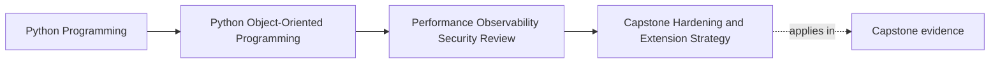

# Capstone Hardening and Extension Strategy

<!-- page-maps:start -->
## Page Maps

<!-- page-maps:end -->

## Why this strategy matters

Once a capstone proves its design, the next risk is changing it in the wrong order.

Teams often rush into:

- speculative optimization
- wider plugin machinery
- bigger infrastructure layers

before they fix the more urgent weaknesses around:

- duplicate side effects
- missing operator signals
- trust-boundary looseness
- accidental public-surface drift

This page exists to keep the next change small, honest, and educationally defensible.

## Use one hardening route, not ten unrelated ideas

Keep the same capstone path from the architecture review:

1. seat request enters the system
2. `WorkshopEnrollment` decides confirm or waitlist
3. repository persists the new truth
4. projection and notification run downstream
5. certificate issuance later consumes confirmed state

Any hardening decision should explain which step it touches, what risk it reduces, and
what contract must remain unchanged.

If it cannot do that, it is probably too vague or too broad.

## Step 1: Rank risks by operational damage first

A useful hardening order does not start with "what would be impressive?"

It starts with:

- what would create the most confusing or damaging failure
- what would be hardest to diagnose under pressure
- what would silently weaken the model if left alone

For this capstone, the first honest risks are usually:

- duplicate visible side effects under retries or repeated callbacks
- weak or missing signals around persistence contention and downstream lag
- public-surface drift caused by examples or deep-import shortcuts
- trust-boundary mistakes in payload handling or logging

These are better next targets than speculative performance tuning.

## Step 2: Preserve strong boundaries while you harden weak ones

The hardening move is only good if it keeps the strong parts strong.

In this capstone, preserve:

- aggregate authority over seat truth
- repository translation instead of row-shaped domain logic
- narrow extension seams instead of internal intimacy

That means:

- do not fix retries by moving truth into downstream consumers
- do not fix performance by letting caches decide authoritative writes
- do not fix customization by opening deep private modules casually

Hardening should deepen the boundary story, not route around it.

## Step 3: Choose the narrowest change that reduces the real risk

For each candidate improvement, ask three questions:

1. What exact failure or confusion is being reduced?
2. Which boundary owns the improvement?
3. What is the smallest reviewable change that would help?

Examples:

- add idempotency or durable dedupe around downstream side effects
- add one latency and conflict signal before reworking throughput
- tighten one callback normalization boundary before redesigning the whole integration
- replace one deep-import example before publishing broader extension support

This is how you keep hardening work educational instead of sprawling.

## Step 4: Match proof to the change

Every hardening move should carry one proof route appropriate to its risk.

Examples:

- duplicate-side-effect fix: interruption and replay workflow test
- observability improvement: one exercised runbook path plus signal review
- public-surface tightening: executable example and import-boundary check
- trust-boundary change: malformed-input and redaction tests

If the proof is absent, the hardening story is incomplete.

If the proof is much larger than the change, the work may be poorly scoped.

## A risk-ordered improvement map for this capstone

An honest next-pass order might be:

1. reduce duplicate visible work under retries and repeated callbacks
2. improve signals around concurrency conflicts and downstream lag
3. tighten logging and payload trust boundaries
4. reinforce the package-level facade and stop teaching deep-import shortcuts
5. only then revisit performance optimizations that measurement actually justifies

That order protects meaning first, operability second, and speculative tuning last.

## What not to do next

- do not add plugin machinery before the public facade and compatibility rules are clear
- do not add broad caching before freshness and authority rules are explicit
- do not add more runtime complexity before you can explain existing failure paths
- do not widen the public surface just because one internal shortcut seems convenient

These are common ways teams bury a good model under unnecessary complexity.

## Worked hardening note

A short useful strategy note might read:

> The next capstone pass should start by protecting downstream idempotency and clearer
> operator signals around persistence and fan-out. Those changes reduce the highest
> operational confusion without weakening aggregate ownership or repository translation.
> Public-surface tightening should follow before any larger extension or plugin story is
> widened. Performance work should wait until measurement proves the current bottleneck.

That note is better than a long wish list because it sets order and defends that order.

## Capstone connection

Use the capstone directly and answer all three:

- which one improvement should happen before speculative performance work
- which boundary owns that improvement
- what proof route would show the change helped without changing semantics

If you cannot answer those three, the next step is still too large or too vague.

## Exit check

Leave this page only when you can do all of these:

- explain why hardening order matters as much as hardening intent
- identify one capstone improvement that should happen before bigger optimization or extension work
- explain how to keep the next change small enough to verify honestly
