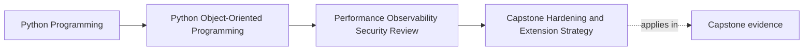

# Capstone Hardening and Extension Strategy

<!-- page-maps:start -->
## Page Maps

<!-- page-maps:end -->

This page is about choosing the next improvement in the right order.

That matters because a good capstone can still be weakened by a bad hardening sequence.

Teams often rush toward:

- speculative performance work
- broader extension mechanisms
- more infrastructure layers

before they reduce the risks that would actually confuse users or operators first.

This page keeps the next pass honest by forcing every change through one operational
priority route.

## Keep one path on the table

Use this capstone workflow:

1. a seat request enters
2. `WorkshopEnrollment` decides the state transition
3. persistence saves the new authoritative truth
4. downstream publication or projection makes the result visible
5. later consumers such as certificate issuance observe that result

Any hardening plan should say exactly:

- which step it changes
- which risk it reduces
- which semantic contract must remain fixed

If it cannot do that, it is too vague to trust.

## Rank by operational damage, not technical glamour

Start with this question:

- which failure would create the most confusing or harmful visible outcome first?

For this capstone, the first honest candidates are usually:

- duplicate visible side effects under retries or repeated callbacks
- weak signals around persistence conflict or downstream lag
- trust-boundary mistakes in payload handling or logging
- public-surface drift that teaches consumers the wrong import path

These are higher-value targets than speculative tuning.

## Preserve strong boundaries while hardening weak ones

The next change is only good if it keeps the strongest architectural truths intact.

Preserve:

- aggregate ownership of seat truth
- repository responsibility for translation rather than meaning
- narrow public and extension seams instead of deep private access

That means:

- do not fix retries by moving truth into downstream consumers
- do not fix latency by letting caches become authority
- do not fix extension pressure by opening private modules casually

Hardening should deepen the ownership model, not route around it.

## Choose the narrowest improvement that reduces the real risk

For each candidate change, ask:

1. what exact failure or confusion does this reduce?
2. which boundary owns the response?
3. what is the smallest reviewable change that would help?

Examples:

- add durable duplicate-protection around downstream visible work
- add one conflict and lag signal before redesigning throughput
- tighten one payload normalization boundary before changing all integration code
- replace one deep-import example before publishing broader extension support

Small honest hardening beats a large blurry "resilience initiative."

## Match proof to the hardening move

Every hardening change needs one proof route sized to its risk.

Examples:

- duplicate-side-effect fix: interruption and replay workflow test
- observability improvement: one exercised runbook path plus signal review
- public-surface tightening: executable example and import-boundary check
- trust-boundary hardening: malformed-input and redaction tests

If the proof is missing, the hardening story is incomplete.
If the proof is vastly larger than the change, the scope is probably still wrong.

## A risk-ordered next-pass map

An honest next order for this capstone might be:

1. reduce duplicate visible work under retries
2. improve signals around conflict, lag, and downstream failure
3. tighten logging and payload trust boundaries
4. reinforce the supported facade and stop teaching deep-import shortcuts
5. revisit performance only after measurement proves the pressure

This order protects meaning first, operability second, and optimization last.

## What should not happen next

- do not widen plugin machinery before the supported facade and compatibility rules are
  clear
- do not add broad caching before freshness and authority rules are explicit
- do not add more runtime layers before current failure paths are understandable
- do not widen the public surface because one internal shortcut feels convenient

These moves often make a design look more advanced while making it harder to trust.

## Build a hardening-order packet

For the next pass, keep a short packet with:

- strongest truth boundary to preserve
- first visible failure to reduce
- smallest honest change that could help
- proof route for that change
- one tempting improvement that should wait

This packet prevents teams from confusing activity with progress.

## Worked strategy note

An honest hardening note might read:

> The next capstone pass should start by reducing duplicate visible work under retries
> and by improving signals around persistence conflict and downstream lag. Those changes
> lower the highest operational confusion without weakening aggregate authority or
> repository translation. Public-surface tightening should follow before broader
> extension work. Performance changes should wait for measurement.

That note is useful because it sets order and defends that order.

## Capstone connection

Use this page to answer three things:

- which one improvement should happen before bigger optimization or extension work
- which boundary owns that improvement
- which proof route would show the change helped without changing semantics

If you cannot answer all three, the next step is still too large.

## Exit check

Leave this page only when you can do all of these:

- explain why hardening order matters as much as hardening intent
- identify one capstone improvement that should happen before speculative tuning
- explain how to keep that improvement small enough to verify honestly
