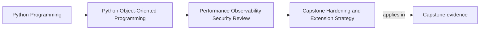

# Capstone Hardening and Extension Strategy

<!-- page-maps:start -->
## Page Maps

<!-- page-maps:end -->

Read the first diagram as a placement map: this page is one concept inside its parent
module, not a detached essay, and the capstone is the pressure test for whether the
idea holds. Read the second diagram as the working rhythm for the page: name the
problem, study the example, identify the boundary, then carry one review question
forward.

## Why this strategy matters

Once a small system proves its design, the next risk is hardening it in the wrong order.

Teams often jump to:

- speculative optimization
- bigger extension machinery
- more infrastructure

before they fix the more urgent risks around:

- trust boundaries
- observability gaps
- compatibility discipline
- recovery readiness

This strategy page exists so the next evolution step strengthens the capstone instead of
burying it under unnecessary complexity.

## Sequence improvements by risk first

A useful hardening order usually asks:

1. what could cause the most confusing or damaging failure first?
2. what evidence is missing today?
3. what narrow change would reduce that risk without widening the system unnecessarily?

This keeps the next move grounded in real operational pressure.

## Extend along existing boundaries

The safest improvements usually follow seams the course already established:

- repository contracts before new storage backends
- better runtime signals before bigger runtime machinery
- narrower codecs before broader serialized surfaces
- capability seams before general plugin ecosystems

That preserves the teaching value of the capstone because each change still reinforces a
named boundary rather than inventing a new framework layer.

## Keep each hardening step reviewable

Good hardening work should remain small enough that a reviewer can answer:

- what risk is being reduced?
- which boundary owns this change?
- what proof will show the improvement worked?
- what semantic contract must remain unchanged?

If a change is too large to answer those questions clearly, it is probably too large to
teach or merge safely.

## Capstone connection

Use the capstone to rank the next likely improvements:

- one trust-boundary improvement
- one observability improvement
- one compatibility or extension-governance improvement

Then ask which one has the highest operational value as of July 27, 2026 and which one
can be delivered through the narrowest reviewable change.

## Exit check

Leave this lesson only when you can do all of these:

- explain why hardening order matters as much as hardening intent
- identify one capstone improvement that should happen before speculative performance work
- explain how to keep the next change small enough to verify honestly
