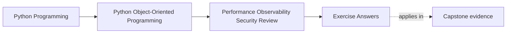
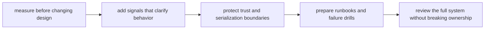

# Exercise Answers

<!-- page-maps:start -->
## Page Maps

<!-- page-maps:end -->

Use these answers as model operational reasoning, not as text to copy blindly.

The strong move in this module is not "having the right opinion." It is building an
operational packet that another maintainer could actually use when pressure, delay, or
duplication appears in the capstone.

These answers stay with one route:

1. an attendee requests a seat
2. `WorkshopEnrollment` decides confirmed or waitlisted
3. authoritative state is persisted
4. projections, notifications, or artifacts make that truth visible elsewhere
5. later workflows such as certificate issuance consume the confirmed result

Everything below is judged by one standard:

> Does the operational change preserve semantic truth while making the system easier to
> measure, diagnose, protect, and recover?

## Answer 1: Name the workflow pressure honestly

A strong pressure statement might be:

> Under burst registration, operators feel slowness when confirmed-seat outcomes become
> visible later than expected. We suspect the persistence-and-downstream path, but we
> will not redesign this workflow until we can prove whether the pressure comes from
> repository conflict handling, repeated projection work, or delayed artifact-side
> publication.

Why this is strong:

- it names who feels the problem
- it names what failure looks like
- it names a suspected stage without pretending certainty
- it rejects intuition as enough evidence

Weak version:

> Enrollment feels slow, so the aggregate probably needs optimization.

That is too vague and too eager to target the wrong boundary.

## Answer 2: Design the first measurement plan

A strong first measurement plan could say:

- measure full confirmation workflow latency from accepted request to visible confirmed
  outcome
- use burst registration workloads, not a single-request loop
- separate stage timing for:
  - aggregate decision
  - repository save
  - conflict retry handling
  - downstream projection or notification publication
- record optimistic concurrency conflict counts
- keep one semantic rule visible: confirmed-seat truth must still come from
  authoritative aggregate state

Why this is stronger than a microbenchmark:

- it starts at the user-visible workflow
- it can distinguish domain cost from persistence and downstream cost
- it protects the truth boundary during investigation

## Answer 3: Compare three performance moves

Suppose the measured pressure concentrates after persistence when many derived views need
updating.

Caching:

- might reduce repeated read work
- pressures freshness and operator trust in seat visibility
- creates confusion if stale derived views look authoritative
- would need one explicit owner for invalidation

Batching:

- might reduce repeated downstream publication or adapter crossings
- pressures visibility timing and partial-failure handling
- creates confusion only if lag is hidden
- should be owned by the boundary that already groups downstream work

Lazy work:

- might defer expensive rendering until a report is requested
- pressures when cost and failure are paid
- creates confusion if cheap-looking access suddenly triggers remote or artifact work
- should be owned only by a clearly documented presentation boundary

Recommended move:

- batch downstream projection or notification work if short lag is acceptable and
  observable

Rejected move:

- cache authoritative seat availability for write decisions

Why reject it:

- it blurs the truth boundary and turns freshness drift into a correctness risk

## Answer 4: Design one observability packet

A strong observability packet for the confirmation route could include:

- metric: `enrollment_confirmation_latency_ms`
- counter: `enrollment_conflict_retries_total`
- trace: one span path from request acceptance through persistence to visible
  confirmation publication
- correlation identifier: `enrollment_id`
- detail kept out: raw attendee payload and artifact storage keys

Operator questions answered:

- latency metric: "Is confirmed visibility slower than expected?"
- conflict counter: "Are retries or contention spikes the main pressure?"
- trace path: "Which boundary is stretching the workflow right now?"
- correlation id: "Which signals belong to this one logical confirmation?"

Why this packet is strong:

- each signal has a distinct job
- the packet avoids noisy or sensitive data
- the signals map directly to the workflow boundaries

## Answer 5: Review one representation boundary

Choose certificate issuance completion logging.

Strong review:

- consumer: operators and support tooling
- truly needed fields:
  - issuance id
  - workshop id
  - bounded outcome category
  - timing or retry class
- over-broad or risky fields:
  - full storage keys
  - rendered artifact locations
  - raw notification payloads
- better representation:
  - a narrow completion event or explicit codec rather than dumping internal object state
- damage if leaked:
  - private storage paths become searchable
  - debugging logs turn into accidental export surfaces
  - replayable details survive longer than intended

The key lesson is that useful logs are still public-enough artifacts. They must be
governed like other outward representations.

## Answer 6: Harden one input boundary

Choose callback intake.

A strong hardening note would say:

- accepted normalized shape:
  - external workflow id
  - supported status enum
  - bounded timestamp or sequence marker if required
- reject early:
  - unknown states
  - oversized identifiers
  - extra mode combinations that the workflow does not support
  - payloads that imply authority broader than the callback should carry
- safer default:
  - omitted optional behavior leaves the workflow inactive or narrow rather than
    permissive
- rejection must happen:
  - before durable writes, side-effect activation, or sink publication
- first proof to fail:
  - boundary tests around malformed, oversized, and ambiguous callback payloads

This answer is strong because it narrows trust before the domain or runtime has to guess.

## Answer 7: Draft one step-shaped runbook entry

Failure mode:

- artifact upload stalls after issuance truth was already persisted

Strong runbook entry:

- `symptom`
  - issuance appears durable, but visible completion or download readiness is delayed
- `first signal`
  - rising issuance latency plus artifact upload timeout or failure counts
- `first safe step`
  - confirm authoritative issuance state before attempting any rerun
- `artifact to inspect`
  - issuance trace or durable progress marker keyed by issuance id
- `unsafe shortcut to avoid`
  - rerunning the whole issuance workflow blindly and risking duplicate visible work
- `design assumption made explicit`
  - authoritative issuance truth is separate from artifact publication

This runbook is useful because it guides the first move while respecting the model.

## Answer 8: Design one failure drill

Scenario:

- deliver the same callback twice under realistic delay

Strong drill design:

- simulation:
  - same logical callback arrives twice with small timing separation
- boundary that should fail loudly first:
  - the workflow or progress boundary that decides whether the trigger has already been
    consumed
- evidence of success:
  - authoritative state remains singular
  - visible downstream work does not duplicate
  - signals explain why the second trigger was absorbed or rejected
- hidden weakness expected:
  - retry safety may be incomplete once work has passed into a notification or artifact
    step
- signal gap that would hurt interpretation:
  - no stable identifier tying the first and second trigger to the same logical workflow

This is a good drill because it tests semantics, visibility, and diagnosis together.

## Answer 9: Write the operational audit note

A strong short audit note might read:

> The semantic contract that must not move is that `WorkshopEnrollment` remains the
> authority for seat truth and later workflows consume confirmed state rather than
> guesses. The main pressure sits in the persistence-and-downstream visibility path under
> burst registration and retries. The most valuable operator evidence is confirmation
> latency, conflict counts, and a trace keyed by `enrollment_id`. The highest-risk trust
> boundary is outward logging or artifact metadata that exposes more than operators need.
> The safest first recovery move is to confirm durable progress before any rerun. The
> remaining weakness is duplicate visible work after retries or partial downstream
> failure.

Why this works:

- it names the truth boundary
- it identifies pressure and signal value clearly
- it points to a concrete trust risk
- it recommends a safe first move
- it admits one unresolved weakness

## Answer 10: Assemble the packet

A strong final packet would include:

- the three working tables
- one pressure statement tied to burst confirmation workflows
- one workflow-first measurement plan
- one tradeoff decision that favors batching downstream work over caching authority
- one observability packet built around latency, conflicts, traces, and stable ids
- one representation note narrowing issuance or log output
- one callback-hardening note
- one runbook entry for stalled downstream completion
- one failure drill for duplicate triggers
- one closing audit note

Another maintainer should be able to answer all of these from the packet:

- where the system is under pressure
- what optimization should be rejected because it weakens truth
- how to diagnose the workflow quickly
- which outward representation must stay narrow
- what first recovery action is safe

## Self-check

You are using Module 10 well when your packet lets a missed-class learner explain all of
these without oral help:

- why measurement must come before redesign
- why signals should follow workflow boundaries
- why serialization and logging are trust-boundary decisions
- why runbooks and drills reveal architectural assumptions rather than merely document
  operations
