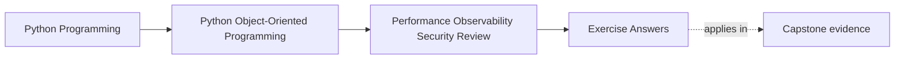
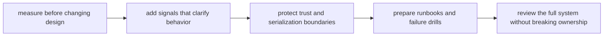

# Exercise Answers

<!-- page-maps:start -->
## Page Maps

<!-- page-maps:end -->

These are model answers for the capstone hardening lab from the exercise page. They use
the course-wide path built across earlier modules:

- `WorkshopEnrollment` owns seat truth
- the repository boundary persists it
- projections and notifications run downstream
- `CertificateIssuanceService` later consumes confirmed state

The point of the answers is to show what a final operational packet looks like when
performance, trust, and recovery pressure are treated as design questions rather than as
detached checklists.

## Answer 1: Measure one hot path first

Suppose the team suspects seat-confirmation requests are slow during registration spikes.

A strong measurement plan says:

- measure end-to-end confirmation latency
- break the trace into aggregate decision time, repository save time, and downstream
  projection/notification time
- capture contention frequency from optimistic concurrency failures

What intuition to reject without evidence:

- "the aggregate logic must be the bottleneck because it feels busy"

The aggregate may be cheap while storage or projection lag is expensive. The profiler or
trace should decide, not aesthetics.

## Answer 2: Review optimization for semantic drift

Possible optimization:

- cache "remaining seat count" for read-heavy screens

Semantic contract that must remain true:

- seat-confirmation decisions still use authoritative aggregate state

Drift risk:

- stale cached counts may leak into write decisions or operator trust

Boundary that should absorb it:

- read-model or projection boundary, not the aggregate itself

Proof route:

- tests that writes still consult authoritative state
- trace or audit output proving the cache only serves reads

## Answer 3: Compare caching, batching, and lazy work

For projection updates after enrollment events:

- caching helps repeated reads but risks stale dashboards
- batching lowers write pressure but risks delayed operator visibility
- lazy work defers cost but may move latency into surprising later paths

Best choice here:

- batching projection updates if the system can tolerate short lag

Rejected option:

- caching authoritative seat availability for writes

Why reject it:

- it pressures the truth boundary and risks semantic drift under concurrency

## Answer 4: Observability addition

Useful signal set:

- metric: `enrollment_confirmation_latency_ms`
- counter: `enrollment_concurrency_conflicts_total`
- structured log on failure with workshop id, attendee id, and boundary name

Safe identifier to include:

- workshop id

Detail to exclude:

- full attendee payload or private payment metadata

Operator question supported:

- "Are slow confirmations coming from domain work, persistence contention, or downstream
  fan-out?"

That is observability serving diagnosis, not just verbosity.

## Answer 5: Harden one input or default

Choose the payment callback boundary.

Hardening rule:

- accept only the small normalized fields required to associate a payment confirmation
  with an enrollment request

Safe default:

- reject unknown callback states unless explicitly mapped

Unsafe convenience to reject:

- passing the whole remote payload through to the aggregate because "we might need it
  later"

Proof that should fail first:

- boundary tests feeding malformed or extra fields
- review artifact showing only normalized data crosses into the domain

## Answer 6: Review one serialization or secret boundary

Choose certificate issuance logging.

Sensitive or risky data:

- storage keys containing personal information
- full certificate file paths
- raw notification payloads

Rule:

- log stable issuance ids and boundary outcome, not the full artifact location or
  rendered content

Damage if debugging convenience wins:

- sensitive storage details become searchable in logs
- operators and developers begin using logs as an accidental data export surface

## Answer 7: Runbook entry

Failure mode:

- certificate generation succeeds in persistence but upload latency spikes and delivery
  stalls

First signal:

- rising certificate issuance latency and object-storage error rate

First safe step:

- verify whether authoritative issuance records committed before attempting reruns

Useful artifact:

- issuance workflow trace or run-specific audit row keyed by issuance id

Design assumption made visible:

- persistence of issuance truth is separate from downstream artifact delivery

That assumption must be explicit, or operators will guess wrong under pressure.

## Answer 8: Failure drill

Scenario:

- duplicate payment callbacks arrive for the same attendee

Boundary that should fail loudly first:

- the workflow boundary that maps callback to enrollment confirmation path

Evidence the drill worked:

- one confirmation succeeds
- duplicates are rejected or ignored idempotently
- projections and notifications do not duplicate visible outcomes

Weakness expected to surface:

- hidden coupling between callback handling and downstream side effects

That is exactly why the drill is worth running before production teaches the lesson more
expensively.

## Answer 9: Full operational audit

A strong audit paragraph might read:

> The core semantic contract is that seat truth lives in `WorkshopEnrollment` and later
> certificate issuance depends on confirmed state only. The main performance pressure is
> the persistence and downstream fan-out path under bursts, not the aggregate alone.
> Operators need confirmation latency, conflict counts, and issuance outcome signals.
> The most important trust boundary is external callback and artifact-logging behavior.
> Recovery depends on a runbook that distinguishes authoritative writes from downstream
> publication or upload delays. The main remaining weakness is duplicate side-effect risk
> under retries and callback duplication.

That is stronger than a checklist because it preserves one coherent story about meaning,
measurement, and recovery.

## Answer 10: Final hardening packet

A strong closing packet includes:

- one measurement table for the confirmation and issuance path
- one trust-boundary table for callbacks, artifact logs, and notifications
- one observability note tying signals to operator questions
- one runbook or drill entry for duplicate callbacks or delayed artifact upload
- one audit summary naming the remaining operational weakness

If another maintainer can answer all of these, the packet is doing real work:

- what must be measured before tuning
- what optimization is safe only in read or derived paths
- what boundary carries the highest trust risk
- how a bad night in production should be diagnosed first

## Self-check

You are using Module 10 correctly when another maintainer can answer these from your
packet without asking for oral background:

- what evidence justifies one optimization
- what must never cross a trust boundary casually
- what signal operators should inspect first
- what remaining risk still needs explicit stewardship
