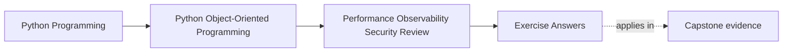
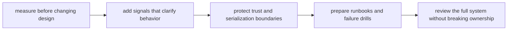

# Exercise Answers

<!-- page-maps:start -->
## Page Maps

<!-- page-maps:end -->

These answers are model explanations, not the only acceptable wording.

## How to use the answer page well

Do not read the model answers first and then reduce Module 10 to "profile first, log
carefully, and keep secrets safe."

A better rhythm is:

1. finish the exercise with your own operational-review packet
2. name the pressure, the semantic contract, and the boundary that should absorb it
3. compare your reasoning with the model answer
4. revise anywhere your answer still treats hardening as separate from design

What matters is whether the reasoning improves production readiness while preserving the
ownership model built throughout the course.

Strong Module 10 answers usually do five things:

- they require evidence before performance change
- they evaluate optimizations against semantic drift, not only speed
- they add observability that clarifies behavior without leaking too much
- they treat input, serialization, and secrets as trust-boundary design work
- they translate likely failures into runbooks, drills, and final review artifacts

The strongest self-study packets also leave behind six concrete artifacts:

- one measurement plan
- one semantics-safe optimization note
- one observability review
- one trust-boundary hardening note
- one runbook or drill recommendation
- one full-system audit summary

If your answers rely mostly on "ops should monitor this," the reasoning is still too
vague.

## Answer 1: Measure one suspected hot path

A strong answer identifies:

- the suspected expensive workflow
- the metric or profile evidence needed first
- the boundary where the cost appears
- the intuition-based optimization story that should be rejected without proof

The main lesson is:

- speed claims are design claims only after measurement makes them real

## Answer 2: Review one optimization for semantic drift

The important pieces are:

- the contract that must stay true
- the semantic risk introduced by the optimization
- the test, benchmark, or review route that would expose drift
- the boundary that should absorb the change

The weakness to avoid is:

- making the system faster by quietly changing freshness, ordering, or authority

## Answer 3: Compare caching, batching, and lazy work

A strong answer explains:

- what each technique would trade away
- which ownership boundary it pressures
- what evidence justifies the chosen technique
- what semantic rule must stay explicit afterward

The main lesson is that:

- not all performance techniques distort the model in the same way

## Answer 4: Design one observability addition

Good answers usually show:

- the signal being added
- the behavior it clarifies
- the sensitive or noisy data it excludes
- the operator decision it supports

Observability is strongest when:

- it makes collaboration and failure easier to interpret rather than simply louder

## Answer 5: Harden one input or default

A strong answer names:

- the trust boundary crossed by the input or default
- the validation or safe-default rule that belongs there
- the convenience shortcut that should be refused
- the proof route that should fail first if the hardening regresses

The main lesson is that:

- secure defaults are a boundary promise, not just a security team preference

## Answer 6: Review one serialization or secret boundary

The important pieces are:

- what data is untrusted
- what data is sensitive
- what handling, redaction, or persistence rule is required
- what damage debugging convenience could cause if it overrides the rule

The key review question is:

- what would leak or become executable in the wrong context if this path stayed casual

## Answer 7: Write one runbook or failure drill entry

A strong answer explains:

- what failure mode the runbook covers
- what signal should be checked first
- what command, artifact, or review path operators should use
- what design assumption the runbook makes visible

Runbooks are strongest when:

- they turn system knowledge into deliberate operator action

## Answer 8: Rehearse one failure drill

A strong answer identifies:

- the scenario being drilled
- the first boundary that should fail loudly
- the evidence that proves the drill worked
- the design weakness the drill is meant to reveal

The main lesson is that:

- drills reveal hidden assumptions long before an incident does

## Answer 9: Perform one full-system operational audit

A strong review names:

- the semantic contract
- the performance pressure
- the required observability
- the trust boundary
- the recovery artifact
- the remaining operational weakness

The strongest final note points to one risk that still needs explicit stewardship before
calling the system ready.

## Answer 10: Produce a final hardening packet

The packet is strong when another maintainer can answer:

- what must be measured before tuning
- what optimization can happen without changing semantics
- what signals should exist for operators
- what trust boundary carries the highest risk
- what artifact should guide diagnosis or recovery under failure

If different readers infer different operational priorities, the packet is still too
ambiguous.

## Self-check

If your answers consistently explain:

- how one performance decision starts with evidence
- why one hardening move belongs at one boundary
- what one signal clarifies without oversharing
- how one trust boundary is defended
- what one runbook or drill exposes before production does

then you are using Module 10 correctly.
