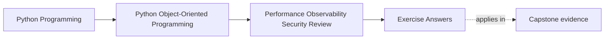
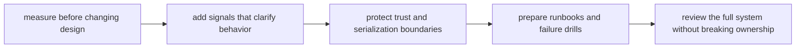

# Exercise Answers

<!-- page-maps:start -->
## Page Maps

<!-- page-maps:end -->

Use these answers as model operational reasoning, not as slogans to repeat.

The point is to show how a strong maintainer turns one capstone path into:

- a measurement plan
- a semantics-safe optimization decision
- a signal plan
- a trust-boundary rule
- a recovery note

If your own packet was longer than these answers, that is expected. The harder work was
building the packet. This page compresses the reasoning behind it.

## Running capstone path

These answers use the same path as the exercise page:

1. a seat request enters
2. `WorkshopEnrollment` decides confirmed or waitlisted
3. the repository saves authoritative state
4. downstream projection, notification, or artifact work makes the result visible
5. later workflows such as certificate issuance depend on that confirmed state

Everything below is judged by one question:

Does the operational change preserve semantic truth while making the system easier to
measure, diagnose, and recover?

## Answer 1: Measure one suspected hot path first

Suppose the team suspects registration spikes make seat confirmation slow.

A strong measurement plan would say:

- measure end-to-end confirmation latency
- separate aggregate decision time from repository save time and downstream fan-out time
- record optimistic concurrency conflict frequency
- use a workload shape that resembles burst registration rather than a synthetic single
  request loop

What intuition to reject without evidence:

- "the aggregate must be slow because it does the important business logic"

That guess may be wrong.
The expensive part may be repository conflict handling or derived downstream work.

## Answer 2: Review one optimization for semantic drift

Possible optimization:

- cache seat-availability reads for busy course pages

Semantic contract that must not move:

- confirmation decisions still use authoritative aggregate state

Possible drift:

- stale cached counts get reused in write decisions
- operators begin trusting an eventually consistent read as if it were authoritative

Boundary that should absorb the optimization:

- a read-model or projection boundary, not the aggregate or write path itself

Proof route that should fail first:

- workflow or integration proof showing writes still consult authoritative state
- observability review showing stale reads are labeled or tolerated correctly

Faster but semantically wrong is still wrong.

## Answer 3: Compare caching, batching, and lazy work

Take projection updates after enrollment events.

Caching:

- helps repeated reads
- risks stale operator dashboards
- is dangerous if confused with authority

Batching:

- reduces write amplification and downstream pressure
- risks short lag before visibility updates
- is acceptable only if that lag is understood and observable

Lazy work:

- defers cost
- can move latency into surprising later paths
- makes timing harder to reason about unless clearly bounded

Best choice here:

- batching projection updates if short lag is acceptable and measurable

Rejected option:

- caching authoritative seat availability for the write path

Why reject it:

- it pressures the truth boundary and invites semantic drift under contention

## Answer 4: One observability addition

Useful signal set:

- metric: `enrollment_confirmation_latency_ms`
- counter: `enrollment_concurrency_conflicts_total`
- structured failure log keyed by workshop id and boundary name
- optional trace segment for repository save and downstream publication

Safe identifier:

- workshop id or issuance id

Detail to keep out:

- full attendee payload
- sensitive storage keys
- raw callback bodies

Operator question this helps answer:

- "Is the slowdown happening in domain work, repository conflict handling, or downstream
  fan-out?"

Signals matter because they shorten diagnosis, not because they increase output volume.

## Answer 5: Harden one input or default

Choose the external callback or administrative reissue boundary.

Good hardening rule:

- accept only the normalized fields required to match the callback or command to a known
  workflow

Safe default:

- reject unknown states or unsupported payload shapes unless explicitly mapped

Convenience shortcut to reject:

- passing the whole remote payload through to the aggregate because "we may want it
  later"

Proof that should fail first:

- boundary tests with malformed and extra-field inputs
- review note proving only normalized information crosses the trust boundary

Secure defaults belong at the crossing point, not in scattered cleanup code later.

## Answer 6: Review one serialization or redaction boundary

Choose certificate issuance logging.

Sensitive or risky data:

- storage keys that reveal personal information
- full certificate file paths
- raw notification payloads

Rule:

- log stable issuance ids, boundary outcomes, and bounded error categories
- do not log raw artifact locations or rendered content

Damage if convenience wins:

- logs become searchable data leaks
- debugging tools become accidental export surfaces
- operators start depending on unsafe details for recovery

Operational readability must never require private data leakage.

## Answer 7: One runbook entry

Failure mode:

- authoritative issuance state is persisted, but artifact upload latency spikes and
  visible completion stalls

A useful runbook entry would say:

- first signal: rising issuance latency plus storage timeout or error counts
- first safe step: confirm authoritative issuance state before attempting rerun
- artifact to inspect: issuance trace, audit row, or progress marker keyed by issuance id
- unsafe shortcut to avoid: rerun the whole workflow blindly and risk duplicate visible
  completion
- design assumption made explicit: authoritative issuance truth is separate from outward
  artifact publication

That is what makes a runbook architectural rather than decorative.

## Answer 8: One failure drill

Scenario:

- duplicate callback or retry trigger arrives for the same logical workflow

Boundary that should fail loudly first:

- the workflow boundary that maps the trigger to durable progress and visible work

Evidence the drill succeeded:

- one logical action remains authoritative
- visible downstream work does not duplicate
- signals explain why the second trigger was absorbed or rejected

Weakness the drill is likely to expose:

- hidden coupling between retries and visible side effects

That is exactly the kind of weakness drills are meant to reveal before production does.

## Answer 9: Full operational audit

A strong short audit note might read:

> The semantic contract that must not move is that `WorkshopEnrollment` owns seat truth
> and later workflows consume confirmed state rather than derived guesses. The main
> pressure sits in the persistence-and-downstream path under bursts, contention, and
> retries. The most useful operator signals are confirmation latency, conflict counts,
> and visible outcome traces for certificate or notification work. The highest-risk trust
> boundary is external callback or artifact-logging behavior. The safest first recovery
> action is to confirm durable progress before any rerun. The main remaining weakness is
> duplicate visible work under interruption or repeated triggers.

This note is useful because it ties meaning, measurement, trust, and recovery into one
story.

## Answer 10: Operational packet summary

A strong closing packet includes:

- one measurement table for the confirmation and issuance path
- one signal table tying metrics and drills to operator questions
- one trust-boundary table for callbacks, logs, and stored artifacts
- one runbook or drill entry for duplicate triggers or stalled artifact publication
- one audit summary naming the remaining operational weakness

Another maintainer should be able to answer all of these from the packet:

- what must be measured before tuning
- what optimization is safe only in derived or read paths
- what trust boundary carries the highest risk
- what first response remains safe on Monday, July 27, 2026 if the workflow misbehaves

## Self-check

You are using Module 10 well when another maintainer can answer these from your packet
without extra oral context:

- what evidence justifies one optimization
- what must never cross a boundary casually
- what signal an operator should inspect first
- what fast recovery move would be architecturally wrong
