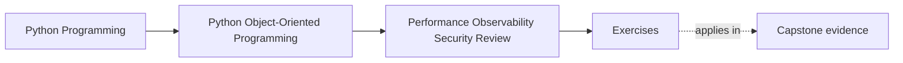
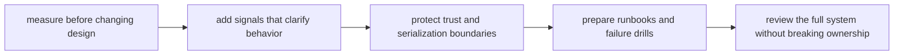

# Exercises

<!-- page-maps:start -->
## Page Maps

<!-- page-maps:end -->

Use this page as one full operational hardening workshop.

The goal is not to collect performance, observability, and security slogans.
The goal is to leave with a packet another maintainer could use to review, operate, and
recover the capstone honestly.

That packet should answer:

- what to measure before tuning
- what optimization preserves meaning
- what signals operators need first
- what trust boundary carries the highest risk
- what safe recovery step preserves the model

If the packet cannot survive those questions, the exercise day is not done.

## Running capstone path

Keep one path visible throughout the workshop:

1. an attendee requests a seat
2. `WorkshopEnrollment` decides confirmed or waitlisted
3. the repository saves authoritative state under contention risk
4. projections, notifications, or artifacts make that truth visible downstream
5. later workflows such as certificate issuance consume the confirmed result

This path is strong because it forces you to think about:

- one semantic contract
- one write boundary
- one derived visibility path
- one external or trust boundary
- one recovery story under pressure

## What you are building by the end

Create one operational packet with these sections:

- measurement plan
- semantics-safe optimization review
- observability table
- trust-boundary table
- runbook or failure-drill note
- final operational audit summary

Keep it small enough to review, but concrete enough to use.

## Tables to prepare first

Start with these working tables.

| Pressure or risk | Semantic contract that must hold | Boundary that should absorb the response | Evidence or artifact needed |
| --- | --- | --- | --- |

| Signal or drill | What operator question it answers | What should stay out because it is noisy or sensitive | First action it supports |
| --- | --- | --- | --- |

| Trust boundary | Untrusted or sensitive asset | Protective rule | Damage if mishandled |
| --- | --- | --- | --- |

## Exercise 1: Measure one suspected hot path

Choose one plausible performance concern from the capstone path, such as:

- enrollment confirmation bursts
- projection rebuild after many events
- bulk certificate rendering

Write:

- the metric, profile, or benchmark you would gather first
- the workload shape the measurement must match
- the intuition you refuse to trust without evidence
- the boundary you expect to be hot, and why that is still only a hypothesis

If the measurement story is weak, the optimization story is still premature.

## Exercise 2: Review one optimization for semantic drift

Pick one possible optimization:

- caching read-heavy seat views
- batching projection updates
- lazy-loading template or storage metadata

For that choice, explain:

- what semantic contract must remain true
- what kind of drift could happen silently
- which proof or review route should reveal that drift first
- which boundary should absorb the optimization rather than exporting the risk

This exercise is about protecting meaning before chasing speed.

## Exercise 3: Compare caching, batching, and lazy work

Take one expensive path and compare these three options:

- caching
- batching
- lazy work

For each option, state:

- what it might improve
- what freshness, ordering, or authority rule it pressures
- what new operational confusion it might create

End with:

- one recommended option
- one rejected option
- one sentence explaining why the rejected option would weaken the model

## Exercise 4: Design one observability addition

Choose one workflow segment and add a concrete signal plan.

Include:

- one metric, trace, or counter
- one structured log or event
- one safe identifier to include
- one detail that must stay out because it is sensitive or noisy
- the operator question this signal helps answer first

Signals are useful only when they change diagnosis quality.

## Exercise 5: Harden one input or default

Choose one boundary such as:

- callback payload intake
- administrative reissue command
- certificate filename or storage key generation
- workflow configuration input

Write:

- what trust boundary is crossed
- what safe default or validation rule belongs there
- what convenience shortcut should be rejected
- what proof should fail first if the rule regresses

This is where secure defaults become design work instead of cleanup.

## Exercise 6: Review one serialization or redaction boundary

Pick one path where data is logged, stored, serialized, or echoed back.

Explain:

- what data is sensitive
- what data is merely untrusted
- what redaction or encoding rule should exist
- what debugging shortcut would create real damage

Be concrete about the damage:

- searchable secrets
- private storage keys in logs
- unsafe payload replay
- accidental data-export surfaces

## Exercise 7: Write one runbook entry

Choose one likely failure mode:

- concurrency conflict spike
- projection lag growth
- duplicate callback delivery
- artifact upload stall after authoritative persistence

Write a short runbook entry with:

- first signal to inspect
- first safe containment or diagnosis step
- one artifact, dashboard, or trace to consult
- one unsafe shortcut that must be avoided
- one design assumption the runbook makes explicit

If the runbook would still require oral explanation, it is not done.

## Exercise 8: Design one failure drill

Choose one failure and write:

- what you would simulate
- which boundary should fail loudly first
- what evidence would prove the drill succeeded
- what hidden weakness you expect the drill to expose

The drill should not just test code.
It should test whether the system and the maintainers remain interpretable under stress.

## Exercise 9: Perform one full operational audit

Write a short audit note naming:

- the semantic contract that must not move
- the main performance or contention pressure
- the most useful signal or drill
- the highest-risk trust boundary
- the safest first recovery action
- one remaining operational weakness

Keep the note short enough to resemble a real review paragraph.

## Exercise 10: Assemble the operational packet

Before opening the answer page, assemble:

- the three tables from the start
- one measurement plan
- one optimization review
- one observability addition
- one trust-boundary note
- one runbook or drill entry
- one audit summary

Another maintainer should be able to answer all of these from the packet:

- what must be measured before tuning
- what change improves speed without moving truth
- what signal operators need first
- what recovery step is safe under pressure

## Done means the system can be operated honestly

You are done only when your packet survives these review questions:

- "What evidence justifies this optimization?"
- "What must never cross this boundary casually?"
- "What should another maintainer inspect first tonight?"
- "What recovery move would be fast but architecturally wrong?"

If those answers still sound generic, tighten the packet before you move to the answer
page.
