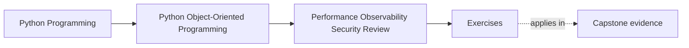
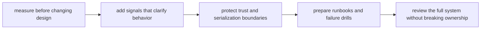
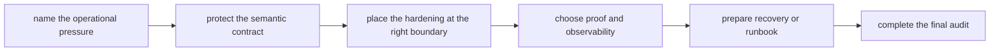

# Exercises


<!-- page-maps:start -->
## Page Maps




<!-- page-maps:end -->

Use these exercises to turn production hardening into a final design audit rather than a
disconnected checklist.

The day is not about collecting optimization or security slogans. It is about deciding
what to measure, what to log, what must stay secret, what trust boundary needs stronger
defense, and how to harden the system without corrupting the ownership model built across
the course.

## How to work through this set

Treat the ten exercises as one full lab day on operational review and hardening.

Before each answer:

1. name the operational pressure under review
2. name the semantic contract that must not change
3. state which boundary should absorb the hardening move

Do the exercises in order. The day is one progression:

- Exercises 1-3 review measurement, profiling, and performance changes
- Exercises 4-6 design observability, trust-boundary, and secure-default discipline
- Exercises 7-8 assemble runbooks and failure drills
- Exercises 9-10 perform a final full-system audit and hardening recommendation

Keep one operational-review packet as you go. By the end of the day it should contain:

- one measurement plan
- one semantics-safe optimization note
- one observability review
- one trust-boundary hardening note
- one runbook or drill recommendation
- one full-system audit summary

If those six artifacts are missing, you are probably still discussing operations in the
abstract instead of reviewing the actual design.

## Recommended working layout

If you want one lab tree that can support the whole day, use something like:

```text
module10-lab/
├── artifacts/
├── notes/
├── scratch/
└── tests/
```

Keep one operational table while you work:

| Pressure or risk | Semantic contract that must hold | Boundary that should absorb the change | Evidence or signal needed | Failure if handled carelessly |
| --- | --- | --- | --- | --- |

Keep one security table:

| Trust boundary | Sensitive asset or assumption | Protective rule | Review artifact or runbook | What must never be exposed |
| --- | --- | --- | --- | --- |



Use that route on purpose. It keeps the day centered on semantics-preserving hardening
instead of on isolated operational tasks.

## Exercise 1: Measure one suspected hot path

Take one performance concern and explain:

- what you would measure before changing design
- what metric or trace would make the pressure real
- what object or workflow is actually suspected
- what mistaken optimization story you would refuse without evidence

Study note:
Performance work starts with observed cost, not with intuition.

## Exercise 2: Review one optimization for semantic drift

Choose one possible optimization and explain:

- what semantic contract must remain unchanged
- what freshness, ordering, or authority rule could drift
- what test or benchmark should catch the drift first
- why the optimization belongs at that boundary instead of deeper in the model

Study note:
The hardest optimization bugs are the ones that stay fast while becoming wrong.

## Exercise 3: Compare caching, batching, and lazy work

Take one expensive path and explain:

- whether caching, batching, or lazy evaluation is the cleaner move
- what correctness or freshness rule each option risks
- what ownership boundary each option touches
- what operational evidence would justify the choice

Study note:
These tools trade different semantic costs, even when they all reduce load.

## Exercise 4: Design one observability addition

Choose one workflow and explain:

- what log, metric, or trace would clarify it
- what behavior the signal should reveal
- what sensitive or misleading detail must stay out
- what operator decision the signal should support

Study note:
Good signals make behavior more understandable; they do not merely add volume.

## Exercise 5: Harden one input or default

Take one input path or configuration default and explain:

- what trust boundary it crosses
- what validation or default rule should harden it
- what unsafe convenience should be rejected
- what proof route should fail first if the boundary weakens

Study note:
Secure defaults are part of API design, not a later bolt-on.

## Exercise 6: Review one serialization or secret boundary

Choose one payload or secret-bearing path and explain:

- what must be treated as untrusted
- what may be logged, persisted, or forwarded
- what redaction, encoding, or handling rule should exist
- what damage appears if debugging convenience overrides the rule

Study note:
Serialization and secret handling are trust decisions before they are transport details.

## Midday self-check

Before moving into runbooks and final audit work, make sure your packet already answers
these questions clearly:

- what one hot path needs measured first
- what one optimization could change semantically if handled badly
- what one signal would clarify behavior without leaking too much
- what one trust boundary needs stronger defaults or handling rules

If you cannot answer those four questions in plain language, return to Exercises 1-6 and
make the packet more explicit before continuing.

## Exercise 7: Write one runbook or failure drill entry

Take one anticipated failure mode and explain:

- what operators need to observe first
- what immediate containment or diagnosis step matters
- what command, artifact, or review route they should follow
- what design assumption the runbook makes explicit

Study note:
Runbooks turn design knowledge into survivable operational behavior.

## Exercise 8: Rehearse one failure drill

Choose one failure scenario and explain:

- what drill would rehearse it
- what boundary should fail loudly first
- what signal proves the drill is working
- what weakness the drill would expose in the current design

Study note:
Failure drills are useful because they reveal what your calm design language forgot.

## Exercise 9: Perform one full-system operational audit

Take one capstone path and write a short review that names:

- the semantic contract
- the performance pressure
- the observability signals
- the trust boundary
- the recovery artifact
- one place the system is still underprepared

Study note:
This review should sound like a production design audit, not like unrelated bullet points.

## Exercise 10: Produce a final hardening packet

Assemble:

- one operational table
- one security table
- one observability review paragraph
- one runbook or drill recommendation
- one full-system audit note

The packet is strong when another maintainer can answer:

- what should be measured before tuning
- which hardening move preserves semantics
- what signals operators actually need
- what trust boundary has the highest risk
- what artifact should guide recovery when the system misbehaves

## Done means more than finishing the page

You are done with the exercise day when your packet can survive three kinds of review:

- a performance review asking whether the evidence justifies the change
- a security review asking whether trust boundaries and secrets are actually protected
- an operational review asking whether the system can be observed and recovered without
  losing the design model

If the packet cannot survive those reviews, keep tightening the hardening language.
