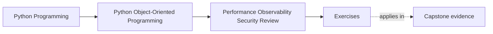
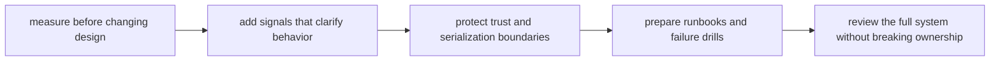

# Exercises

<!-- page-maps:start -->
## Page Maps

<!-- page-maps:end -->

Use this page as a full operational review workshop for the capstone.

The point is not to repeat phrases such as "add metrics" or "be secure by default." The
point is to produce one packet that another maintainer could actually use to review,
operate, and recover the system without guesswork.

By the end, your packet should make all of these clear:

- which workflow deserves measurement first
- which optimization is acceptable and which one would weaken the model
- which signals would help an operator diagnose pressure quickly
- which trust boundary is most likely to leak or widen accidentally
- which recovery step is safe and which shortcut would create new damage

## Working capstone route

Keep one route visible all day:

1. an attendee requests a seat
2. `WorkshopEnrollment` decides confirmed or waitlisted
3. authoritative state is persisted under contention risk
4. derived projections, notifications, or artifacts make that truth visible elsewhere
5. later workflows such as certificate issuance consume the confirmed result

This route is strong because it combines:

- one semantic truth boundary
- one write and contention boundary
- one observability path
- one serialization and trust boundary
- one downstream recovery problem

Do not switch scenarios between exercises. Reuse this path so the operational packet
builds on itself.

## What you are building

Create one operational packet with these sections:

- workflow pressure statement
- measurement plan
- performance tradeoff review
- observability plan
- trust-boundary and representation table
- input-hardening note
- runbook entry
- failure-drill plan
- closing operational audit

Each exercise contributes one section. Do not try to solve everything at once.

## Working tables to prepare first

Start by drafting these three tables before Exercise 1.

| Pressure or failure | Semantic contract that must remain true | Boundary that should absorb the problem | Evidence or artifact needed |
| --- | --- | --- | --- |

| Signal or drill | Operator question it answers | Detail that must stay out because it is noisy or sensitive | First action it supports |
| --- | --- | --- | --- |

| Representation or input boundary | Trusted consumer | What must be accepted or emitted | What must be rejected, redacted, or bounded |
| --- | --- | --- | --- |

You will keep filling these tables as you work. If you wait until the end, the packet
usually becomes generic.

## Exercise 1: Name the workflow pressure honestly

Choose one pressure point on the capstone route, such as:

- registration bursts causing conflict spikes
- projection rebuilds after many enrollment changes
- certificate issuance stalls after authoritative persistence

Write:

- who feels this pressure first
- what "slow" or "broken" would look like from their point of view
- which stage you suspect is responsible
- one intuition you refuse to trust without evidence

Finish with one sentence beginning:

> We will not redesign this path until we can prove that...

This keeps the rest of the exercises anchored to evidence rather than aesthetics.

## Exercise 2: Design the first measurement plan

For the same pressure point, specify:

- the full workflow you will measure
- the representative workload shape
- the first coarse stage boundaries you will time
- whether you need latency, conflict counts, allocation evidence, or all three
- the semantic rule that must stay unchanged while measuring

Do not jump straight to a microbenchmark unless you can justify why the broader workflow
question is already answered.

## Exercise 3: Compare three performance moves

Using the same pressure point, compare:

- caching
- batching
- lazy work

For each option, explain:

- what cost it might reduce
- what truth, freshness, timing, or authority rule it pressures
- which operator confusion it might create
- which boundary would own the new complexity

End with:

- one recommended move
- one move to reject
- one sentence explaining why the rejected move weakens the model more than it helps

## Exercise 4: Design one observability packet

Choose the same workflow and define:

- one metric
- one structured log or event
- one trace or span path
- one correlation identifier
- one detail that must stay out because it is sensitive or noisy

For each signal, answer:

- what operator question does it answer?
- what first action becomes easier because it exists?

If two signals answer the same question with no added value, remove one.

## Exercise 5: Review one representation boundary

Pick one place where data crosses outward, such as:

- callback payload normalization
- issuance artifact metadata
- log events for certificate completion
- notification payloads

Write:

- who consumes the representation
- what fields are genuinely needed
- what fields are over-broad, sensitive, or replayable
- whether an explicit codec or narrower view object should replace a broader dump
- what damage would happen if the current representation leaked

Be specific about the damage. Name the failure, not just "security risk."

## Exercise 6: Harden one input boundary

Choose one input boundary, such as:

- callback intake
- administrative reissue command
- sink or adapter configuration

Write:

- the normalized shape you actually want
- which fields, sizes, or combinations should be rejected early
- which omitted option should default to the safer behavior
- which stage must reject the input before any durable or outward work begins
- which proof should fail first if the rule regresses

This is not only validation. It is a contract about what the system is willing to trust.

## Exercise 7: Draft one step-shaped runbook entry

Pick one likely failure:

- conflict spikes during burst enrollment
- projection lag growth
- duplicate callback delivery
- artifact upload stalls after issuance truth is saved

Write a runbook entry with these headings:

- `symptom`
- `first signal`
- `first safe step`
- `artifact to inspect`
- `unsafe shortcut to avoid`
- `design assumption made explicit`

If your runbook still sounds like "check the logs and investigate," tighten it until it
guides a real first move.

## Exercise 8: Design one failure drill

Choose one failure mode and specify:

- what you will simulate
- which boundary should fail loudly first
- what evidence will show the drill succeeded
- what hidden weakness you expect the drill to expose
- what signal gap would make the drill hard to interpret

The goal is not only to test code. The goal is to test whether the system remains
legible under stress.

## Exercise 9: Write the operational audit note

Write one short audit note that names:

- the semantic contract that must not move
- the dominant pressure or failure risk
- the most valuable signal or drill
- the highest-risk trust or serialization boundary
- the safest first recovery move
- one remaining weakness you would still not trust in production

Keep the note short enough to resemble a real architecture or readiness review comment.

## Exercise 10: Assemble the packet

Before opening the answer page, assemble:

- the three working tables
- the workflow pressure statement
- the measurement plan
- the performance tradeoff comparison
- the observability packet
- the representation and hardening notes
- the runbook entry
- the failure-drill plan
- the closing audit note

Then test your packet against these questions:

- could another maintainer explain where pressure lives without reading code first?
- would they know which optimization to reject because it weakens meaning?
- could they diagnose the workflow from signals that already exist?
- would they avoid leaking or replaying dangerous representations?
- could they take a first recovery step without bypassing the truth boundary?

If the answer to any of these is "not yet," the packet is still too weak.

## Done means the packet is usable

You are done only when the packet is strong enough that a maintainer who missed class
could use it as a first operational playbook.

That means it must be:

- specific about the workflow
- explicit about the truth boundary
- concrete about signals and artifacts
- honest about trust and failure risks
- useful without oral explanation
