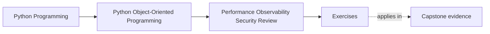
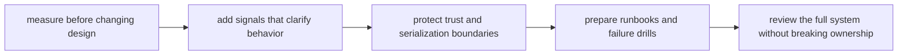

# Exercises

<!-- page-maps:start -->
## Page Maps

<!-- page-maps:end -->

Use these exercises as one full capstone hardening lab. The goal is not to collect
performance, security, and observability slogans. The goal is to prove that a learner
studying alone can take a real workflow, measure the right pressure, harden the right
boundary, and leave behind an operational packet another maintainer can actually use.

## Running lab scenario

Use the course capstone path built across earlier modules:

- `WorkshopEnrollment` decides seat ownership
- the aggregate is persisted through a repository boundary
- projections and notifications run downstream
- `CertificateIssuanceService` may later issue completion certificates

Focus one audit path:

1. attendee requests a seat
2. aggregate confirms or waitlists
3. repository saves with optimistic concurrency
4. event updates projection and notification
5. later, certificate issuance reads the confirmed state and writes an artifact

This path is good for the final module because it includes:

- one semantic contract
- one write path
- one read model
- one external boundary
- one later workflow under operational pressure

## What to keep open while you work

Build one hardening packet as you go. By the end it should contain:

- one measurement plan
- one semantics-safe optimization review
- one observability table
- one trust-boundary note
- one runbook or drill entry
- one final operational audit summary

Useful tables:

| Pressure or risk | Semantic contract that must hold | Boundary that should absorb the change | Evidence needed |
| --- | --- | --- | --- |

| Trust boundary | Sensitive or untrusted asset | Protective rule | What must never leak or execute |
| --- | --- | --- | --- |

## Exercise 1: Measure one suspected hot path

Choose one performance concern from the scenario, such as:

- large waitlist promotion path
- projection rebuild on many events
- certificate rendering for bulk attendees

Explain:

- what metric, profile, or benchmark you would gather first
- what intuition you refuse to trust without evidence
- what workload shape the measurement must match

If the measurement story is weak, the optimization story is not ready.

## Exercise 2: Review one optimization for semantic drift

Pick one possible optimization, such as:

- caching confirmed-seat reads
- batching projection updates
- lazy loading certificate template data

For that change, explain:

- what semantic contract must remain true
- what could drift silently
- what test or review artifact should catch drift first
- what boundary should absorb the optimization

Faster but semantically wrong is still wrong.

## Exercise 3: Compare caching, batching, and lazy work

Take one expensive path and compare three options:

- caching
- batching
- lazy evaluation

For each, state:

- what it buys
- what freshness or ordering rule it risks
- what ownership boundary it pressures

End with one recommendation and one rejected option.

## Exercise 4: Design one observability addition

Choose one workflow segment and add a concrete signal plan.

Include:

- one metric or trace
- one structured log or event
- one identifier safe to include
- one detail that must stay out because it is noisy or sensitive

Then name the operator question this signal helps answer.

## Exercise 5: Harden one input or default

Take one boundary such as:

- enrollment command input
- payment callback payload
- certificate filename or storage key
- administrative reissue command

Explain:

- what trust boundary is crossed
- what safe default or validation rule belongs there
- what convenience shortcut should be rejected
- what proof should fail first if the boundary regresses

## Exercise 6: Review one serialization or secret boundary

Pick one path where data leaves the process or lands in logs.

Examples:

- event payload
- projection debug view
- certificate storage metadata
- notification logs

Explain:

- what data is sensitive
- what data is merely untrusted
- what redaction or encoding rule should exist
- what damage appears if debugging convenience wins

## Exercise 7: Write one runbook entry

Choose one likely failure mode:

- projection lag grows
- optimistic concurrency conflicts spike
- certificate generation fails after repository success
- storage upload latency spikes

Write a short runbook entry with:

- first signal to inspect
- first safe containment or diagnosis step
- one command, artifact, or dashboard to consult
- one design assumption the runbook makes visible

## Exercise 8: Rehearse one failure drill

Design one drill for a known risk, such as:

- duplicate callback delivery
- projection consumer outage
- template file removal on a live system

State:

- what you would simulate
- which boundary should fail loudly first
- what evidence proves the drill worked
- what weakness you expect the drill to expose

## Exercise 9: Perform one full operational audit

Write a short review of the capstone path that names:

- the semantic contract
- the main performance pressure
- the core observability signal
- the most important trust boundary
- the recovery artifact
- one remaining operational weakness

This should read like a production design audit, not a list of disconnected concerns.

## Exercise 10: Produce the final hardening packet

Finish the lab by assembling:

- one measurement table
- one trust-boundary table
- one observability note
- one runbook or drill entry
- one final audit summary

The packet is done only when another maintainer can answer:

- what must be measured before tuning
- what hardening move preserves semantics
- what signals operators need first
- what trust boundary carries the highest risk

## Done means the system can be operated honestly

You are done with the exercise day when your packet can survive these review questions:

- "What evidence justifies this optimization?"
- "What must never leak across this boundary?"
- "How would another maintainer diagnose the first bad failure tonight?"

If those answers are still fuzzy, keep tightening the packet before you open the answer
page.
