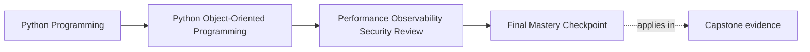

# Final Mastery Checkpoint

<!-- page-maps:start -->
## Page Maps

<!-- page-maps:end -->

This checkpoint asks whether the course has changed how you review a system.

You do not finish by remembering the module titles.
You finish when one meaningful change can be traced across the whole model without
losing semantic discipline.

That is the course outcome this page is testing.

## The final review prompt

Choose one capstone change.

Use a real one, such as:

- increasing seat allocation throughput under contention
- tightening duplicate-protection for downstream certificate or notification work
- publishing a narrower supported facade for consumers and integrations
- adding a replaceable sink seam with compatibility rules

Then ask this first:

What must stay true before I talk about what will change?

If you can answer that clearly, the course has likely moved from pattern vocabulary to
architectural judgment.

## The full-system route

Walk the change through these seven checks in order:

1. semantic contract
2. boundary and ownership impact
3. persistence and schema implications
4. runtime and retry behavior
5. verification route
6. public API and compatibility impact
7. observability, trust-boundary, and runbook consequences

Each check exists because strong object-oriented review is cross-cutting without being
blurry.

## Check 1: semantic contract

State the truth that must not move.

Examples:

- `WorkshopEnrollment` still owns seat truth
- visible downstream work still must not duplicate under retry
- consumers still should not depend on deep private modules

If the contract is unclear, every later optimization or extension discussion becomes
guesswork.

## Check 2: boundary and ownership impact

Name which boundary should absorb the change.

Ask:

- does this belong in the domain object, repository, facade, workflow coordinator, or
  external adapter?
- would moving the change elsewhere weaken ownership just to make implementation easier?

This step prevents convenience from rewriting architecture silently.

## Check 3: persistence and schema implications

Decide whether the change affects:

- versioning or conflict behavior
- durable duplicate-protection state
- stored event or projection shape
- migration and rollback expectations

If persistence implications are ignored, many "safe" changes become unsafe under real
load.

## Check 4: runtime and retry behavior

Ask what the system now does under interruption, delay, or repeat attempts.

Examples:

- does a retry create visible duplicate work?
- does batching or caching alter freshness expectations?
- does a new extension seam create a host-owned failure mode?

Operational behavior is part of design, not a later appendix.

## Check 5: verification route

Choose which proof should fail first if the change is wrong.

Examples:

- behavior-first test for a local semantic rule
- lifecycle proof for history-sensitive state
- contract suite for substitute repositories or integrations
- workflow test for retry and side-effect composition
- compatibility packet for a public seam

If you cannot name the first-failing proof, the change is still under-specified.

## Check 6: public API and compatibility impact

Ask what outsiders may now rely on.

Check:

- whether a facade changed
- whether an example or CLI workflow changed
- whether a compatibility promise widened or narrowed
- whether deprecation language and migration guidance must update

This step keeps release safety inside the design review instead of after it.

## Check 7: observability, trust-boundary, and runbook consequences

Finish by asking:

- what signal would help an operator explain the new failure path?
- what data now crosses a boundary that needs stronger normalization or redaction?
- what runbook step should exist before calling this production-ready?

If the answer is "none," that should be a real conclusion, not a skipped thought.

## What mastery should now sound like

A strong final answer no longer sounds like:

- "we should use caching here"
- "this could be a plugin"
- "let's add more tests"
- "we need better logging"

It sounds like:

> The change belongs at this boundary, must preserve this semantic contract, should be
> proven first by this route, changes this public promise, and requires this operational
> artifact before release.

That is the voice of whole-system review.

## Common signs mastery is still incomplete

- naming patterns without naming the contract they protect
- discussing performance or security before restating meaning
- treating verification as separate from design choices
- widening public seams without governance language
- talking about production readiness as though operators appear after architecture is
  finished

These are the habits the course was designed to correct.

## Your final exercise on this page

Pick one real capstone change and write a short review note with:

- the contract that must stay true
- the owning boundary
- the first-failing proof route
- the public-compatibility consequence
- the operational artifact still required before release

If you can write that note cleanly, the course has become a durable review method.

## Exit check

Leave this checkpoint only when you can do all of these:

- trace one change across semantics, ownership, storage, runtime, proof, public
  contract, and operations
- state what must remain true before discussing implementation strategy
- explain which proof route and operational artifact should reveal the first sign of
  drift
