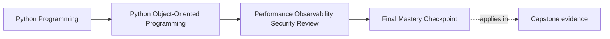

# Final Mastery Checkpoint

<!-- page-maps:start -->
## Page Maps

<!-- page-maps:end -->

Read the first diagram as a placement map: this page is one concept inside its parent
module, not a detached essay, and the capstone is the pressure test for whether the
idea holds. Read the second diagram as the working rhythm for the page: name the
problem, study the example, identify the boundary, then carry one review question
forward.

## Why this checkpoint matters

The course is not complete when you can repeat the module titles.

It is complete when you can take one real change and reason through:

- semantics
- lifecycle
- persistence
- runtime coordination
- verification
- public API effects
- operational hardening

This checkpoint turns the whole course into one review skill.

## The final question

Ask of one meaningful change:

- can I explain what must stay true before I explain what will change?

That is the strongest signal that the course has actually changed how you think about
object-oriented Python systems.

## What mastery should now look like

By the end of Module 10, you should be able to:

- explain object and workflow semantics without leaning on folklore
- place behavior at the right boundary with clear reasons
- evolve storage, APIs, and serialized forms with compatibility discipline
- verify real risks through the right test layers
- reason about performance, observability, trust boundaries, and runbooks without
  abandoning the ownership model

The key is not isolated knowledge. The key is that these concerns now connect.

## A final capstone review route

Use one proposed capstone change and walk it through this sequence:

1. state the semantic contract that must remain true
2. identify which objects, boundaries, and workflows the change touches
3. explain the persistence or schema implications
4. identify the runtime, retry, or scheduling pressures it changes
5. choose the verification layers that should fail first if you get it wrong
6. identify the public API, compatibility, or extension effects
7. identify the observability, trust-boundary, and runbook updates required before calling it production-ready

If you can do that cleanly, the course has become a working design method instead of a
set of notes.

## Common signs that mastery is still incomplete

- talking about patterns without naming the contract they protect
- optimizing or hardening first and asking semantic questions later
- treating verification as separate from design
- widening APIs or extensions without governance thinking
- discussing production readiness as an operational afterthought rather than part of the architecture

These are the exact habits the course was meant to correct.

## Exit check

Leave this checkpoint only when you can do all of these:

- choose one capstone change and trace it across the whole course model
- state what must stay semantically true before discussing optimizations or hardening
- explain which proof route and operational artifact should reveal the first sign of drift
