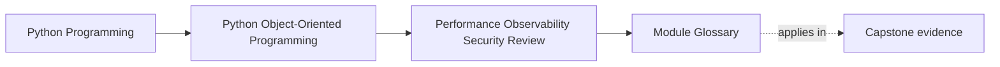

# Module Glossary

<!-- page-maps:start -->
## Page Maps

<!-- page-maps:end -->

This glossary belongs to **Module 10: Performance, Observability, and Security Review**
in **Python Object-Oriented Programming**. Use it when the system is already correct in
principle and you now need to prove that it stays understandable, safe, and operable
under real pressure.

## How to use this glossary

Return here when a review conversation starts mixing together speed, logging, secrets,
defaults, and incident readiness. This module is not about "ops things" in general. It
is about protecting semantic truth while the system is measured, hardened, and run.

## Terms that matter in this module

| Term | Meaning in this module | Review question |
| --- | --- | --- |
| Hot path | The execution path whose cost meaningfully shapes latency, throughput, or allocation behavior. | What evidence says this path is expensive enough to justify design change? |
| Profiling | Measuring where time or allocations are actually spent before changing structure. | Are you changing code because the profiler found cost, or because the code merely looks suspicious? |
| Benchmark | A repeatable measurement that tests one workload or design claim under known conditions. | Does this benchmark match the usage story you care about, or is it only easy to run? |
| Semantic drift | A correctness change introduced while pursuing speed, batching, caching, or laziness. | What business rule could quietly change if this optimization lands? |
| Cache freshness rule | The stated promise about how old cached data may be before the answer becomes misleading. | Can a caller tell when cached output is acceptable and when it becomes a lie? |
| Observability signal | A log, metric, or trace that helps a maintainer understand behavior or diagnose failure. | What concrete operator decision becomes easier because this signal exists? |
| Cardinality risk | The danger that labels, dimensions, or identifiers explode metric volume or cost. | Will this signal stay useful at scale, or will it flood the system with unreviewable detail? |
| Trust boundary | The point where data, commands, or identities cross from less-trusted to more-trusted space. | What assumptions become dangerous if this boundary is treated casually? |
| Secure default | A default behavior that fails toward safety when callers forget to configure a dangerous path. | If the caller does nothing, is the system still safer than the risky alternative? |
| Redaction rule | A clear policy for what sensitive data must never appear in logs, payload echoes, or traces. | Could a debugging shortcut expose something that should remain secret or untrusted? |
| Runbook | A concrete operator guide for observing, diagnosing, and recovering from a known class of failure. | Would another maintainer know the first safe step under pressure because this exists? |
| Failure drill | A deliberate rehearsal of one failure mode used to expose hidden assumptions before production does. | What weak assumption becomes visible only when the system is exercised under stress? |

## Fast distinctions

- **Measure** before optimizing; otherwise performance language is just intuition.
- **Observe** behavior without logging secrets, private payloads, or unbounded identifiers.
- **Harden** the boundary where trust changes, not the random place where the symptom surfaced.
- **Prepare** runbooks and drills so recovery knowledge exists outside one person’s memory.

## Exit check

Leave this glossary only when you can do all of these:

- explain how one optimization could preserve speed while still breaking semantics
- identify one useful signal and the operator decision it supports
- explain why secure defaults and redaction rules belong to boundary design, not post-hoc cleanup
