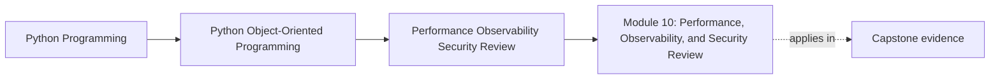

# Module 10: Performance, Observability, and Security Review

<!-- page-maps:start -->
## Page Maps

<!-- page-maps:end -->

This final module is where design leaves the whiteboard and meets operational pressure.

The question is not "how do we add performance, logs, and security?"

It is:

> Which operational pressure can be absorbed without changing the meaning of the system,
> and which response would quietly corrupt ownership, truth, or public promises?

If you keep that distinction visible, operational work becomes a design review instead
of a detached production checklist.

## The capstone route for this module

Use one end-to-end path:

1. a workshop seat request enters the system
2. `WorkshopEnrollment` decides confirmed or waitlisted
3. persistence saves the new truth under contention risk
4. downstream signals, projections, or notifications make that truth visible
5. later workflows such as certificate issuance consume the result

This path is good because every major operational pressure can appear on it:

- hot-path cost
- duplicate work under retries
- stale visibility
- trust-boundary mistakes
- weak runbook coverage

## What this module is really about

Late-stage operational review should keep five distinctions honest:

- measurement versus folklore
- semantics-preserving acceleration versus semantic drift
- useful signals versus noisy telemetry
- trusted data handling versus convenience shortcuts
- hardening order versus feature sprawl

If those distinctions blur, teams often ship operational complexity while weakening the
very design they were trying to protect.

## Preflight

Before going further, you should already be able to:

- name the domain truth that must not move
- distinguish authoritative state from projections or downstream effects
- describe one workflow without collapsing all boundaries together

If the ownership story is still weak, performance and security advice will sound
disconnected.

## What you should be able to do by the end

By the end of this module, you should be able to:

- measure real pressure before changing structure
- choose hardening moves that preserve semantics
- design signals that help an operator explain failure quickly
- treat input, secrets, and serialization as trust-boundary design problems
- review the whole capstone as one operationally credible system

## Read this module as one production-readiness day

Use the pages in this order:

1. measurement and profiling
2. caching, batching, and lazy work
3. observability design
4. input hardening and trust boundaries
5. operational readiness and failure drills
6. capstone architecture review
7. capstone hardening strategy
8. final mastery checkpoint
9. the exercises and answer packet

That order matters because hardening should follow measured pressure and preserved
semantics, not fashion.

## Lesson map

- [Measuring Allocation Costs and Object Hot Paths](measuring-allocation-costs-and-object-hot-paths.md)
- [Profiling before Optimization](profiling-before-optimization.md)
- [Caching, Batching, and Lazy Work](caching-batching-and-lazy-work.md)
- [Observability Signals for Object Systems](observability-signals-for-object-systems.md)
- [Input Hardening and Secure Defaults](input-hardening-and-secure-defaults.md)
- [Safe Serialization, Secrets, and Trust Boundaries](safe-serialization-secrets-and-trust-boundaries.md)
- [Operational Readiness, Runbooks, and Failure Drills](operational-readiness-runbooks-and-failure-drills.md)
- [Capstone Architecture Review](capstone-architecture-review.md)
- [Capstone Hardening and Extension Strategy](capstone-hardening-and-extension-strategy.md)
- [Final Mastery Checkpoint](final-mastery-checkpoint.md)
- [Exercises](exercises.md)
- [Exercise Answers](exercise-answers.md)
- [Glossary](glossary.md)

## Keep these support surfaces open

- `../guides/proof-matrix.md` when you need to tie one operational claim to one proof
  route
- `../guides/proof-ladder.md` when the honest next check is smaller than a full
  end-to-end run
- `../reference/self-review-prompts.md` when you want to pressure-test a hardening idea
  before widening the change

## One study route through the capstone

If this module starts feeling too broad, use this route:

1. choose one operational pressure on the capstone path
2. state the semantic contract that must not change
3. name which boundary owns the response
4. decide which signal or proof route should reveal drift first
5. compare your answer with the lesson pages and exercises

That route turns the module into a practical audit method.

## Questions to keep explicit

- Which measurement would justify a design change, and which proposed optimization is
  still only folklore?
- Which signal would help an operator explain this path under pressure?
- Which trust boundary is currently under-described or under-proved?
- Which hardening move belongs at the facade, repository, or workflow boundary rather
  than inside the domain model?

## Common failure modes

- optimizing before measuring
- using caches or batching in ways that quietly change freshness or authority rules
- logging sensitive payloads because debugging feels urgent
- treating deserialization as simple data loading instead of boundary crossing
- hardening everything at once and losing the ability to verify what changed

## Honest completion signal

You are ready to finish the course when you can review one operational change and say:

- what meaning must stay fixed
- which boundary owns the response
- which proof route or runbook artifact should reveal the first sign of drift

## Closing criteria

You should finish this module able to harden an object-oriented Python system for real
operational use without abandoning the ownership and contract discipline built across
the earlier modules.

## Directory glossary

Use [Glossary](glossary.md) when you want the module's recurring operational language
kept stable while you move between the lessons, review pages, and final checkpoint.
