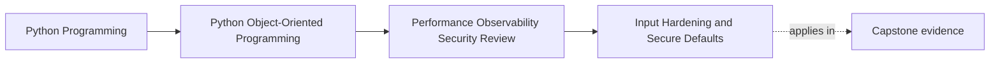

# Input Hardening and Secure Defaults

<!-- page-maps:start -->
## Page Maps

<!-- page-maps:end -->

This lesson is about deciding what the system is willing to trust before expensive or
dangerous work begins.

Weak boundaries create long-lived problems:

- ambiguous modes
- oversized payloads
- unsupported combinations that fail late
- permissive defaults that become public debt

Hardening matters because unclear input is not only a correctness problem. It is also an
operations problem and often a security problem. Every boundary that guesses what the
caller meant increases the work required from the domain model and the maintainers who
must diagnose it later.

## Keep one boundary route visible

Use one capstone route:

1. external input arrives
2. the host decides whether it is valid enough to normalize
3. the workflow begins durable or side-effecting work

Now hold one question in view:

- what should be rejected here so the rest of the system never has to guess?

That question is the center of input hardening.

## Secure defaults are governance decisions

When a caller omits a choice, the default behavior should usually favor:

- less privilege
- narrower exposure
- smaller blast radius
- clearer rejection over silent widening

Why?

Because permissive defaults are easy to add and expensive to retract. The first version
may treat them as convenience. Later versions inherit them as a public contract.

That is why secure defaults belong in the first design discussion, not in a late
"security pass."

## Reject before durable or outward work begins

Boundary checks are strongest when they happen before:

- authoritative writes
- network calls
- sink or plugin activation
- expensive background work
- artifact generation

Early rejection helps because it:

- avoids partial side effects
- shortens diagnosis
- keeps unclear state away from the domain model
- reduces recovery work if the input was wrong all along

Late rejection often means the wrong boundary was trusted too far.

## Bounds are part of the contract

Hardening is not only about field presence. It also includes:

- size limits
- list or batch count limits
- supported mode combinations
- retry ceilings
- timeout and window bounds

These are not arbitrary restrictions. They define the safe operational envelope a
maintainer can reason about.

If the envelope is implicit, two bad things happen:

- callers discover behavior by accident
- maintainers debug failures with no clear rule to point to

Clear bounds make both security and operations easier.

## Strong validation supports the object model

This course is about object systems, so the hardening lesson must connect back to the
model.

Clear semantic types, strict enums, and explicit state transitions reduce:

- accidental invalid states
- coercions that hide caller mistakes
- exploit-friendly ambiguity
- pressure to scatter cleanup logic across the runtime

The point is not only to reject bad payloads. The point is to protect the truth boundary
that the object model depends on.

## Worked capstone boundary review

Suppose the capstone accepts:

- callback payloads
- administrative certificate reissue commands
- configuration for outward sinks or artifact behavior

A strong hardening review might require:

- reject unknown callback states before they reach a domain command
- bound identifier length, list size, or batch width before any durable work
- refuse unsupported mode combinations up front
- default omitted configuration to disabled or narrow behavior
- reject malformed sink configuration before the workflow tries to activate it

What it should not do:

- accept extra fields "for future convenience"
- widen authority silently when optional values are present
- let outward work begin and fail only after partial side effects

This is the difference between a boundary that governs input and one that merely
transports it.

## Design safer defaults intentionally

For each omitted option, ask:

- if the caller forgets this field, what behavior is safest?
- if the caller does not understand the option, what choice narrows harm?
- if a future maintainer reads a failure report, would the default be obvious?

Examples of stronger defaults:

- disabled rather than implicitly active external behavior
- narrow supported mode rather than permissive mixed mode
- bounded retry count rather than open-ended retries
- explicit rejection rather than best-effort coercion

Defaults are part of the user story. Treat them as public language, not background code.

## Build a boundary-hardening packet

For each important input boundary, keep a short packet with:

- boundary name
- accepted normalized shape
- rejected combinations or bounds
- safer default when a caller omits a choice
- earliest boundary that must reject invalid input
- first proof that should fail if the rule regresses

This packet makes hardening reviewable. It also prevents validation from dissolving into
ad hoc checks spread across the system.

## Common failure modes

- using permissive defaults that later become hard-to-remove public behavior
- validating after durable or outward work has already begun
- accepting oversized or ambiguous input because "we can ignore extra fields"
- leaving mode combinations implicit until runtime paths collide
- treating hardening as separate from domain integrity instead of part of it

## Hardening review card

Use this card at every boundary:

| Question | What a strong answer sounds like |
| --- | --- |
| what shape do we actually accept? | "a normalized callback command with strict status enum and bounded identifiers" |
| what is rejected early? | "unknown states, oversized batches, unsupported mode combinations" |
| what is the safer default? | "sink behavior remains disabled unless explicitly configured" |
| where must rejection happen? | "before durable writes or side-effect activation" |
| what proof keeps this honest? | "boundary tests around malformed, oversized, and omitted-option cases" |

## Capstone connection

Use this page to decide:

- which capstone boundary is still too permissive by default
- where invalid combinations should be rejected before runtime work begins
- which size or count bound would make the system easier to reason about
- which default today feels convenient but would become dangerous as a public contract

That is where input hardening becomes architectural clarity instead of a final cleanup
step.

## Exit check

Leave this lesson only when you can do all of these:

- explain one way a permissive default becomes long-term public debt
- identify one capstone boundary that needs earlier rejection or stronger bounds
- explain why input hardening protects both security and domain integrity
