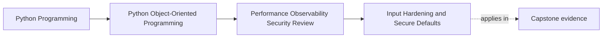

# Input Hardening and Secure Defaults

<!-- page-maps:start -->
## Page Maps

<!-- page-maps:end -->

Read the first diagram as a placement map: this page is one concept inside its parent
module, not a detached essay, and the capstone is the pressure test for whether the
idea holds. Read the second diagram as the working rhythm for the page: name the
problem, study the example, identify the boundary, then carry one review question
forward.

## Why this lesson matters

Permissive boundaries make systems harder to reason about and easier to misuse.

Weak inputs create pressure such as:

- ambiguous modes
- oversized payloads
- partial unsupported combinations
- late failures after side effects already began

Hardening matters because boundary ambiguity is both a correctness problem and a
security problem.

## Secure defaults reduce future damage

If a caller omits an option, the default behavior should normally favor:

- narrower exposure
- less privilege
- clearer rejection
- smaller blast radius

Convenient permissive defaults often survive for years and become part of the public
contract, which makes later hardening harder.

## Validate before expensive or dangerous work begins

Boundary checks should usually happen before:

- writes
- network calls
- plugin activation
- expensive background work

Early rejection is easier to diagnose and less likely to leave partial state behind.

## Bounds are part of the contract

Hardening is not only about field presence. It also includes:

- size limits
- count limits
- timeout ceilings
- allowed mode combinations

These boundaries make the operational envelope explicit instead of leaving it to chance.

## Strong validation supports the object model

Secure parsing and domain integrity often reinforce one another.

Clear semantic types, strict enums, and explicit transitions reduce:

- accidental invalid states
- surprising coercions
- exploit-friendly ambiguity

This is why hardening belongs in an OOP course: it protects the same design boundaries
the model depends on.

## Capstone connection

Use the capstone to ask:

- which input surface is still too permissive by default?
- where should invalid mode combinations be rejected before runtime work begins?
- which size or count bound would make one external boundary safer and more predictable?

## Exit check

Leave this lesson only when you can do all of these:

- explain one way a permissive default can become long-term public debt
- identify one capstone boundary that needs stricter limits or earlier rejection
- explain why input hardening improves both security and domain integrity
