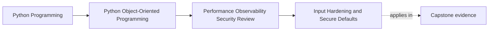

# Input Hardening and Secure Defaults

<!-- page-maps:start -->
## Page Maps

<!-- page-maps:end -->

This lesson is about making boundary behavior predictable before expensive or dangerous
work begins.

Weak input boundaries create long-lived problems:

- ambiguous modes
- oversized payloads
- unsupported combinations that fail late
- permissive defaults that become public debt

Hardening matters because boundary ambiguity is both a correctness problem and a
security problem.

## Keep one boundary path visible

Use one capstone route:

1. external input arrives
2. the host decides whether it is valid enough to normalize
3. the workflow begins durable or side-effecting work

The design question is:

What should be rejected early so that the domain and runtime never have to guess what
the caller meant?

That is the core of input hardening.

## Secure defaults are future governance decisions

If an option is omitted, the default behavior should usually favor:

- less privilege
- narrower exposure
- clearer rejection
- smaller blast radius

Permissive defaults often feel convenient in the first version and then become very
expensive to change later because callers come to depend on them.

That is why secure defaults belong in the first design discussion, not only in a later
security pass.

## Validate before writes, network calls, or activation

Boundary checks should usually happen before:

- authoritative writes
- network calls
- plugin activation
- expensive background work
- artifact generation

Early rejection is valuable because it:

- avoids partial side effects
- shortens diagnosis
- keeps bad state farther from the domain model

Late rejection often means the wrong boundary has already been given too much trust.

## Bounds are part of the public contract

Hardening is not only about field presence.
It also includes:

- size limits
- count limits
- allowed mode combinations
- timeout ceilings
- bounded retry or batching parameters

These are not arbitrary restrictions.
They define the safe operational envelope another maintainer can reason about.

If the envelope stays implicit, the system remains easy to misuse.

## Strong validation supports the object model

Secure parsing and domain integrity reinforce each other.

Clear semantic types, strict enums, and explicit transitions reduce:

- accidental invalid states
- surprising coercions
- exploit-friendly ambiguity
- caller confusion about what the system actually accepts

This is why hardening belongs in an OOP course: it protects the same ownership and
truth boundaries the object model depends on.

## A worked capstone boundary

Suppose the capstone accepts:

- a callback payload
- an administrative reissue command
- configuration for an outward sink

An honest hardening review might require:

- rejecting unknown states before they reach domain commands
- bounding identifier lengths and list sizes
- refusing unsupported mode combinations up front
- defaulting to disabled or narrow behavior when configuration is omitted

What it should not do:

- let optional fields silently widen authority
- pass remote payloads through "for later convenience"
- activate sinks or side effects before validating configuration shape

That is the difference between a soft boundary and a governed one.

## Build a boundary-hardening packet

For each important input boundary, keep a short packet with:

- boundary name
- accepted normalized shape
- rejected combinations or size limits
- secure default when the caller omits a choice
- first proof that should fail if the rule regresses

This packet makes hardening rules reviewable instead of tribal knowledge.

## Common failure modes

- using permissive defaults that later become hard-to-remove public behavior
- validating after durable or outward work has already started
- accepting oversized or ambiguous inputs because "we can ignore extra fields"
- leaving mode combinations implicit until runtime paths collide
- treating hardening as separate from domain integrity

## Hardening review card

Use this short card when reviewing an input boundary:

| Question | What you want to see |
| --- | --- |
| is invalid or ambiguous input rejected before expensive work begins? | yes |
| do omitted options fail toward safer behavior? | yes |
| are bounds and combinations explicit rather than guessed? | yes |
| does the rule strengthen both security and domain clarity? | yes |

## Capstone connection

Use this page to ask:

- which capstone boundary is still too permissive by default
- where invalid mode combinations should be rejected before runtime work begins
- which size or count limit would make one external boundary safer and easier to reason
  about

That is where input hardening becomes part of architectural clarity.

## Exit check

Leave this lesson only when you can do all of these:

- explain one way a permissive default becomes long-term public debt
- identify one capstone boundary that needs earlier rejection or stricter bounds
- explain why input hardening improves both security and domain integrity
