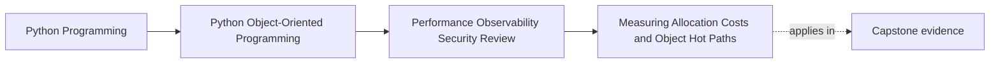

# Measuring Allocation Costs and Object Hot Paths

<!-- page-maps:start -->
## Page Maps

<!-- page-maps:end -->

Read the first diagram as placement: this page belongs to the final review module, where
performance claims must be defended with evidence instead of style preferences. Read the
second diagram as method: identify one user-facing workflow, inspect where objects are
created inside it, measure the cost, and only then discuss redesign.

## Why this lesson matters

Object-oriented systems create many short-lived values:

- request models
- domain entities
- snapshots
- view models
- serialization payloads
- error wrappers

That is not a defect. It is often the price of clear boundaries.

The real question is narrower and more demanding:

- where does object creation become expensive enough, frequent enough, and visible enough
  that it harms a workflow people actually care about?

Many weak performance conversations fail because they start with a belief such as:

- too many dataclasses must be the problem
- copying must be slow
- wrapping values must be wasteful

Those claims are architecture-shaped guesses. This lesson teaches you how to turn them
into reviewable evidence.

## Keep one workflow visible

Never begin allocation analysis with a type in isolation. Begin with a workflow.

In the capstone, a useful target might be:

- operator opens a filtered incident review report
- the application loads incidents
- domain objects are normalized
- report rows and summary objects are built
- the result is serialized for output

Now you have something a learner can reason about:

- who feels the slowness
- where repetition may happen
- which objects are probably short-lived
- what correctness rules must survive any optimization

Without that workflow, "allocation cost" becomes a vague complaint about abstraction.

## A hot path means repetition plus visibility

One allocation is almost never interesting.

A path becomes hot when three things meet:

1. It runs many times in one workflow or across many requests.
2. The workflow is visible to users, operators, or system throughput.
3. The work done there is meaningful compared with the rest of the path.

That means:

- a large object built once during startup may not matter
- a small wrapper built hundreds of thousands of times in a report loop might matter a lot
- an elegant conversion inside a cold admin command may be fine forever

Hotness is not about whether code looks busy. Hotness is about repeated cost in a
pressure-bearing path.

## Measure object churn, not only elapsed time

Elapsed time answers one question:

- how long did the workflow take?

Allocation analysis answers a different question:

- what kinds of objects are being created repeatedly, and how much churn do they create?

You usually need both views.

Use elapsed time to decide whether the workflow deserves attention.
Use allocation evidence to explain where the pressure comes from.

That distinction matters because a path may be:

- slow because of I/O, not object churn
- memory-heavy because of repeated transient projections, even when CPU time looks modest
- allocation-heavy but operationally irrelevant because it runs rarely

Do not confuse "many objects were created" with "this is our problem."

## Keep semantic contracts visible while measuring

Performance work becomes dangerous when it strips away the very structures that keep the
system honest.

Before measuring a hot path, name the truths that must survive:

- incident ordering must remain stable
- freshness rules must stay explicit
- permission-filtered fields must not leak
- aggregate invariants must remain enforced in the domain layer

This protects you from fake wins such as:

- skipping normalization that used to guarantee consistency
- reusing mutable objects across boundaries that should stay isolated
- caching stale projections without documenting staleness rules

The right optimization keeps the truth and removes only the unnecessary cost.

## A practical measurement route

Use this route when you suspect object churn in an OOP workflow.

1. Name the user-facing workflow.
2. Capture representative input size.
3. Measure whole-workflow duration first.
4. Identify the stage that repeats most heavily.
5. Inspect where transient objects are built inside that stage.
6. Count or sample allocations with a tool that fits the question.
7. Propose the smallest design change that could remove waste without weakening meaning.
8. Re-run the same workflow under the same conditions.

The order matters. If you jump straight to step 5, you are already optimizing before you
know whether the path deserves that attention.

## Worked capstone example

Assume operators say the incident review report feels slow for large data sets.

A disciplined investigation might look like this:

1. Run the full report generation against representative incident volume.
2. Confirm that report generation, not repository latency, dominates the workflow.
3. Inspect the report-building stage and find that each incident becomes:
   - a domain object
   - a policy-filtered presentation object
   - a summary row object
   - a serialized dictionary
4. Measure allocation churn and discover that the summary row object is rebuilt twice for
   two adjacent export steps.
5. Check the semantic contract:
   - the summary row is immutable
   - field filtering must remain explicit
   - ordering must remain stable
6. Change the workflow so the summary row is built once and consumed by both export steps.
7. Re-run the same workload and compare time and allocation evidence.

This is a real optimization candidate because:

- the path is user-visible
- the churn is repeated
- the waste is specific
- the semantic contract remains intact

## Local object cost versus architectural cost

Sometimes the measured problem is not the object itself. It is the workflow shape around
it.

Compare these two diagnoses:

| Observation | Weak diagnosis | Better diagnosis |
| --- | --- | --- |
| many row objects are created | row objects are bad | projection is repeated across two export branches |
| many permission wrappers appear | wrappers are overhead | permission filtering is happening too late and too often |
| many serialization payloads exist | dict conversion is slow | the system serializes the same logical report for multiple sinks |

This is the architectural move you must learn:

- do not blame the nearest object
- explain why the workflow keeps needing that object

Good optimization often comes from changing repetition boundaries, not from deleting
abstractions blindly.

## When extra allocations are worth paying for

Some allocations should remain even after careful measurement.

Keep them when they buy something important:

- clearer ownership
- immutable handoff across layers
- stronger testability
- easier reasoning about permissions, ordering, or freshness

If removing the allocation would make the design harder to review, easier to misuse, or
more mutation-prone, the cost may be justified.

Performance review is not a contest to create the fewest objects. It is a judgment about
whether each repeated object still earns its cost on a hot path.

## Common failure modes

- declaring a hot path without proving repetition
- measuring a tiny helper while ignoring the workflow that calls it
- treating all object creation as suspicious
- removing isolation boundaries to reduce copies
- comparing before and after runs under different workloads
- presenting one timing number without explaining what stage it represents

## Build an allocation evidence packet

When you present a performance claim, package it so another engineer can review it.

Include:

- the named workflow
- representative input size
- the semantic contracts that must survive
- before measurement
- the stage where churn concentrates
- the proposed change
- after measurement
- what remained unchanged in behavior

This turns performance discussion into engineering review instead of folklore.

## Allocation review card

| Review question | What a strong answer sounds like |
| --- | --- |
| which workflow is under pressure? | "large incident review report generation" |
| why is this path hot? | "it runs per incident across operator-facing report generation" |
| what objects are repeated? | "summary rows and export payloads for the same logical report" |
| what contract must survive? | "stable ordering and explicit permission-filtered fields" |
| what changed? | "duplicate projection step removed, semantics unchanged" |

## Capstone connection

Use this page to inspect one capstone workflow and answer all of these:

- where does repeated object creation actually cluster?
- which of those objects are paying for real clarity or safety?
- which ones exist only because the workflow repeats work unnecessarily?
- what proof would show that a redesign improved cost without weakening meaning?

If you cannot answer those questions yet, you are not ready to optimize the capstone.

## Exit check

Leave this lesson only when you can do all of these:

- define a hot path in terms of repeated visible cost rather than stylistic suspicion
- distinguish whole-workflow timing from allocation churn evidence
- explain one capstone optimization candidate without weakening the semantic contract it
  depends on
