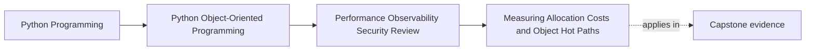

# Measuring Allocation Costs and Object Hot Paths

<!-- page-maps:start -->
## Page Maps

<!-- page-maps:end -->

Read the first diagram as a placement map: this page is one concept inside its parent
module, not a detached essay, and the capstone is the pressure test for whether the
idea holds. Read the second diagram as the working rhythm for the page: name the
problem, study the example, identify the boundary, then carry one review question
forward.

## Why this lesson matters

Performance arguments become dangerous when they are detached from evidence.

Students often say:

- this object model must be too allocation-heavy
- these wrappers look expensive
- this copy probably hurts throughput

Sometimes they are right. Often they are optimizing what feels expensive instead of what
the system actually does a lot.

Measurement matters because operational hardening should begin with observed pressure,
not aesthetic suspicion.

## A hot path is about repetition and cost together

Most allocations in a program are harmless because they happen rarely or outside
latency-sensitive work.

A path becomes interesting when several conditions meet:

- it runs often
- it sits inside a workflow users feel
- it allocates or copies large or repeated structures
- it adds enough overhead to matter compared with surrounding work

That is why one elegant object wrapper is not automatically a problem, while one
repeated wrapper in a tight loop might be.

## Allocation cost is a design signal, not a moral failure

Extra objects can be worth the cost when they buy:

- clarity
- safer ownership
- easier testing
- better boundaries

The right question is not:

- how do we eliminate object creation?

It is:

- where is object creation now materially harming a real workflow, and what semantic
  discipline must survive any change?

This keeps performance work tied to design tradeoffs rather than to anti-allocation
folklore.

## Measure representative workflows, not isolated trivia

A microbenchmark can help answer a narrow question, but many real costs appear only when
the full workflow runs:

- repository loads
- decoding or serialization
- projections or view-building
- repeated transitions across boundaries

If the production latency is dominated by boundary work, proving that one helper
allocates less may not matter.

That is why hot-path measurement should usually start from a representative scenario and
then zoom inward when needed.

## Separate local object cost from workflow cost

Two useful questions are often being mixed together:

1. Is this specific type or conversion allocating more than expected?
2. Does that allocation materially affect the whole workflow under realistic load?

You need both answers eventually, but not at the same time.

Start by finding out whether the workflow is slow enough, frequent enough, or expensive
enough to justify deeper object-level analysis. Then narrow the measurement target.

## Preserve semantics while measuring

Every performance discussion in this course should keep one design guardrail visible:

- what semantic behavior must not change?

For example:

- freshness rules must stay honest
- ordering guarantees must stay the same
- object authority must not move casually across boundaries

Without that guardrail, teams sometimes "optimize" by removing the very structure that
made the system correct or reviewable.

## A worked example

Suppose the capstone repeatedly:

- loads incidents
- builds transient report shapes
- serializes summaries

If operators report slow review output, a good first measurement route is:

1. run the whole reporting workflow with representative data
2. identify which step dominates time or allocation
3. inspect whether transient object creation is concentrated in one hot projection path
4. only then ask whether fewer copies or different boundaries would help

That is much stronger than declaring, up front, that "object orientation is probably too
slow here."

## Common mistakes

- optimizing a type because it looks allocation-heavy without checking whether the path is hot
- measuring one helper in isolation while the real cost lives at a boundary
- treating all object creation as a problem instead of a tradeoff
- changing semantics such as freshness or ownership while claiming to optimize only performance
- stopping at one timing number without understanding what part of the workflow it represents

## Review checklist

| Question | Good sign |
| --- | --- |
| is the claimed hot path tied to a representative workload? | yes |
| do you know whether the cost is local or workflow-wide? | yes |
| is the measured cost large enough to justify design change? | yes |
| is the semantic contract that must survive the optimization stated clearly? | yes |

## Capstone connection

Use the capstone to ask:

- which workflow feels operationally expensive enough to measure first?
- where are transient objects or copies likely clustered inside that workflow?
- what semantic rule must remain intact even if the implementation becomes leaner?

This is the first discipline of the final module: measure pressure honestly before
changing the design.

## Exit check

Leave this lesson only when you can do all of these:

- explain what makes a path hot in operational rather than purely stylistic terms
- identify one capstone workflow that deserves representative measurement
- state one semantic contract that an optimization on that workflow must not change
