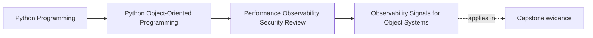

# Observability Signals for Object Systems

<!-- page-maps:start -->
## Page Maps

<!-- page-maps:end -->

This lesson is about making the system explain itself under pressure.

Observability is not "add more logs."
It is the discipline of choosing signals that let another maintainer answer:

- which workflow is in trouble
- which boundary is slow or failing
- what outcome the system believed it had produced
- what retry, conflict, or lag path is growing

If the signals cannot answer those questions, operators are forced to reverse-engineer
the codebase during an incident.

## Keep one workflow visible

Use one capstone path:

1. a seat request enters
2. `WorkshopEnrollment` confirms or waitlists
3. the repository saves authoritative truth or rejects a stale write
4. downstream publication, projection, or artifact work begins
5. later workflows consume the visible result

Now ask:

What signals would let another maintainer explain this path quickly on Monday, July 27,
2026 if users reported delay, duplication, or failure?

That is the real observability question.

## Signals should follow design boundaries

The strongest signals usually sit at collaboration points the architecture already cares
about:

- command or workflow start and finish
- aggregate acceptance or rejection
- repository save, conflict, or retry
- adapter publish, timeout, or failure
- artifact or notification completion

These are easier to interpret than low-level chatter because they map to the same
boundary language used in design review.

If a signal cannot be tied back to a meaningful boundary, it is harder to use when time
is short.

## Different signal types answer different questions

Keep the roles clear:

- logs explain one event with local context
- metrics summarize counts, rates, and durations
- traces connect one workflow across boundaries

That means:

- a metric is not a narrative explanation
- a log is not a latency graph
- a trace is not a permanent audit store

Mixing their jobs carelessly creates noise and weakens diagnosis.

## Correlation turns fragments into one story

Cross-boundary systems need identifiers that let operators connect related signals.

Useful identifiers might include:

- request or command id
- workshop id
- enrollment id
- issuance id
- sink identifier

Choose them so an operator can move between logs, metrics, and traces without guessing
which events belong together.

Correlation is what turns several signals into one debuggable story.

## Noise is an operational bug

Too much signal is not neutral.

Examples of noisy design:

- logging every expected retry as an error
- dumping large payloads where one bounded field would do
- publishing many metrics that answer no operator question
- duplicating the same event at several layers with little extra value

If the interesting event is buried in signal volume, observability stops clarifying the
system and starts obscuring it.

Noise should be reviewed with the same seriousness as missing signals.

## Sensitive data changes the signal design

Signals cross trust boundaries too.

Review them for:

- secret exposure
- personal or sensitive identifiers
- payload detail that exceeds what diagnosis needs
- object dumps that reveal internal or replayable state

Useful observability is never an excuse to leak data that the runtime was supposed to
protect.

This is why observability design belongs close to trust-boundary review.

## A worked capstone signal set

For the capstone path, an honest first-pass signal set might include:

- one trace span for the full confirmation workflow
- one structured log when an enrollment transition is rejected
- one metric for repository conflict rate
- one duration metric for artifact or notification completion
- one bounded log or counter for sink retry or failure pressure
- one correlation identifier tying together the authoritative write and the downstream
  visible outcome

This set is useful because each signal answers a different operator question.

## A signal should justify itself by action

For each signal, ask:

- what operator question does this answer?
- what design boundary does it illuminate?
- what first action becomes easier because this signal exists?

If the answer is fuzzy, the signal is probably decorative.

A smaller, more actionable set is often stronger than a large unreviewed one.

## Build a small signal packet

For each important workflow, keep a short packet with:

- signal name
- type: log, metric, or trace
- correlation identifier used
- operator question answered
- one thing deliberately left out because it would be noisy or sensitive

That packet keeps observability teachable and reviewable.

## Common failure modes

- placing signals at arbitrary code points instead of meaningful boundaries
- using one signal type for every question
- omitting correlation identifiers on cross-boundary workflows
- flooding the system with low-value logs or metrics
- logging sensitive data because it was convenient during debugging

## Observability review card

Use this short card when reviewing a signal plan:

| Question | What you want to see |
| --- | --- |
| do the main signals align with meaningful workflow and boundary events? | yes |
| can operators connect related events through correlation identifiers? | yes |
| is each signal type answering the right kind of question? | yes |
| have noisy or sensitive signals been reduced, removed, or redesigned? | yes |

## Capstone connection

Use this page to ask:

- which capstone workflow needs one trace or correlation path first
- which boundary deserves a duration or failure-rate metric
- which current or proposed log would create more noise or leakage than clarity

That is where observability becomes part of the architecture rather than a logging
afterthought.

## Exit check

Leave this lesson only when you can do all of these:

- explain one difference between a useful log, metric, and trace
- identify one capstone workflow that needs better correlation
- identify one noisy or unsafe signal that should be removed, reduced, or redesigned
