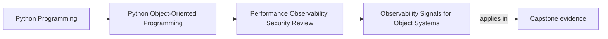

# Observability Signals for Object Systems

<!-- page-maps:start -->
## Page Maps

<!-- page-maps:end -->

This lesson is about making the system explain itself under pressure.

The weak version of observability is:

- add more logs
- emit a few counters
- hope traces are useful later

The stronger version is:

- decide which workflow matters
- decide which boundary can fail, slow, retry, or duplicate
- choose signals that help another maintainer answer the first real operator questions

If the signals cannot help somebody diagnose Monday-morning trouble without reverse
engineering the whole codebase, the signal plan is still weak.

## Keep one workflow visible

Use one capstone path throughout this lesson:

1. a seat request enters
2. `WorkshopEnrollment` confirms or waitlists
3. authoritative state is persisted or rejected under contention
4. derived projections, notifications, or artifacts publish the visible outcome
5. later workflows such as certificate issuance consume that visible result

Now ask one practical question:

- if users report delay, duplication, or missing output, what evidence would help another
  maintainer explain where the workflow went off course?

That is the observability question worth answering.

## Start from operator questions, not from tools

Before choosing a log, metric, or trace, write the operator question.

Good questions:

- is the slowdown happening before or after authoritative persistence?
- are conflict retries growing during burst registration?
- are downstream notifications lagging even though seat truth is already saved?
- are duplicate callbacks being absorbed or creating duplicate visible work?

Weak questions:

- what can we log here?
- what metric should this service have?
- should we add tracing?

The stronger questions are better because they tell you:

- what boundary deserves observation
- what kind of signal would help
- what action the signal should support

Without that framing, signal design becomes decorative instrumentation.

## Signals should follow architecture boundaries

The most useful signals usually sit where the design already distinguishes
responsibilities:

- workflow start and finish
- aggregate acceptance or rejection
- repository save and concurrency conflict
- projection or notification publication
- artifact creation or delivery

These signals are valuable because they match the same vocabulary you use in design and
code review.

Signals placed at arbitrary internal lines or helper calls often produce noise without
improving diagnosis. Operators usually need to know which boundary is in trouble before
they care which helper was hot.

## Logs, metrics, and traces have different jobs

Keep the roles explicit.

Logs are best when you need:

- one event with bounded local context
- a rejection reason
- a state transition that needs explanation

Metrics are best when you need:

- rate
- duration
- lag
- retry or error growth over time

Traces are best when you need:

- one end-to-end workflow story
- timing across several boundaries
- evidence about where latency or failure accumulates

When you mix those jobs carelessly, you get bad outcomes:

- logs that try to act like dashboards
- metrics that are too detailed to summarize anything
- traces that carry the wrong identifiers and cannot be joined to decisions

Use the right tool for the question instead of asking one tool to do all of them.

## Correlation is what makes signals usable

Cross-boundary workflows need stable identifiers so one maintainer can connect fragments
of evidence.

In the capstone, useful identifiers might include:

- `enrollment_id`
- `workshop_id`
- `issuance_id`
- a bounded sink or workflow name

Choose identifiers that support diagnosis without leaking more than you need.

Correlation turns these scattered observations into one readable story:

- request accepted
- aggregate decided
- repository save conflicted twice
- final persistence succeeded
- downstream publication timed out

Without correlation, those events may all exist and still be too expensive to reason
about during an incident.

## Noise is an operational bug

Over-instrumentation is not neutral.

Examples of noisy design:

- logging every expected retry at error level
- duplicating the same event at several layers without new meaning
- storing large payload fragments because they "might help later"
- adding counters that answer no operator question

Noise harms operations in at least three ways:

- it hides the signal that matters
- it increases review surface without increasing clarity
- it normalizes unsafe or unbounded output

Treat noisy instrumentation as a real defect, not as harmless enthusiasm.

## Sensitive data changes signal design

Observability crosses trust boundaries too.

The signal plan must ask:

- who can read this output?
- how long will it live?
- can it be copied, searched, or replayed later?
- what diagnosis value do we lose if we redact or omit the risky field?

In practice, this often means:

- keep raw attendee payloads out of logs
- keep artifact storage locations out of general diagnostics
- use stable ids instead of personal or replayable detail
- prefer bounded error categories over large dumps

Useful observability is never an excuse to leak information the runtime was supposed to
protect.

## Worked capstone signal packet

Suppose operators complain that confirmations are slow and certificate issuance sometimes
seems delayed.

A strong first-pass signal packet might include:

- metric: `enrollment_confirmation_latency_ms`
- counter: `enrollment_conflict_retries_total`
- counter: `certificate_issuance_publication_failures_total`
- trace path: request acceptance -> aggregate decision -> repository save ->
  visible publication
- structured log: bounded rejection record for invalid callback or sink refusal
- correlation identifier: `enrollment_id` or `issuance_id`

Now attach the operator questions:

| Signal | Operator question |
| --- | --- |
| confirmation latency | where is user-visible slowness growing? |
| conflict retry count | is contention the main source of delay? |
| issuance publication failures | is truth saved but visible completion failing? |
| end-to-end trace | which boundary is stretching or failing in this one workflow? |
| bounded rejection log | why was this one transition rejected? |

This packet is strong because every signal supports a decision, not merely output.

## Build a signal review packet

For each important workflow, keep a short packet with:

- workflow name
- signal name
- signal type
- correlation identifier
- operator question answered
- one field deliberately left out because it is noisy or sensitive
- first action the signal supports

That last line matters. If a signal does not make a first action clearer, its value is
probably lower than it looks.

## Common failure modes

- choosing instrumentation before naming the operator question
- placing signals at arbitrary implementation points instead of architecture boundaries
- omitting stable identifiers for cross-boundary workflows
- confusing logs, metrics, and traces by making one carry the job of another
- leaking payload detail because it was easier than designing a bounded diagnostic shape

## Observability review card

Use this review card for each workflow:

| Question | What a strong answer sounds like |
| --- | --- |
| what operator question is this signal answering? | "is persistence or downstream publication causing the delay?" |
| what boundary does it illuminate? | "repository conflict handling" or "artifact publication" |
| how is this signal correlated to the rest of the workflow? | "with `enrollment_id` across logs and trace spans" |
| what detail is intentionally omitted? | "raw attendee payload and storage keys" |
| what first action does it support? | "inspect conflict pressure before redesigning domain logic" |

## Capstone connection

Use this page to decide all of these:

- which one capstone workflow deserves the first full trace path
- which boundary needs a lag or failure metric first
- which current or proposed log is too noisy or too revealing to keep
- which identifier gives enough correlation without widening exposure

That is when observability becomes part of the architecture instead of an afterthought.

## Exit check

Leave this lesson only when you can do all of these:

- start signal design from an operator question instead of a tool choice
- explain one difference in the jobs of logs, metrics, and traces
- propose one capstone signal packet that would make the workflow easier to diagnose
  under pressure
