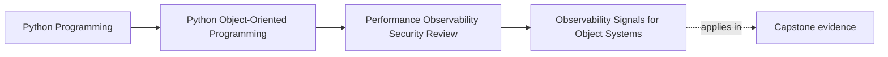

# Observability Signals for Object Systems

<!-- page-maps:start -->
## Page Maps

<!-- page-maps:end -->

Read the first diagram as a placement map: this page is one concept inside its parent
module, not a detached essay, and the capstone is the pressure test for whether the
idea holds. Read the second diagram as the working rhythm for the page: name the
problem, study the example, identify the boundary, then carry one review question
forward.

## Why this lesson matters

A well-designed system can still be hard to operate if nobody can tell what it is doing
under load or failure.

Observability should answer questions such as:

- which workflow is failing?
- which boundary is slow?
- which aggregate or policy decision produced this outcome?
- which retry, timeout, or conflict path is growing?

If the signals cannot answer those questions, operators are forced to reverse-engineer
the codebase during an incident.

## Signals should follow architectural boundaries

The best signals usually sit at meaningful collaboration points:

- command start and finish
- aggregate transition or rejection
- repository save or conflict
- adapter retry, timeout, or downstream failure

These are easier to interpret than low-level chatter because they map back to the object
model and workflow boundaries the team already uses to reason about the system.

## Different signals serve different questions

Keep the roles clear:

- logs explain one local event with context
- metrics summarize counts, rates, and durations
- traces connect one workflow across boundaries

Trying to force every question into one signal type usually creates noise. A structured
log is not a duration graph. A metric is not a narrative explanation. A trace is not a
permanent audit log.

## Correlation turns events into one story

Cross-boundary systems need a way to connect related activity.

Useful identifiers may include:

- request or command ID
- incident ID
- policy or rule ID
- plugin or sink identifier

These should be chosen so an operator can move between logs, traces, and metrics without
guessing which events belong together.

## Noise is an operational bug

Too much signal can be as harmful as too little.

Examples:

- every retry logged as an error even when the retry is expected
- debug-level payload dumps hiding real failures
- many low-value metrics with no alert or decision use
- duplicated signals at several layers for the same event

When important behavior is buried inside volume, observability stops clarifying the
system and starts obscuring it.

## Sensitive data changes the signal design

Signals cross trust boundaries too.

That means logs, traces, and metrics should be reviewed for:

- secret exposure
- excessive payload detail
- personally sensitive identifiers
- unsafe serialization of internal objects

Useful observability is never an excuse to leak data the runtime was supposed to protect.

## A worked example

Suppose the capstone workflow:

- receives a command
- evaluates rules
- persists an incident
- publishes a downstream notification

An honest observability design might include:

- a trace span for the whole command path
- a structured log when a rule transition is rejected
- a metric for repository conflict rate
- a metric or log for sink failure and retry pressure
- correlation identifiers linking the incident and command across these signals

That gives operators a story they can follow without logging every internal detail.

## Signals should help action, not only analysis

Ask of each signal:

- what operator question does this answer?
- what change in behavior would this help detect?
- what action becomes easier because this exists?

If the answer is unclear, the signal is likely decorative.

## Common mistakes

- placing signals at arbitrary code points instead of design boundaries
- using one signal type for every observability need
- omitting correlation identifiers on cross-boundary workflows
- flooding the system with low-value logs and metrics
- logging sensitive data because it was convenient for debugging

## Review checklist

| Question | Good sign |
| --- | --- |
| do the main signals align with meaningful workflow and boundary events? | yes |
| can operators connect related events through correlation identifiers? | yes |
| is each signal type answering the right kind of question? | yes |
| have noisy or sensitive signals been reduced or redesigned? | yes |

## Capstone connection

Use the capstone to ask:

- which workflow needs one trace or correlation path first?
- which boundary deserves a duration or failure-rate metric?
- which current or proposed log would create more noise or leakage than operational clarity?

This is where observability becomes part of the architecture instead of a logging afterthought.

## Exit check

Leave this lesson only when you can do all of these:

- explain one difference between a useful log, metric, and trace
- identify one capstone workflow that needs better correlation
- identify one noisy or unsafe signal that should be removed, reduced, or redesigned
