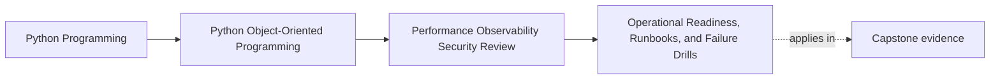

# Operational Readiness, Runbooks, and Failure Drills

<!-- page-maps:start -->
## Page Maps

<!-- page-maps:end -->

Read the first diagram as a placement map: this page is one concept inside its parent
module, not a detached essay, and the capstone is the pressure test for whether the
idea holds. Read the second diagram as the working rhythm for the page: name the
problem, study the example, identify the boundary, then carry one review question
forward.

## Why this lesson matters

A system is not operationally ready just because the code looks clean.

Readiness means the team can answer:

- what failure modes are expected?
- how will operators recognize them?
- what safe first actions are allowed?
- what recovery path preserves the design instead of bypassing it?

Runbooks and drills matter because architecture claims should survive the first real
incident, not only the first code review.

## Runbooks should follow the boundary map

A useful runbook points to:

- the affected workflow or boundary
- the signals that reveal the problem
- the likely causes
- safe first actions
- escalation or rollback options

This is much easier when the system already has clear ownership and observability.

## Failure drills reveal missing proof

A drill is valuable when it turns one abstract risk into an operational question:

- what if repository conflicts spike?
- what if one sink times out repeatedly?
- what if a queue backlog grows?
- what if plugin registration fails at startup?

If the team cannot answer those questions without guessing, the design still has
operational blind spots.

## Recovery must respect the model

Weak runbooks often tell operators to bypass the very invariants the design claims to
protect.

For example:

- mutate internal tables directly
- skip validation
- force state transitions outside the aggregate boundary

That may look fast during an incident, but it creates hidden corruption debt. Recovery
guidance should preserve the same authority and trust boundaries the code depends on.

## Capstone connection

Use the capstone to ask:

- which predicted failure mode deserves a runbook first?
- which signal would an operator need to recognize it quickly?
- which current recovery idea would be unsafe because it bypasses too much model authority?

## Exit check

Leave this lesson only when you can do all of these:

- explain what makes a runbook useful rather than decorative
- identify one capstone failure mode worth drilling
- explain why safe recovery must still respect the design boundaries
