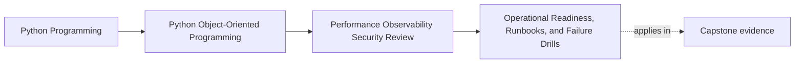

# Operational Readiness, Runbooks, and Failure Drills

<!-- page-maps:start -->
## Page Maps

<!-- page-maps:end -->

Operational readiness means another maintainer can recognize, contain, and recover from
the first bad night without violating the design to do it.

That is much stricter than "the code looks clean."

This page teaches runbooks and drills as design artifacts:

- they expose what the system assumes
- they reveal where observability is missing
- they show whether recovery guidance still respects authority boundaries

If the runbook says "patch the data directly and hope," the architecture was not really
ready.

## Keep one failure path visible

Use one capstone path while reading:

1. seat confirmation succeeds
2. the repository saves authoritative truth
3. downstream projection, notification, or artifact work begins
4. something fails, slows, duplicates, or backs up

The runbook question is:

How does another maintainer diagnose and respond without moving truth to the wrong
place?

## What a useful runbook actually contains

A runbook is not a prose reminder to "check the logs."

A useful runbook should name:

- the workflow or boundary in trouble
- the first signal or symptom to inspect
- the first safe containment or diagnosis step
- the design assumption made visible by that step
- the escalation or recovery path that does not bypass model authority

If those pieces are missing, the runbook is decorative.

## Runbooks should follow the boundary map

Good runbooks align with the system's boundaries.

For the capstone, that means a runbook should distinguish:

- aggregate truth versus derived visibility
- repository conflict versus downstream lag
- durable progress versus visible publication
- public-seam trouble versus private-implementation trouble

This prevents a common failure:

- treating every symptom as if it were a data-fix problem

Boundary-aware runbooks lead operators toward safe first actions.

## Failure drills reveal hidden assumptions

A drill is valuable when it makes one operational assumption explicit.

Examples:

- duplicate callback delivery arrives
- projection consumer stops advancing
- repository conflict rate spikes during registration bursts
- certificate artifact upload fails after authoritative state was already persisted

A drill should answer:

- what do we simulate?
- which boundary should fail loudly first?
- what evidence proves the drill worked?
- what hidden weakness do we expect to expose?

If the drill cannot answer those questions, it is still a scenario idea, not a learning
exercise.

## Recovery must respect the model

Weak runbooks often recommend bypassing the very boundaries the design depends on.

Bad examples:

- mutate internal rows directly
- skip aggregate validation "just for recovery"
- replay downstream work without checking durable progress
- expose private runtime controls to public operators out of convenience

These steps may feel fast, but they create corruption debt.

A strong runbook preserves:

- aggregate authority
- repository conflict semantics
- durable progress markers
- public/private boundary discipline

Recovery is not real if it requires abandoning the design.

## A concrete capstone runbook shape

Take this failure:

- certificate issuance persistence succeeded, but artifact upload latency spiked and
  outward completion evidence stalled

A useful runbook entry would name:

- first signal: rising issuance latency plus upload error or timeout counts
- first safe step: confirm authoritative issuance state before triggering any rerun
- key artifact: issuance trace, audit row, or durable progress marker keyed by issuance
  id
- design assumption: persistence of issuance truth is separate from downstream artifact
  publication
- unsafe shortcut to avoid: rerunning the whole workflow blindly and risking duplicate
  visible work

This is what it means for a runbook to teach architecture under pressure.

## A good failure drill for the capstone

Take this drill:

- deliver the same callback or retry trigger twice

The drill should observe:

- which boundary rejects or absorbs the duplicate first
- whether visible downstream work duplicates
- whether operator signals make the reason legible
- whether the recovery step preserves durable truth

The drill is successful when it exposes both design strength and remaining weakness.

If everything "passes" but nobody can explain why, the drill taught too little.

## Build a small operational packet

For each predicted failure mode, keep a packet with:

- failure name
- first signal
- first safe step
- authority boundary not to violate
- one artifact or dashboard to inspect
- one escalation trigger

This packet can be short. It just has to be real enough that another maintainer could
use it on Monday, July 27, 2026 without oral backchannel context.

## Common failure modes

- writing runbooks as abstract reminders instead of step-shaped guides
- giving unsafe shortcuts that bypass aggregate or repository authority
- running drills without deciding what evidence would count as success
- assuming logs exist without specifying which signal matters first
- treating downstream duplicate work as harmless because the domain model stayed pure

## Capstone connection

Use this page to answer all of these:

- which capstone failure mode deserves the first real runbook
- which signal would let another maintainer recognize it quickly
- which recovery move would be unsafe because it bypasses too much model authority
- which drill would most likely expose a hidden retry or duplication weakness

That is the operational-readiness test the module is trying to teach.

## Exit check

Leave this lesson only when you can do all of these:

- explain what makes a runbook step-shaped and safe rather than decorative
- identify one capstone failure mode worth drilling first
- explain how recovery can stay fast without violating design boundaries
