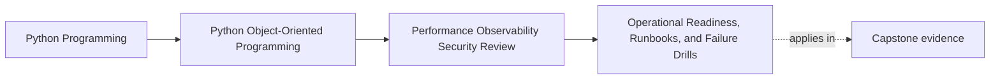

# Operational Readiness, Runbooks, and Failure Drills

<!-- page-maps:start -->
## Page Maps

<!-- page-maps:end -->

Operational readiness means another maintainer can recognize, contain, and recover from
the first bad night without violating the design to do it.

That standard is much stricter than:

- the code looks clean
- the tests pass
- somebody on the team knows what usually goes wrong

This page treats runbooks and drills as architecture artifacts because they expose all of
these:

- which failures the system expects
- which signals are good enough to support first action
- which recovery moves preserve authority boundaries
- which hidden assumptions still exist only in maintainers' heads

If the only real recovery plan is "ask the person who built it," the system is not ready.

## Keep one failure route visible

Use one capstone route:

1. seat confirmation succeeds
2. authoritative state is persisted
3. downstream projection, notification, or artifact work begins
4. something fails, slows, duplicates, or backs up

Now ask:

- how should another maintainer diagnose and respond without moving truth to the wrong
  place?

That question is what distinguishes operational architecture from generic troubleshooting
advice.

## A useful runbook is step-shaped

A weak runbook says:

- check the logs
- retry the job
- investigate the queue

A strong runbook names:

- the workflow or boundary in trouble
- the first signal to inspect
- the first safe containment or diagnosis step
- one artifact or dashboard to consult
- one unsafe shortcut to avoid
- the design assumption that makes the step safe

That shape matters because operational work happens under time pressure. If the document
does not tell another maintainer what first move is safe, it is decorative.

## Runbooks should follow the boundary map

Good runbooks match the architecture.

In the capstone, that means distinguishing:

- aggregate truth from derived visibility
- repository conflicts from downstream lag
- durable progress from visible publication
- public seam trouble from private implementation trouble

This prevents a common operational mistake:

- treating every symptom as if it were a data-fix problem

Boundary-aware runbooks help maintainers choose containment that preserves the truth
model instead of bypassing it.

## Recovery must preserve authority

Weak runbooks often recommend the very shortcuts the design was supposed to make
unnecessary.

Unsafe examples:

- mutate internal rows directly
- replay downstream work without checking durable progress
- bypass aggregate validation "just for recovery"
- widen operator controls so they can trigger private runtime behavior ad hoc

These moves may feel fast, but they create corruption debt.

Strong recovery preserves:

- aggregate authority
- repository conflict semantics
- durable progress markers
- public/private boundary discipline

The recovery is only real if it keeps the system honest while stabilizing it.

## Failure drills reveal assumptions you forgot to write down

A drill is valuable when it makes one hidden operational assumption explicit.

Examples:

- duplicate callback delivery arrives
- projection consumer stops advancing
- conflict rates spike during registration bursts
- certificate artifact upload fails after authoritative state was already persisted

A useful drill answers:

- what exactly are we simulating?
- which boundary should fail loudly first?
- what evidence proves the drill succeeded?
- what hidden weakness do we expect to expose?

If the drill cannot answer those questions, it is still only a scenario idea.

## Worked capstone runbook

Take this failure:

- issuance persistence succeeded, but artifact upload latency spiked and visible
  completion stalled

A strong runbook entry would include:

- workflow:
  - certificate issuance publication after authoritative issuance state exists
- first signal:
  - rising issuance latency plus upload timeout or failure counts
- first safe step:
  - confirm authoritative issuance state and durable progress before any rerun
- artifact to inspect:
  - issuance trace or progress marker keyed by `issuance_id`
- unsafe shortcut:
  - rerun the whole workflow blindly and risk duplicate visible completion
- design assumption:
  - issuance truth is separate from downstream artifact publication

This runbook is strong because it names a safe first move and the architecture reason
behind it.

## Worked capstone drill

Take this drill:

- deliver the same callback or retry trigger twice under realistic delay

The drill should observe:

- whether authoritative state stays singular
- whether visible downstream work duplicates
- whether signals explain why the duplicate was absorbed or rejected
- whether the first recovery step preserves durable truth

Why this drill matters:

- duplicate triggers often expose hidden coupling between retries and visible effects
- they test observability, not only correctness
- they reveal whether durable progress is actually being used during recovery

If the system "passes" but nobody can explain why, the drill still taught too little.

## Build an operational packet

For each predicted failure mode, keep a short packet with:

- failure name
- first signal
- first safe step
- authority boundary not to violate
- one artifact or dashboard to inspect
- one escalation trigger

This packet does not need to be long. It needs to be usable by a missed-class learner or
maintainer without oral backchannel support.

## Common failure modes

- writing runbooks as reminders instead of step-shaped guides
- recommending shortcuts that bypass aggregate or repository authority
- running drills without deciding what evidence counts as success
- assuming logs exist without specifying which signal matters first
- treating duplicate visible work as harmless because the domain model itself stayed pure

## Readiness review card

Use this card for each failure story:

| Question | What a strong answer sounds like |
| --- | --- |
| what failure are we naming? | "artifact publication stalls after authoritative issuance persistence" |
| what is the first signal? | "issuance latency and upload timeout counts" |
| what is the first safe step? | "confirm durable progress before any rerun" |
| what shortcut is forbidden? | "blind full-workflow replay" |
| what assumption does the runbook expose? | "truth persistence and visible publication are separate boundaries" |

## Capstone connection

Use this page to decide:

- which capstone failure mode deserves the first real runbook
- which signal would let another maintainer recognize it fastest
- which recovery move would be unsafe because it bypasses too much authority
- which drill is most likely to expose hidden retry or duplication weakness

That is how operational readiness becomes part of the design rather than an afterthought.

## Exit check

Leave this lesson only when you can do all of these:

- explain what makes a runbook step-shaped and safe instead of decorative
- identify one capstone failure mode worth drilling first
- explain how recovery can stay fast without violating the truth boundary
