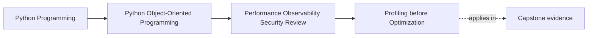

# Profiling before Optimization

<!-- page-maps:start -->
## Page Maps

<!-- page-maps:end -->

Read the first diagram as context: profiling belongs at the end of the course because
it depends on everything you learned earlier about boundaries, object lifetimes, and
semantic contracts. Read the second diagram as a discipline: start from a performance
question, gather evidence, translate the evidence into a design diagnosis, and only then
consider a change.

## Why this lesson matters

Teams often say they want to "make it faster" when what they really need is a better
description of where time is going.

Without profiling, performance work is usually driven by:

- code that looks busy
- a dislike of abstraction
- memories from a different system
- fear that object orientation must be inefficient

Those instincts can occasionally point in the right direction, but they are not strong
enough for review.

Profiling matters because it answers a harder and more useful question:

- where is the system actually spending time under a real workload, and what architectural
  explanation makes that cost understandable?

The last clause matters. Profiling is not about collecting heatmaps for their own sake.
It is about turning measurement into a design decision.

## Start with a named performance question

A useful profile begins with a question that a learner can state clearly.

Good questions sound like this:

- why does the incident review report feel slow for large filters?
- is report generation CPU-bound or repository-bound?
- is serialization dominating API response time?
- are repeated permission-filtering passes inflating export latency?

Weak questions sound like this:

- what is slow?
- can we optimize this code?
- what does the profiler say?

The difference is important. A named question tells you:

- what workflow to run
- which tool class is relevant
- what "better" would mean
- which parts of the output deserve attention

Without that question, profiling becomes wandering through numbers until something looks
suspicious enough to justify a change you already wanted to make.

## Keep one workflow under inspection

Just as with allocation analysis, profiling should stay attached to a user-visible path.

For the capstone, one strong candidate is:

- operator requests an incident review report
- incidents are loaded and normalized
- policy filtering is applied
- rows are projected
- the result is serialized for display or export

That workflow gives you a stable frame for every later decision:

- where the clock starts
- where the clock ends
- what repetitions matter
- what behavior must remain correct

If you profile helpers without this frame, you may collect precise data about a problem
the user never feels.

## Translate profile output into architecture

Raw profiler output is not the end of the job.

Suppose a report shows heavy time inside one formatting function. You still need to ask:

- is formatting itself expensive?
- or is formatting expensive because the system keeps rebuilding the same projection?
- or is formatting merely where repeated boundary crossings become visible?

This is the habit the course wants you to build:

- never stop at "function X is hot"
- continue until you can explain why the workflow keeps returning to that work

Architecture-level interpretations are far more useful than line-level fascination.

## Different tools answer different questions

Profiling is not one tool. It is a family of evidence routes.

Use this decision table:

| Question | Better evidence route | Typical diagnosis target |
| --- | --- | --- |
| where is CPU time concentrated? | CPU profiler | repeated computation, projection, formatting |
| where is object churn concentrated? | allocation or memory profiler | transient object floods, repeated conversions |
| where is end-to-end latency spent? | tracing, spans, timed workflow stages | repository trips, serialization boundaries, retries |
| is one local implementation choice faster than another? | focused benchmark after broader diagnosis | narrow substitution inside a proven hotspot |

The lesson is not "memorize all tools." The lesson is "match the tool to the question."

## Profile before you redesign

Object-oriented code often invites premature structural edits:

- flatten the domain object
- remove wrappers
- inline policies
- skip projections
- merge layers

Those changes can make the code less understandable long before they make it faster.

A profile protects you from that drift because it forces you to say:

- what is slow
- where the time accumulates
- how much that path matters
- whether the proposed redesign targets the actual cause

If the profile does not support the redesign, the redesign is still speculation.

## A worked capstone route

Assume operators report that the incident review report is slow on large datasets.

Use this profiling route:

1. Run the full report workflow under representative volume.
2. Capture coarse stage timing:
   - repository loading
   - normalization
   - policy filtering
   - row projection
   - serialization
3. Identify the dominant stage.
4. Use a more focused profiler inside that stage.
5. Translate the hotspot into an architectural explanation.
6. Propose one smallest credible redesign.
7. Re-run the same workload and compare before and after.

Here are three possible outcomes:

| Profile result | Architectural interpretation | Better next move |
| --- | --- | --- |
| repository stage dominates | boundary I/O is the bottleneck | reduce round-trips or reshape retrieval |
| row projection dominates | repeated in-memory transformation is the bottleneck | inspect duplicate projections or expensive derived fields |
| serialization dominates | output boundary is the bottleneck | reduce repeated payload construction or redundant encoding |

This table shows why "line 87 is hot" is not enough. You need a system explanation.

## Preserve contracts while optimizing

Every proposed improvement should carry one explicit reminder:

- what truth must stay unchanged?

Examples in the capstone:

- incidents must remain ordered deterministically
- permission-filtered fields must stay filtered
- aggregate invariants must not be bypassed
- freshness and staleness rules must remain visible

This keeps you from accepting fake wins such as:

- caching stale views without stating freshness tradeoffs
- moving policy checks later to reduce apparent cost
- bypassing domain objects entirely just because projection is hot

A fast system that silently changes meaning is not an optimization. It is a regression.

## Re-measure every meaningful change

Once you change the design, rerun the same question under the same workload.

Your evidence packet should include:

- the original performance question
- the workload definition
- before numbers
- the diagnosis
- the change
- after numbers
- the behavior that remained unchanged

This is essential because some optimizations:

- add complexity with no meaningful gain
- shift cost elsewhere
- improve only trivial datasets
- appear helpful in a microbenchmark but not in the real workflow

Re-measurement is what separates an engineering improvement from a story.

## Common failure modes

- profiling without a named question
- choosing a tool before understanding the workflow
- treating a line-level hotspot as a complete diagnosis
- optimizing a helper while the real cost lives in a boundary
- comparing results from different input sizes and calling it improvement
- skipping semantic regression checks because the code is now faster

## Build a profiling evidence packet

When you review a performance change, expect a packet that includes:

- the workflow being profiled
- who feels the slowness
- the exact question being answered
- the measurement route used
- the architectural interpretation of the hotspot
- the proposed change and its scope
- before and after evidence
- the invariants that were preserved

If any of those pieces are missing, the claim is still weak.

## Profiling review card

| Review question | What a strong answer sounds like |
| --- | --- |
| what question did the profile answer? | "why report generation latency spikes for large filtered incident sets" |
| what workflow was measured? | "full incident review report generation" |
| what was the hotspot category? | "row projection dominates CPU time" |
| what is the architectural diagnosis? | "the same derived report row is built twice for adjacent outputs" |
| what stayed unchanged? | "ordering, filtering, and domain invariants" |

## Capstone connection

Apply this lesson by choosing one capstone workflow and writing down:

- the performance question
- the stage boundaries you will measure
- the tool family you need first
- the semantic guarantees that cannot move
- the kind of redesign the profile might justify

That short plan is often more valuable than opening a profiler immediately, because it
prevents random tuning.

## Exit check

Leave this lesson only when you can do all of these:

- state a profiling question in user-facing workflow terms
- explain the difference between a hotspot report and an architectural diagnosis
- describe one capstone optimization path that would require before-and-after evidence
  before review
