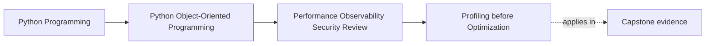

# Profiling before Optimization

<!-- page-maps:start -->
## Page Maps

<!-- page-maps:end -->

Read the first diagram as a placement map: this page is one concept inside its parent
module, not a detached essay, and the capstone is the pressure test for whether the
idea holds. Read the second diagram as the working rhythm for the page: name the
problem, study the example, identify the boundary, then carry one review question
forward.

## Why this lesson matters

Optimization discussions become much clearer once the team can point to a profile instead
of an opinion.

Without profiling, people often argue from:

- coding style
- personal intuition
- past experience with unrelated systems
- fear that abstraction must be expensive

Profiling matters because it converts those guesses into evidence about where time,
allocations, or blocking are actually concentrated in this system on this workload.

## A profile is useful only when tied to a real question

Before profiling, name the concern:

- is latency too high?
- is CPU time concentrated in one path?
- is serialization dominating response time?
- are retries or repeated loads inflating one workflow?

Without a question, profile output turns into a wall of numbers that invites random
tuning instead of design judgment.

## Read profiler output in architectural terms

A profile is not most useful when it says:

- line 87 is hot

It is most useful when it helps answer:

- is the pressure in domain logic, boundary I/O, or representation churn?
- are we paying for repeated repository crossings?
- is one projection or report path building too many transient shapes?
- is one cache miss path dominating user-visible latency?

This is the move from raw profiling data to design evidence.

## Different tools answer different questions

No single profile tells the whole story.

You may need:

- CPU profiling for execution hotspots
- allocation profiling for object churn
- tracing or timing spans for cross-boundary workflow time
- focused micro-measurement only after the wider workflow pressure is known

The lesson is not to memorize tools. It is to match the profiling route to the
performance question.

## Optimize the boundary that actually hurts

Students often jump from one hot function to one micro-optimization.

But many real wins come from changing a wider boundary:

- fewer repository round-trips
- less repeated serialization
- narrower projection work
- clearer cache placement

If the architecture is causing repeated cost, a clever local loop is often the wrong
target.

## Re-measure after each meaningful change

A performance claim is incomplete without:

- before evidence
- after evidence
- the semantic contract that stayed intact

This matters because some optimizations add complexity without real gain, while others
seem small but materially change the workflow. Re-measurement is what distinguishes the
two.

## A worked example

Suppose the capstone shows slow operator-facing review output.

A useful profiling route could be:

1. run the full review workflow under representative data
2. identify whether time is dominated by repository access, projection, serialization, or formatting
3. if projection dominates, inspect where transient objects or repeated work accumulate
4. change one boundary or one object-creation pattern
5. re-run the same workflow to compare before and after

This is much stronger than arguing that "the reporting code looks inefficient."

## Preserve meaning while tuning

Just like measurement, profiling should keep one design question visible:

- what must not change while we make this faster?

Examples:

- ordering must remain stable
- freshness rules must remain honest
- aggregate authority must stay where it belongs
- error behavior must not become vague or hidden

If the optimization changes those truths, the result may be faster and still worse.

## Common mistakes

- profiling after deciding the answer in advance
- reading line-level heat without translating it into architectural causes
- using a microbenchmark to justify a workflow-wide conclusion
- optimizing one local hotspot while the real cost sits at a boundary
- failing to re-measure after adding complexity

## Review checklist

| Question | Good sign |
| --- | --- |
| does the profile answer a named performance question? | yes |
| has the hotspot been translated into an architectural explanation? | yes |
| is the proposed optimization targeting the real source of pressure? | yes |
| is there before-and-after evidence under the same workload? | yes |

## Capstone connection

Use the capstone to ask:

- which workflow should be profiled first because users or operators would feel its slowness directly?
- where does the profile point to one boundary-level redesign instead of one local trick?
- what semantic guarantee has to remain explicit while the change is evaluated?

This is where performance work becomes reviewable instead of speculative.

## Exit check

Leave this lesson only when you can do all of these:

- explain why a profile must answer a specific question instead of merely produce data
- identify one capstone workflow that deserves profiling next
- state one example of turning raw profiler output into an architectural diagnosis
