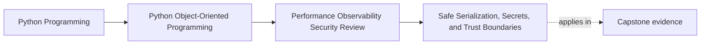

# Safe Serialization, Secrets, and Trust Boundaries

<!-- page-maps:start -->
## Page Maps

<!-- page-maps:end -->

Read the first diagram as a placement map: this page is one concept inside its parent
module, not a detached essay, and the capstone is the pressure test for whether the
idea holds. Read the second diagram as the working rhythm for the page: name the
problem, study the example, identify the boundary, then carry one review question
forward.

## Why this lesson matters

The moment object state is serialized, logged, queued, or exported, it stops being an
internal implementation detail and becomes a trust-boundary artifact.

That changes the review questions:

- what leaves the process?
- what could be reconstructed or replayed unsafely?
- which secrets or sensitive identifiers might leak?
- which formats allow too much magic or ambiguity?

Serialization is not harmless data movement. It is one of the most security-sensitive
places where design meets operation.

## Trust boundaries should be named explicitly

Useful boundaries include:

- process memory to log file
- domain object to wire payload
- internal state to persistent snapshot
- public command to decoded request object

If a team cannot say where the boundary is, it often cannot explain what the
representation is allowed to contain.

## Explicit codecs are safer than magical reconstruction

Safer serialization usually means:

- deliberate fields
- controlled formats
- narrow decoding rules
- no implicit object resurrection

The more a format tries to recreate live objects automatically, the more likely it is to
smuggle in:

- unsafe code execution paths
- privilege confusion
- unexpected state shape

Explicit codecs are more work up front, but they make trust decisions visible.

## Secrets should be hard to leak by default

Sensitive values should not appear automatically in:

- `repr`
- debug dumps
- snapshot fixtures
- logs
- convenience JSON output

Safe defaults usually mean:

- omitting the field
- redacting it
- hashing or tokenizing it when only correlation matters

This should be consistent, not left to each caller or logger to reinvent.

## Representation is part of the security contract

Two outputs may both "work" and still differ greatly in risk.

A good review asks:

- does this representation include only what the consumer truly needs?
- does it reveal internal structure that should stay private?
- could it be replayed, forged, or misread more easily than intended?

This keeps serialization tied to least-exposure discipline rather than to convenience.

## Safe logging is part of the same problem

Teams often treat logging and serialization as separate topics, but the trust questions
overlap:

- what fields are visible?
- who can read them?
- how long will they live?
- what redaction policy applies?

If one object is safe for internal memory but unsafe for logs, that difference should be
designed deliberately.

## Capstone connection

Use the capstone to ask:

- which serialized outputs cross a real trust boundary?
- which `repr`, logging, or snapshot shapes might currently expose too much?
- where should a narrow explicit codec replace a more magical or over-broad dump?

## Exit check

Leave this lesson only when you can do all of these:

- explain why serialization is a trust-boundary concern, not just a format concern
- identify one capstone representation that needs redaction or narrowing
- explain why explicit codecs are usually safer than magical object reconstruction
