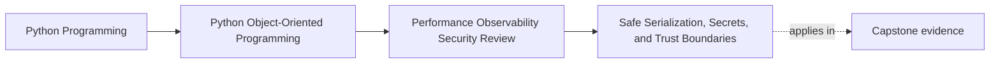

# Safe Serialization, Secrets, and Trust Boundaries

<!-- page-maps:start -->
## Page Maps

<!-- page-maps:end -->

This lesson is about treating every representation as a boundary decision.

The moment state is:

- serialized
- logged
- queued
- stored
- echoed back to a caller

it stops being an internal implementation detail and becomes a trust-boundary artifact.

That changes the review questions.
The new question is not "can this be encoded?"
It is:

- what is leaving the trusted boundary
- what could be replayed or reconstructed unsafely
- what sensitive information is now easier to expose
- what representation is broader than the consumer truly needs

## Keep one capstone route visible

Use one whole-system path:

1. external input enters a workflow
2. the workflow normalizes it into domain meaning
3. authoritative state is persisted
4. derived events, logs, or artifacts are emitted
5. later consumers inspect or replay some representation of that work

Now ask:

Which of those representations truly need to exist outside the process, and how narrow
can each one become while still serving its consumer?

That is the heart of the trust-boundary review.

## Trust boundaries should be named explicitly

Useful examples in this course include:

- request payload to decoded command object
- domain object to durable snapshot or row data
- workflow state to log entry
- artifact metadata to outward response
- internal event to queue or sink payload

If a team cannot name the boundary, it usually cannot explain what the representation is
allowed to contain.

Explicit boundary names make exposure decisions reviewable instead of accidental.

## Explicit codecs are safer than magical reconstruction

Safer serialization usually means:

- deliberate fields
- explicit encode and decode steps
- narrow accepted formats
- no hidden object resurrection

The more a format tries to recreate live objects automatically, the more likely it is to
invite:

- unsafe code execution paths
- privilege confusion
- surprise state shape
- representations that outlive the assumptions they were built under

Explicit codecs are more work up front, but they make trust decisions visible.

## Least exposure is part of the contract

A strong representation includes only what the next boundary really needs.

Ask:

- does the consumer need the full object or only a stable summary
- does this payload reveal internal structure that should stay private
- could this format be replayed or forged more easily than intended
- does the representation mix trusted truth with untrusted source detail

Working output is not enough.
Useful output can still be over-broad and risky.

## Secrets should be hard to leak by default

Sensitive values should not appear automatically in:

- `repr`
- debug dumps
- logs
- snapshot fixtures
- convenience JSON output

Safer defaults usually mean:

- omit the field
- redact the field
- replace it with a token or correlation-safe id

This should be a designed default, not a habit every caller must remember under pressure.

## Logging and serialization are the same governance problem

Teams often treat them separately.
They should not.

The trust questions overlap:

- who can read this representation
- how long will it live
- what will it reveal later
- what redaction rule applies
- what damage appears if it is copied or replayed

If a value is safe in process memory but unsafe in logs, that difference must be shaped
deliberately.

## A worked capstone review

Suppose the capstone emits:

- callback or command intake payloads
- repository-backed progress state
- certificate or notification metadata
- debug or audit logs for outward workflow boundaries

An honest trust-boundary review might conclude:

- callback payloads should be normalized before domain entry
- persisted workflow state should store only the fields needed for durable progress
- outward artifact metadata should avoid personal or replayable storage details
- logs should use stable ids and bounded error categories rather than dumping payload
  contents

That review is strong because it narrows each representation by purpose.

## Build a representation packet

For each boundary, keep a short packet with:

- boundary name
- representation consumer
- fields or categories that must be present
- fields that must be redacted or omitted
- risk if the representation is replayed, leaked, or misread

This packet makes serialization and redaction review teachable to another maintainer.

## Common failure modes

- treating serialization as a pure format choice instead of a trust choice
- logging entire objects because it is convenient for debugging
- using magical codecs that recreate more state than the boundary should trust
- allowing secrets or sensitive identifiers to appear by default in outward
  representations
- publishing representations broader than the consumer actually needs

## Trust-boundary review card

Use this short card when reviewing a representation:

| Question | What you want to see |
| --- | --- |
| is the trust boundary named explicitly? | yes |
| does the representation contain only what the next consumer needs? | yes |
| are secrets and sensitive fields omitted or redacted by default? | yes |
| would replay or leakage cause bounded rather than surprising damage? | yes |

## Capstone connection

Use this page to ask:

- which capstone representation most needs narrowing or redaction
- where an explicit codec should replace a broader or more magical dump
- which log, payload, or artifact currently reveals more than its consumer truly needs

That is where trust-boundary review becomes part of the architecture instead of a final
security pass.

## Exit check

Leave this lesson only when you can do all of these:

- explain why serialization is a trust-boundary concern, not just a format concern
- identify one capstone representation that needs narrowing or redaction
- explain why explicit codecs are usually safer than magical object reconstruction
