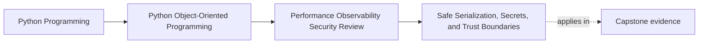

# Safe Serialization, Secrets, and Trust Boundaries

<!-- page-maps:start -->
## Page Maps

<!-- page-maps:end -->

This lesson is about treating representation as a governance choice, not as a formatting
detail.

The moment information is:

- serialized
- logged
- queued
- persisted
- echoed back in a response
- turned into artifact metadata

it becomes a trust-boundary artifact.

At that point, the question is no longer:

- can we encode this object?

The real questions become:

- who is allowed to read this representation?
- how long might it survive?
- what could be reconstructed, replayed, or leaked from it?
- what information does the consumer actually need?

That is why serialization belongs in an OOP course about design boundaries. It decides
how much of your object model escapes the place where it was safe.

## Keep one end-to-end route visible

Use one capstone route while reading:

1. external input enters the workflow
2. the workflow normalizes that input into domain meaning
3. authoritative state is persisted
4. derived events, logs, notifications, or artifacts are emitted
5. another boundary later reads, replays, or diagnoses one of those representations

Now ask:

- which of these outward forms truly need to exist?
- how narrow can each one become without starving the next consumer?

Those two questions keep trust-boundary review grounded in purpose instead of fear.

## Name the boundary before reviewing the format

Do not start with JSON, YAML, rows, or log lines.

Start by naming the crossing:

- callback payload -> normalized command
- domain object -> durable progress row
- workflow state -> operator-visible log event
- issuance state -> artifact metadata
- internal event -> sink payload

Once the boundary is named, the review becomes clearer:

- who is the consumer?
- what authority does the consumer have?
- what fields are necessary?
- what fields would over-share internal truth or sensitive detail?

If you cannot name the boundary, you probably cannot narrow the representation well.

## Explicit codecs make trust decisions visible

Safer representation usually means:

- explicit fields
- explicit encode and decode steps
- narrow accepted shapes
- deliberate rejection of extra or ambiguous data

This is usually safer than magical reconstruction that tries to "bring the object back"
automatically.

Why?

- object resurrection may trust data too broadly
- hidden reconstruction rules age badly when the model changes
- broad payloads tend to carry more than the next consumer actually needs
- replay and debugging risks grow when internal structure escapes intact

Explicit codecs are not just safer for security. They are easier to review because the
boundary decision is visible in one place.

## Least exposure is part of the contract

A strong outward representation includes only what the next consumer needs.

Ask for every field:

- does the next boundary need this to perform its job?
- is this field merely convenient for today's debugging?
- would the field reveal private structure, personal data, or replayable state?
- could the same diagnosis be supported with a stable identifier instead?

This is where many systems go wrong. They produce a useful representation, then stop
reviewing because the format "works." But a working payload can still be too broad.

## Logging and serialization are the same design problem

Teams often separate them:

- serialization is treated as application behavior
- logging is treated as operations behavior

That split is misleading. The core review questions are the same:

- who can read it?
- how long will it live?
- what would leakage reveal?
- what replay or search behavior becomes possible?
- what narrower representation would still do the job?

A value can be safe inside process memory and unsafe in logs, traces, or stored payloads.
That difference must be designed deliberately, not discovered during an incident.

## Secrets should be difficult to leak by default

Sensitive values should not appear automatically in:

- `repr`
- debug dumps
- default JSON encoders
- trace attributes
- snapshot fixtures
- diagnostic logs

Safer defaults usually mean:

- omit the field
- redact the field
- replace it with a stable but bounded identifier

The right question is not "can callers remember not to log this?" The right question is:

- why would the unsafe version be the default in the first place?

If secrecy relies on perfect discipline from every caller, the boundary has not really
been hardened.

## Worked capstone boundary review

Suppose the capstone emits all of these:

- callback intake payloads
- durable issuance progress rows
- certificate artifact metadata
- structured log events for notification or completion

A strong review might conclude:

- callback payloads should be normalized before domain entry and then discarded or
  narrowed
- durable progress should store only the fields required to resume or explain the
  workflow
- artifact metadata should avoid personal or replayable storage details unless a trusted
  consumer truly needs them
- logs should use stable ids and bounded outcome categories rather than raw payload dumps

This is stronger than saying "be careful with secrets." It attaches narrowing rules to
named boundaries and consumers.

## Build a representation packet

For each boundary, keep a short review packet with:

- boundary name
- consumer
- representation purpose
- fields that must exist
- fields that must be omitted or redacted
- whether an explicit codec exists
- damage if the representation leaks or is replayed

That packet gives another maintainer something concrete to review. It also helps you see
when two boundaries are being treated as if they had the same trust level when they do
not.

## Common failure modes

- reviewing the format without naming the boundary first
- logging whole objects because it is convenient during debugging
- using broad or magical codecs that recreate more than the consumer should trust
- keeping secrets out of documentation but allowing them in default runtime output
- persisting or publishing fields that exist only because "they might help later"

## Trust-boundary review card

Use this card for every outward representation:

| Question | What a strong answer sounds like |
| --- | --- |
| what boundary is being crossed? | "issuance state to operator-visible completion log" |
| who consumes this representation? | "operators and support tooling, not arbitrary external callers" |
| what fields are truly necessary? | "issuance id, workshop id, bounded outcome category" |
| what must be omitted or redacted? | "raw payloads, storage keys, personal details" |
| what damage would leakage or replay cause? | "searchable private locations or repeatable outward effects" |

## Capstone connection

Use this page to decide:

- which capstone representation most needs narrowing right now
- where an explicit codec should replace a broader convenience dump
- which diagnostic output is currently carrying more detail than the consumer needs
- where stable ids could replace dangerous payload detail

That is where serialization becomes part of the architecture instead of a late security
cleanup task.

## Exit check

Leave this lesson only when you can do all of these:

- explain why serialization is a trust-boundary decision rather than a mere format choice
- name one capstone boundary that needs a narrower outward representation
- explain how explicit codecs help make trust decisions visible and reviewable
