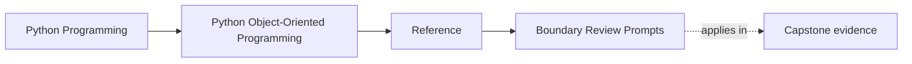

# Boundary Review Prompts

<!-- page-maps:start -->
## Page Maps

<!-- page-maps:end -->

Read the first diagram as a lookup map: this page is part of the review shelf, not a first-read narrative. Read the second diagram as the reference rhythm: arrive with a concrete ambiguity, compare the current work against the boundary on the page, then turn that comparison into a decision.

Use these prompts when a design crosses process, time, persistence, or extension
boundaries. These are the places where object-oriented systems usually stop being
clear unless the ownership rules are made explicit.

## How to use this page

Do not answer every section by default. Start with the kind of boundary you are
reviewing, then only use the neighboring sections if the boundary leaks into them.

Good inputs:

- one repository or codec boundary
- one runtime orchestration surface
- one plugin or extension seam
- one facade or public entrypoint

Weak input:

- "the whole architecture"

## Public API prompts

- Which names are intentionally public, and which names are only convenient today?
- Does the facade match a real domain or workflow boundary, or only the current package layout?
- Which promises are documented, and which promises only exist by accident?
- If a caller depended on this surface for a year, what would you be willing to support?

## Persistence prompts

- Does storage mapping preserve invariants, or can it bypass the authoritative owner?
- Which serialized shape is a contract, and which is only a storage convenience?
- Where is conflict detection, rollback, or migration responsibility visible?
- Which persistence shortcut would make saves easier while making the model less trustworthy?

## Runtime prompts

- Which object owns clocks, retries, queues, timeouts, async bridges, or worker coordination?
- Is runtime orchestration coordinating the domain, or quietly absorbing domain rules?
- Which behavior would become unsafe first under concurrency, cancellation, or retry pressure?
- Where should operational pressure terminate so the domain boundary stays narrow?

## Extension prompts

- What is the narrowest supported extension seam?
- Could an adapter, plugin, or subclass mutate internals it should never control?
- Which compatibility checks or review prompts would fail first if an extension broke the contract?
- Are you exposing an extension point because it is truly governable or because it is currently convenient?

## The verdict step

After answering the prompts for one boundary, force one explicit verdict:

- `keep` because ownership, proof, and review cost still line up
- `tighten` because convenient access is creating accidental authority
- `redesign` because the split no longer matches where the rule should live

If you cannot name one of those three verdicts, the review is probably still too vague.

## Evidence to ask for before accepting the boundary

- which guide, file, command, or test would you show another reviewer first
- which proof surface should fail first if this boundary drifts
- which neighboring boundary becomes simpler or safer because this one stayed narrow
- which nearby non-owner is now prevented from becoming accidentally authoritative

## Good answer shape

Use this structure when writing the result of the review:

1. name the boundary under review
2. name the rule or contract it must protect
3. name the verdict: `keep`, `tighten`, or `redesign`
4. name the first evidence surface
5. name the first failure you expect if drift begins
