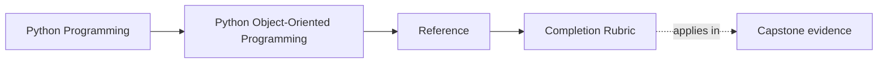

# Completion Rubric

<!-- page-maps:start -->
## Page Maps

<!-- page-maps:end -->

Use this page when you need to decide whether understanding is actually complete or
whether it still rests on class-shaped intuition and pattern recognition. The point is
not to declare yourself finished early. The point is to use a visible bar.

## Completion standard

You should be able to do all of the following:

- explain which object is authoritative for a given invariant or lifecycle rule
- distinguish values, entities, aggregates, policies, adapters, and read models clearly
- justify where mutation belongs and where it should be blocked
- explain how persistence, time, or concurrency should adapt to the domain rather than distort it
- review an object boundary by ownership, collaboration, and proof instead of by class count

## Completion by area

| Area | What a completed learner can do | What an incomplete learner still sounds like |
| --- | --- | --- |
| object semantics | explain identity, equality, copying, and representation choices intentionally | "it is just a class, so any of these would probably work" |
| boundary ownership | point to the object or layer that should absorb a change and defend the choice | "the rule could live in several places" without naming why |
| lifecycle and validation | state legal and illegal transitions and where they are enforced | rely on convention, nullable drift, or later cleanup |
| collaboration and extension | say which behavior belongs in the domain, orchestration, adapters, or extensions | confuse sources of truth with observers, helpers, or plugins |
| stewardship | write one architecture judgment backed by one file and one proof route | appeal to taste, style, or vibes instead of evidence |

## Three completion levels

### Foundation complete

You can:

- classify objects by meaning rather than syntax
- explain one invariant and its owner clearly
- reject at least one unnecessary class, service, or abstraction

### Design complete

You can:

- place behavior across values, entities, aggregates, services, repositories, and adapters deliberately
- explain how lifecycle, persistence, and runtime pressure interact with ownership
- choose a proof route that matches the claim you are making

### Stewardship complete

You can:

- mark a seam public, internal, or extension-safe with reasons
- identify one operational or trust-boundary risk without drifting into vagueness
- defend one keep/change verdict on the capstone with named evidence

## Capstone evidence

Use these as the minimum capstone evidence:

1. `make PROGRAM=python-programming/python-object-oriented-programming capstone-walkthrough`
2. `make PROGRAM=python-programming/python-object-oriented-programming test`
3. `make PROGRAM=python-programming/python-object-oriented-programming proof`

Running them is not enough if you cannot explain which object, rule, or boundary each
route is proving.

## Reviewer questions

- Which object owns this invariant?
- Which state is authoritative and which is only derived?
- Where should a new rule, sink, or projection land?
- Which proof route would fail first if that ownership story drifted?

## Honest signs you are not finished yet

- you can name the pattern but not the owner
- you can run the tests but cannot explain what they prove
- you describe most boundaries as "kind of shared"
- you still treat persistence, concurrency, or public APIs as later plumbing
- you rely on refactor familiarity rather than explicit judgments

## Exit check

Leave this page only when you can finish all three sentences honestly:

> The authoritative owner for `____` is `____`.
>
> The first evidence I would show for that claim is `____`.
>
> The next boundary I would review for drift is `____`.
