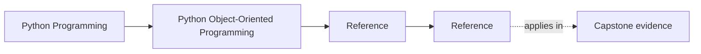
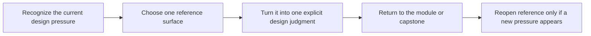

# Reference

<!-- page-maps:start -->
## Page Maps

<!-- page-maps:end -->

This shelf is for durable language, review criteria, and boundary questions. Use it when
the pressure is already recognizable and you need a stable reference surface to sharpen a
decision.

Do not use this shelf as a substitute for the lesson. If the concept itself is still
unclear, go back to the module or capstone page that teaches it. Reference pages are for
judgment, not for first exposure.

## Choose the reference page by question

| If your question is... | Best page | What it should help you do |
| --- | --- | --- |
| What does this term mean in this course? | [Glossary](glossary.md) | keep the vocabulary stable instead of drifting into private definitions |
| Why does this module come before or after that one? | [Module Dependency Map](module-dependency-map.md) | understand the course order as a learning dependency, not a publishing accident |
| What should I practice or prove next? | [Practice Map](practice-map.md) | choose the next deliberate repetition instead of rereading passively |
| How should I review this object or boundary? | [Review Checklist](review-checklist.md) | turn design review into explicit criteria |
| Which sharper ownership question should I ask? | [Boundary Review Prompts](boundary-review-prompts.md) | expose weak boundaries before they harden |
| How do I test whether I actually remember this? | [Self-Review Prompts](self-review-prompts.md) | turn reading into active recall |
| What failure shape am I probably seeing? | [Anti-Pattern Atlas](anti-pattern-atlas.md) | identify recurring design distortions without hand-waving |
| What counts as genuinely complete understanding here? | [Completion Rubric](completion-rubric.md) | distinguish familiarity from defensible understanding |
| Does this topic belong in the center of the course or at its edge? | [Topic Boundaries](topic-boundaries.md) | keep scope honest and stop importing unrelated concerns |

## What this shelf is good for

Use it to:

- keep ownership, lifecycle, and collaboration language stable
- review object, aggregate, public, and extension boundaries with explicit criteria
- connect module order to practice and capstone proof routes
- detect when a boundary is earning its complexity and when it is only accumulating noise

## What this shelf is bad for

Do not use it for:

- first-time learning of a concept the modules have not yet taught you
- passive rereading when you are avoiding exercises or proof
- replacing the capstone when the real question is executable evidence
- pretending a checklist is understanding

If one of those is happening, leave this shelf and return to the lesson or capstone.

## Good entry routes by learner need

| Learner need | Best first reference page |
| --- | --- |
| I need the course vocabulary to stop shifting under me | [Glossary](glossary.md) |
| I need to know whether I am practicing the right thing next | [Practice Map](practice-map.md) |
| I need sharper questions for a fuzzy design review | [Boundary Review Prompts](boundary-review-prompts.md) |
| I need to diagnose a recurring design smell | [Anti-Pattern Atlas](anti-pattern-atlas.md) |
| I need an honest completion bar | [Completion Rubric](completion-rubric.md) |

## Strong reference rhythm

1. Name the exact question.
2. Open one reference page only.
3. Turn it into one explicit design judgment or next action.
4. Return to the module, exercise, or capstone.

The reference shelf is working only if it sends you back to real study or review.

## Companion pages outside reference

| Need | Best page |
| --- | --- |
| route selection before the pressure is clear | [Guides](../guides/index.md) |
| course-stage orientation | [Course Map](../module-00-orientation/course-map.md) |
| executable system route | [Capstone](../capstone/index.md) |
| proof-route selection | [Proof Matrix](../guides/proof-matrix.md) |

## Exit check

Leave this page only when you can say:

> My recognized pressure is `____`, the right reference page is `____`, and the design
> judgment or next move it gave me is `____`.
