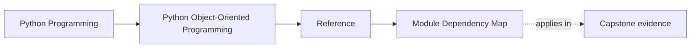
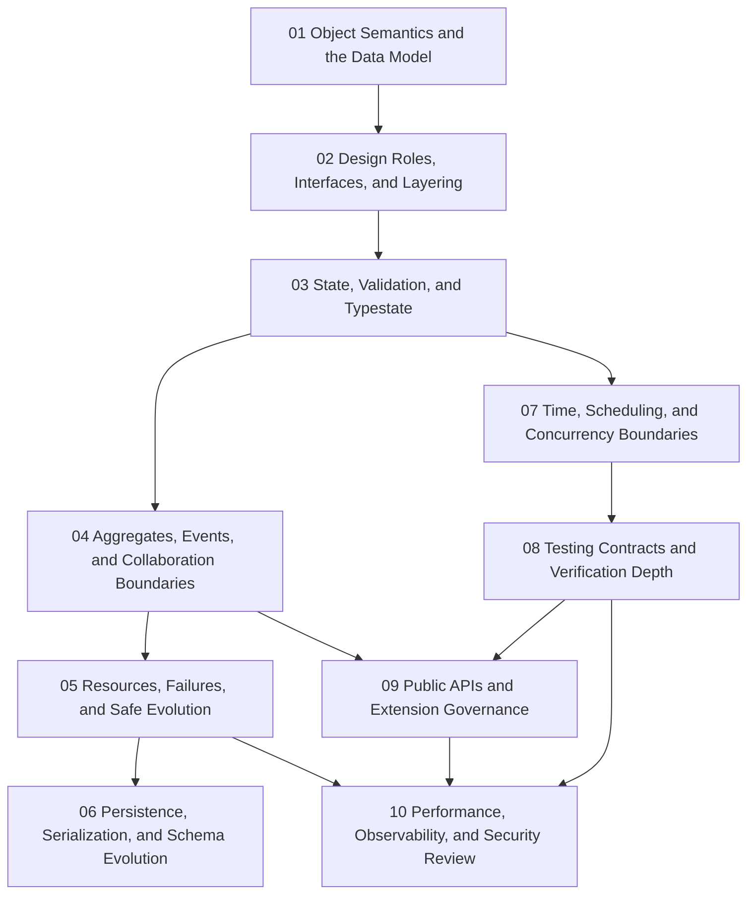

# Module Dependency Map

<!-- page-maps:start -->
## Page Maps

<!-- page-maps:end -->

Use this page when you remember a topic name but no longer remember why the course put
it where it did. The goal is not only navigation. The goal is to stop you from treating
later design pressures as if they were detachable tricks.

## Main sequence

## What the arrows really mean

An arrow here means more than "this topic comes earlier." It means the later module
borrows language, assumptions, and review habits from the earlier one.

Use this map with three questions:

1. Which earlier module gives meaning to the thing I am now trying to review?
2. Which missing foundation is making a later chapter feel harder than it should?
3. Which module should I revisit when a design decision starts sounding arbitrary?

## Dependency story by module

| Module | Depends most on | What it inherits | What breaks when you skip that inheritance |
| --- | --- | --- | --- |
| 01 | none | the runtime meaning of objects, equality, identity, copying, and representation | every later design discussion turns into pattern talk without semantics |
| 02 | 01 | object meaning and responsibility vocabulary | interfaces, layers, and inheritance choices feel stylistic instead of necessary |
| 03 | 01-02 | clear roles plus object boundaries stable enough to carry lifecycle rules | validation becomes scattered and null-heavy because no owner is trusted |
| 04 | 02-03 | authoritative ownership and legal state transitions | aggregates, events, and projections blur together |
| 05 | 03-04 | lifecycle discipline plus collaboration boundaries | failures, cleanup, and evolution leak into random places |
| 06 | 03-05 | invariants worth preserving and boundaries worth adapting to | storage starts redefining the model |
| 07 | 03-05 | owned mutation, lifecycle rules, and failure boundaries | time and concurrency pressure dissolve ownership |
| 08 | 01-07 | the full set of claims the design is actually making | proof depth becomes guesswork |
| 09 | 02-08 | roles, contracts, and evidence strong enough to publish safely | internal convenience seams get mislabeled as public APIs |
| 10 | all earlier modules | a complete design and review vocabulary | hardening turns into a checklist instead of a judgment |

## Four recovery patterns

### When Module 4 feels foggy

Go backward to Modules 2 and 3. Aggregates usually feel mysterious because role
ownership or lifecycle ownership is still unstable.

### When Module 6 feels too abstract

Go backward to Modules 3, 4, and 5. Persistence becomes concrete once you know which
invariants matter, who owns them, and how failure pressure should terminate.

### When Module 8 feels too broad

Go backward to the module that contains the claim you are trying to prove. Testing
gets clearer when the target claim is named precisely.

### When Module 9 or 10 feels political instead of technical

Go backward to Modules 4 through 8. Governance and hardening feel vague only when the
system's ownership, proof, and boundary story is still incomplete.

## Best routes for different learners

| Learner | Safe entry route | Why this route works |
| --- | --- | --- |
| first full-pass learner | Modules 1 through 10 in order | every later judgment depends on earlier vocabulary |
| maintainer joining an existing codebase | 3 -> 4 -> 5 -> 8 -> 9, then backfill 1 and 2 as needed | ownership, lifecycle, and proof usually matter before taxonomy elegance |
| architecture reviewer | 4 -> 6 -> 8 -> 9 -> 10, then revisit 2 and 3 when authority is unclear | collaboration, storage, and public contract pressure expose the sharpest risks fastest |
| runtime or operations-minded learner | 5 -> 7 -> 8 -> 10, then revisit 3 and 4 | failure, concurrency, and hardening depend on earlier state and boundary rules |

## Signals that you need to go backward

- you are describing a boundary as "kind of shared"
- you keep saying "it depends" without naming the owner
- you are debating test style before naming the design claim
- persistence or concurrency is being discussed as if it can invent domain rules
- extension decisions feel like package layout arguments rather than contract arguments

## Exit check

Leave this page only when you can finish the sentence:

> I need `module __` before `module __` because without it I cannot honestly explain `____`.
