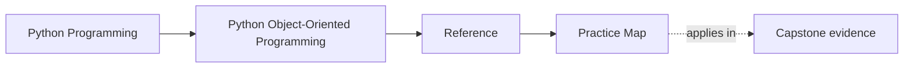
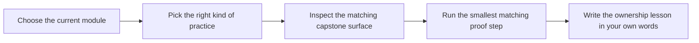

# Practice Map

<!-- page-maps:start -->
## Page Maps

<!-- page-maps:end -->

Use this page when you do not want more theory first. It tells you what kind of practice
best fits each stage of the OOP course and how to connect that practice back to the
capstone.

## Practice by module

| Module | Best practice shape | Best capstone follow-up | Best proof loop |
| --- | --- | --- | --- |
| 01 | value versus entity comparison, equality design, and representation decisions | inspect `model.py`, `rules.txt`, and lifecycle tests | say what the type owns, then show which behavior would fail if that ownership drifted |
| 02 | role placement drills: move behavior among values, entities, policies, services, and adapters until the boundary becomes least surprising | compare `application.py`, `model.py`, and the architecture guide | justify why the chosen role is better than the closest alternative |
| 03 | lifecycle and validation labs that make illegal states or transitions harder to construct | inspect lifecycle tests and inspection bundle outputs | list legal transitions, blocked transitions, and the owner of the guard |
| 04 | aggregate and collaboration exercises that force one clear authoritative owner | inspect projections, read models, and architecture surfaces | name the aggregate, then show which views are derived instead of authoritative |
| 05 | failure and evolution reviews: retries, cleanup, rollback, and change-cost placement | inspect `runtime.py`, `repository.py`, and unit-of-work tests | explain which object absorbs failure pressure and why |
| 06 | persistence-boundary reviews: repositories, codecs, schema pressure, and rehydration choices | inspect repository boundaries and verification bundle artifacts | separate domain meaning from storage shape explicitly |
| 07 | runtime-boundary labs: clocks, queues, tasks, threads, and async coordination | inspect runtime tests and walkthrough artifacts | name where time enters and where ownership must stop moving |
| 08 | proof-design exercises: pick the narrowest test or bundle that actually proves the claim | inspect tests, verification bundle, and proof routes | say why a lighter or heavier route would be wrong |
| 09 | extension and public-surface reviews: decide what is allowed, internal, and governable | inspect application surface, extension guide, and proof routes | explain where a new public behavior may land without dissolving the model |
| 10 | stewardship review: write one architecture judgment backed by one evidence route | inspect the full proof route and review worksheet | defend one keep/change decision with a named artifact |

## Reusable practice loops

| Loop | Use it when... | What to produce |
| --- | --- | --- |
| ownership loop | the hardest part is deciding who should carry the behavior | one sentence naming the owner, one sentence naming the nearest non-owner |
| lifecycle loop | states and transitions are the problem | a table of legal and illegal transitions plus the enforcing boundary |
| projection loop | you keep confusing authoritative and derived state | one list of truths, one list of views |
| extension loop | a change could plausibly land in several places | one chosen boundary, one rejected boundary, one reason for each |
| proof loop | you know the claim but not the evidence size | one first route, one first artifact, one escalation trigger |

## Good practice habits

- practice one boundary at a time
- say the ownership rule aloud before changing code or diagrams
- inspect one capstone surface during the exercise, not only after it
- stop after one design question becomes materially clearer

## Bad practice habits

- doing all practice as open-ended opinion
- skipping the capstone follow-up entirely
- using the strongest proof route for every exercise
- writing answers that never name the owner, the non-owner, or the first evidence surface

## Exit check

Leave this page only when you can say:

> For this module, the best practice is `____`, the capstone follow-up is `____`,
> and the first proof loop I should run is `____`.
