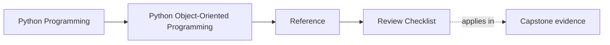
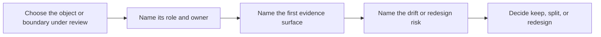

# Review Checklist

<!-- page-maps:start -->
## Page Maps

<!-- page-maps:end -->

Use this checklist when reviewing any design in the course or capstone. It is not a
checklist for "more classes" or "clean code vibes." It is a checklist for ownership,
authority, mutation, collaboration, and evidence.

## Identity and role

- What is this thing: value, entity, aggregate, policy, adapter, facade, repository, or runtime boundary?
- Would another engineer likely describe its role the same way after reading one file?
- Does its name describe the contract, not just the implementation trick?

## Ownership and authority

- Which invariant does this object or boundary own directly?
- Which state is authoritative here?
- Which state is only derived, cached, or convenient to inspect?
- Which nearby boundary is *not* allowed to answer the same question?

## Mutation and lifecycle

- Does the API make legal transitions easier than illegal ones?
- Are invalid states blocked at construction or transition time instead of tolerated quietly?
- Is mutation visible only where the ownership boundary justifies it?

## Collaboration and dependency direction

- Does this boundary depend on the right abstractions for its role?
- Is composition more honest here than inheritance?
- If it emits events or calls adapters, does it still preserve a clear source of truth?
- Would removing this boundary make a neighboring boundary simpler or dangerously heavier?

## Evolution and change pressure

- What would need to change if a new behavior arrived tomorrow?
- Would that change stay local, or would it ripple through several unrelated files?
- Does this boundary keep compatibility pressure local?
- If this boundary changed representation, which callers should remain unaffected?

## Proof and review

- Which test, bundle, or guide would fail first if the ownership claim stopped being true?
- Which capstone surface shows the same role clearly?
- Which lighter proof route should be tried before the strongest one?
- If the boundary feels wrong, is the problem semantics, collaboration, runtime pressure, or public surface design?

## Keep, split, or redesign

| Verdict | Use it when... |
| --- | --- |
| keep | one ownership story still explains the invariant, mutation, and public contract cleanly |
| split | two different authorities are hiding behind one convenient object or module |
| redesign | callers need to know private sequencing, cleanup, storage, or runtime details to use the boundary safely |

## Fast review prompts

- If I changed this tomorrow, who should become suspicious first?
- Which neighboring boundary would get simpler if this one were carrying the right burden?
- Am I reviewing a real owner, or only a place where work happened to collect?
- Is the evidence route proportionate to the claim I am making?

## Exit check

Leave this checklist only when you can say:

> This boundary should be `keep` / `split` / `redesign` because `____` owns `____`,
> `____` is only derived, and `____` would reveal the drift first.
