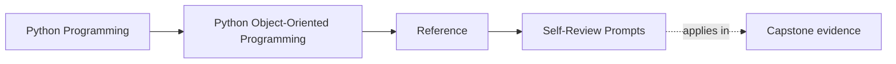

# Self-Review Prompts

<!-- page-maps:start -->
## Page Maps

<!-- page-maps:end -->

Use this page when you want practice that improves review judgment, not flash-card
memory. A strong answer to these prompts should sound like a design review, a refactor
decision, or an architecture note.

## How to use these prompts well

Pick one concrete object, boundary, or module claim before you start. If you answer the
questions in the abstract, the exercise becomes vague very quickly.

Good inputs:

- a class or value object from the capstone
- one repository, service, policy, aggregate, or adapter under review
- one lesson claim from the current module

Weak inputs:

- "the architecture"
- "object-oriented design in general"
- "all of the persistence layer"

## Semantic prompts: what kind of thing is this?

- What makes this object a value, an entity, an aggregate root, a policy object, or none of those?
- Which part of its contract depends on identity, and which part depends on value semantics alone?
- If two engineers disagreed about what this object is, which file or behavior should settle the argument?
- Which mutation preserves the object's meaning, and which mutation quietly changes what the object is?

## Ownership prompts: who gets final authority?

- Which invariant belongs here, and why is the nearest neighbor the wrong owner?
- Where does orchestration stop and authoritative domain behavior begin?
- Which question should callers ask this boundary directly, and which question should they never ask it?
- If a new rule arrived tomorrow, where should it land first and why?

## Lifecycle prompts: when is the object allowed to change?

- Which illegal state is still too easy to construct?
- Which transition is currently implied by habit instead of made explicit in the API?
- Which method or boundary should reject the invalid transition first?
- Which field is pretending to model lifecycle when the real problem is a missing state boundary?

## Collaboration prompts: how do neighboring boundaries stay honest?

- Which collaboration is necessary, and which one exists only because ownership is unclear?
- Where is the boundary between an authoritative object and a derived view, cache, or projection?
- Which event, policy, or adapter should react to the change without becoming the source of truth?
- Which dependency direction would become suspicious if one more feature landed here?

## Persistence prompts: what must storage not be allowed to redefine?

- Which storage concern is threatening to reshape the domain model?
- Which serialized or stored shape belongs only to transport or persistence?
- Which invariant could be bypassed during rehydration, upcasting, or bulk loading?
- Which repository or codec decision would make the object easier to save but harder to trust?

## Runtime prompts: where should execution pressure terminate?

- Which runtime pressure belongs outside the aggregate or domain boundary?
- Where do clocks, retries, timeouts, queues, or async coordination first become visible?
- Which mutation would become dangerous first under concurrency or cancellation?
- Which boundary should absorb operational pressure so the domain contract stays narrow?

## Proof prompts: what evidence is honest enough?

- What exactly is the claim you are making about this object or boundary?
- What is the smallest honest proof route for that claim?
- Which stronger route would be wasteful, and which weaker route would be misleading?
- Which test, bundle, or walkthrough should fail first if the ownership story drifted?

## Good answer shape

Aim to answer each prompt in this format:

1. name the owner or boundary directly
2. name the nearest tempting non-owner
3. explain the difference in one or two sentences
4. name the first evidence surface you would inspect

## Best companion pages

- `review-checklist.md`
- `boundary-review-prompts.md`
- `anti-pattern-atlas.md`
- `topic-boundaries.md`
