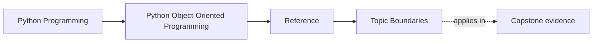

# Topic Boundaries

<!-- page-maps:start -->
## Page Maps

<!-- page-maps:end -->

Read the first diagram as a lookup map: this page is part of the review shelf, not a first-read narrative. Read the second diagram as the reference rhythm: arrive with a concrete ambiguity, compare the current work against the boundary on the page, then turn that comparison into a decision.

Use this page when you need to decide whether a topic belongs in the center of this
course, near its edge, or outside its teaching promise entirely. This boundary matters
because OOP courses become muddy when every advanced Python topic is treated as equally
central.

## What this course is centrally about

These topics are the spine of the course:

- object semantics: identity, equality, aliasing, copying, and attribute lookup
- ownership and responsibility assignment across values, entities, services, and adapters
- state design: validation, typestate, null pressure, and lifecycle transitions
- collaboration boundaries: aggregates, policies, events, projections, and read models
- survivability: cleanup, failure handling, compatibility, persistence, and schema change
- runtime pressure: time, queues, threads, async boundaries, and owned mutation
- proof and governance: tests, contracts, public APIs, extension seams, observability, and security

If a question changes who owns behavior, how invariants survive, or how a boundary
remains governable under change, it belongs in the center of this course.

## Three boundary bands

### Central topics

Keep the topic in this course when the question is fundamentally about:

- meaning: identity, equality, aliasing, copying, representation, and lifecycle
- ownership: which object, aggregate, service, repository, or adapter owns the rule
- survivability: how the design stays honest under storage, time, failure, extension, or review pressure
- proof: how to verify that the contract is still true

These questions are the actual curriculum.

### Adjacent topics

Use adjacent material when the topic matters, but only because it changes object-design
decisions:

- type-checker details beyond what is needed for protocols, contracts, and API design
- ORM or framework APIs beyond the design pressure they introduce
- database indexing, SQL tuning, and deployment mechanics
- low-level performance tuning once the ownership model is already correct
- distributed-systems patterns that go beyond the in-process or single-service boundary

The course should mention these when they distort or sharpen object design. It should
not turn into a framework manual, infrastructure catalog, or vendor tour.

### Outside topics

Move outside the course center when the question is mainly about:

- beginner syntax for `class`, `self`, inheritance, or decorators
- broad meta-programming coverage of descriptors, `__init_subclass__`, or metaclasses
- functional-programming-first design except where OOP and FP choices meet directly
- database administration, deployment pipelines, or cloud operations
- broad secure-coding coverage unrelated to trust boundaries, public APIs, or serialization

Those topics can be important. They are simply not the main teaching promise here.

## Common boundary confusions

| Confusion | Better boundary |
| --- | --- |
| “OOP means class syntax and design patterns.” | OOP here means explicit ownership, invariants, and change boundaries. |
| “If a framework uses classes, the framework itself is the curriculum.” | Frameworks are examples of pressure, not the subject. |
| “Persistence is a storage topic, not an object-design topic.” | Persistence belongs here because storage can corrupt or preserve domain contracts. |
| “Concurrency is infrastructure, not OOP.” | Concurrency belongs here when it changes ownership, mutation, and lifecycle guarantees. |
| “Security is separate from OOP.” | Security belongs here when trust boundaries, serialization, or public APIs change the object contract. |

## How to decide quickly

Use this table when you are unsure whether to stay here or step sideways:

| If the real question is... | Stay here? | Why |
| --- | --- | --- |
| who owns this rule? | yes | ownership is the core currency of the course |
| what state is authoritative? | yes | the course is built around preserving authority under change |
| which framework flag enables this behavior? | usually no | that is tool usage unless it changes the design boundary |
| how do I tune this database query? | usually no | useful, but not object-design central by itself |
| should this object model survive serialization, retries, or concurrency? | yes | those pressures are central here because they reshape contracts |
| how do I write a metaclass for clever API generation? | usually no | the course cares more about boundary clarity than meta-programming breadth |

## A good scope test for any new page or question

Before you spend serious study time here, ask:

1. Does this topic change who owns behavior or invariants?
2. Does it change what must remain authoritative over time?
3. Does it change how the design is reviewed, extended, or proven?

If the answer is no to all three, the topic is probably adjacent or outside.

## Exit check

Leave this page only when you can say:

> This topic belongs `inside` / `adjacent to` / `outside` the course center because it does or does not change `____`.
