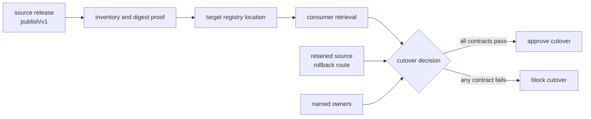
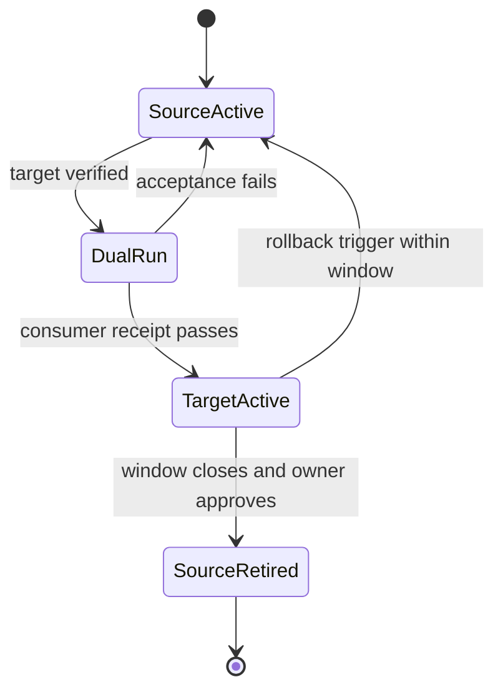

# Boundary migration audit guide

A migration is not proved by a successful copy. The copy answers only one
question: did some bytes reach a destination? A safe cutover must also show that
the right bytes arrived, only the declared boundary changed, consumers can use
the new boundary, the old route remains recoverable, and every operational
responsibility still has an owner.

This guide teaches that argument with an executable specimen. The specimen
moves an already promoted release from `publish/v1` into a registry location
named `incident-escalation/2026-07`. It does not create a new release. That
distinction is the heart of the exercise.

## The claim under review

The migration contract permits one change:

| Surface | Before | After | May change? |
|---|---|---|---:|
| consumer location | `publish/v1` | `incident-escalation/2026-07` | yes |
| artifact inventory | seven promoted files | the same seven files | no |
| artifact bytes | source digests | matching target digests | no |
| release meaning | approved incident-escalation release | the same release | no |
| source provenance | recorded source revision | the same revision | no |
| consumer behavior | read the promoted contract | read the same contract elsewhere | location only |

Calling the operation a migration does not enforce this table. The contract,
decision record, file inventories, and retrieval receipt make the claim
reviewable.



## Build the evidence bundle

From the repository root, run:

```console
make PROGRAM=reproducible-research/deep-dive-dvc \
  capstone-boundary-migration-audit
```

The route writes to:

```text
artifacts/audit/reproducible-research/deep-dive-dvc/boundary-migration/
```

Start with `route.txt`, then read `migration-contract.json` and `report.json`.
Do not begin by reading the Python implementation. A reviewer should understand
the decision from the evidence before inspecting how the auditor computed it.

To run only the adversarial checks:

```console
make PROGRAM=reproducible-research/deep-dive-dvc \
  capstone-boundary-migration-selftest
```

## Read the contract as a change budget

`migration-contract.json` is a budget, not a description written after the
work. It names:

- the exact source and target boundaries;
- the single surface permitted to change;
- the invariants that must survive;
- the required before and after proofs;
- the rollback expectation;
- the consumer acceptance proof;
- the ownership split;
- the required shape of any exception.

The most important review move is to compare the declared changed surfaces
with the actual operation. If a migration changes location and metric schema,
two independent decisions have been bundled together. Matching target files
cannot repair that governance error.

## Inspect one contrast at a time

The audit constructs one accepted case and seven rejected cases. Each rejected
case changes one fact. This isolation lets you learn what each check proves.

| Finding | Deliberate defect | Failed check | Why cutover stops |
|---|---|---|---|
| `COMPLETE_CUTOVER` | none | none | every required proof is present |
| `PARTIAL_COPY` | `report.md` absent at target | `target_matches_source` | target cannot represent the approved release |
| `UNBOUNDED_CHANGE` | metric schema added to changed surfaces | `one_boundary_changes` | migration silently becomes a release change |
| `NO_ROLLBACK` | source not retained as a ready route | `rollback_is_ready` | recovery depends on invention during failure |
| `UNVERIFIED_CONSUMER` | retrieval receipt removed | `consumer_cutover_is_verified` | storage success is mistaken for usability |
| `OWNERLESS_TARGET` | registry owner removed | `responsibilities_have_owners` | failures at the target have no accountable response |
| `STALE_EXCEPTION` | exception expired | `exception_is_current` | temporary debt has become ungoverned permanent state |
| `TOOL_OWNERSHIP_OVERREACH` | DVC and registry duties swapped | `tool_boundaries_match_policy` | tool capability is confused with system ownership |

Open `workspace/complete-cutover/assessment.json`. Then compare it with exactly
one blocked assessment. For example:

```console
jq '{finding, decision, failed_checks}' \
  artifacts/audit/reproducible-research/deep-dive-dvc/boundary-migration/workspace/complete-cutover/assessment.json

jq '{finding, decision, failed_checks}' \
  artifacts/audit/reproducible-research/deep-dive-dvc/boundary-migration/workspace/unverified-consumer/assessment.json
```

The contrast should reveal one changed fact and one changed decision.

## Separate byte identity from release identity

The source and target inventories record relative path, byte count, and SHA-256
digest. Equality proves that the target contains the same file set and bytes.
It does not independently prove:

- that this was the release approved by reviewers;
- that its manifest describes its source honestly;
- that a consumer is allowed to retrieve it;
- that the consumer interprets it under the same contract;
- that the location is durable enough for the promised service.

Those claims need provenance, authorization, consumer, and ownership evidence.
The inventory is necessary and deliberately insufficient.

## Make before and after symmetric

A migration plan often documents the desired destination in detail while
treating the source as common knowledge. That makes comparison impossible
after the old environment disappears.

The contract therefore names both sides:

| Evidence time | Required proof | Review question |
|---|---|---|
| before | source manifest and source verification | what exactly are we preserving? |
| during | copied inventory and digest comparison | did the operation preserve it? |
| after | target manifest and target verification | can the target make the same claim? |
| acceptance | consumer retrieval receipt | can the intended user actually consume it? |
| rollback window | retained source and restoration route | can service return without reconstruction? |

“Verified before and after” is too vague. Name the files, commands, results,
and owners that constitute each proof.

## Treat rollback as a maintained route

A sentence saying “we can switch back” is not rollback evidence. A credible
rollback has:

- a retained source boundary;
- a trigger that tells the operator when to use it;
- an owner authorized to make the decision;
- a route that has already been exercised;
- a time window during which the route is promised to work;
- a consumer check after restoration.

The specimen models the smallest version of this promise: the source remains
retained and the decision declares rollback ready. A production migration
would add measured recovery time and an executed rollback receipt.



Notice that source retirement is a separate decision. A successful target copy
does not authorize deletion.

## Require a consumer proof

The producing team can confirm that files exist at the destination while every
real consumer remains broken. Consumer acceptance should exercise the access
path the consumer will actually use:

1. resolve the durable target reference;
2. authenticate with consumer-equivalent credentials;
3. retrieve the promoted manifest and required artifacts;
4. verify the manifest and file digests;
5. run the smallest meaningful consumer operation;
6. preserve the command, status, and result as a receipt.

The specimen records a clean retrieval receipt. The
`UNVERIFIED_CONSUMER` case removes it. No other evidence is allowed to stand in
for that missing observation.

## Assign ownership at the system boundary

DVC records artifact lineage and supports transfer through configured remotes.
That capability does not make DVC the owner of every surrounding concern.

| Responsibility | Accountable system or role | Evidence |
|---|---|---|
| artifact lineage | DVC | tracked metadata and recorded stage state |
| consumer lifecycle | registry | durable reference and retrieval behavior |
| shared verification | CI | executed checks and retained result |
| cutover decision | release owner | signed or recorded decision |
| deployment behavior | deployment system | rollout and health evidence |
| access policy | identity platform | authorization policy and access log |

The `TOOL_OWNERSHIP_OVERREACH` case swaps artifact-lineage and
consumer-lifecycle duties. Every owner field remains non-empty, yet the
decision still blocks. Merely naming people or tools is not enough; the
responsibility must sit at the boundary that can actually enforce it.

## Bound exceptions so they can end

An exception is a temporary, reviewed departure from a rule. It is not a
synonym for an undocumented shortcut.

A reviewable exception includes:

- an accountable owner;
- a concrete reason the normal proof is unavailable;
- an expiry date;
- a removal condition that can be observed;
- the narrower compensating control used meanwhile.

The expiry answers “when must we review this again?” The removal condition
answers “what fact lets us delete the exception?” Both are needed. An expiry
without a removal condition invites renewal by habit. A removal condition
without an expiry can remain ignored forever.

The audit uses an explicit evaluation date. This makes stale-exception
behavior deterministic and reviewable later.

## State the decision as an argument

An approval record should be readable as:

> Approve this cutover because the target matches the approved source, only
> consumer location changed, before and after proofs exist, consumer retrieval
> passed, rollback remains ready, responsibilities have owners, no stale
> exception bypasses policy, and each tool stays within its owned boundary.

A block should name the failed premise rather than offering a generic status.
That turns the decision into a repair route:

```text
BLOCK_CUTOVER
failed contract: consumer_cutover_is_verified
missing evidence: clean target retrieval receipt
repair: run the consumer-equivalent retrieval and attach its receipt
```

## Know what this audit does not prove

The specimen is intentionally bounded. It proves the structure of a governed
cutover argument. It does not prove:

- registry availability under production load;
- access control correctness for every consumer identity;
- recovery-time compliance;
- semantic correctness beyond the promoted release contract;
- organizational authorization outside the recorded decision;
- long-term retention after the rollback window.

Add those proofs when the real migration promises them. Do not expand this
audit by adding checks with no corresponding system contract.

## Review checklist

Before approving a real boundary migration, verify:

- [ ] the source and target are named precisely;
- [ ] one coherent boundary change is declared;
- [ ] preserved invariants are explicit;
- [ ] source evidence was captured before mutation;
- [ ] target inventory and bytes match the source;
- [ ] target verification makes the same release claim;
- [ ] a consumer-equivalent retrieval succeeded;
- [ ] rollback has a retained route, owner, trigger, and window;
- [ ] source retirement is a separate recorded decision;
- [ ] each responsibility sits with a system able to enforce it;
- [ ] every exception has an owner, expiry, and removal condition;
- [ ] the approval or block names the evidence for every premise.

If any item is unknown, record it as unknown. An honest block preserves more
trust than an approval assembled from assumptions.
