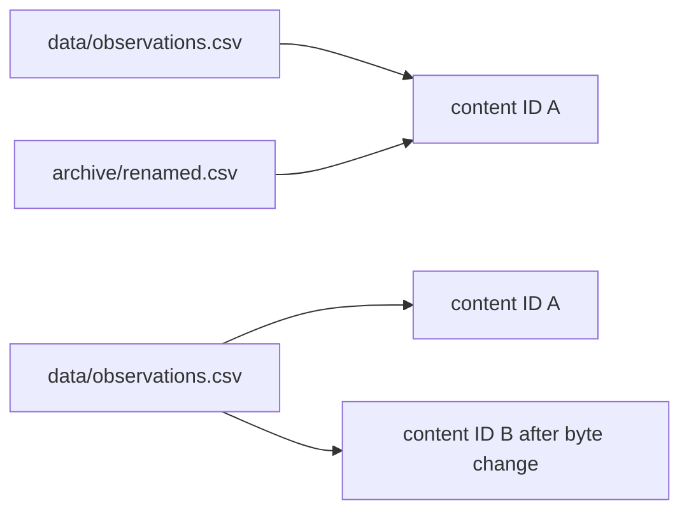

# Data Identity Audit Guide

This audit answers two questions that are easy to blur:

1. Which exact bytes does a DVC pointer name?
2. Which storage layer can supply those bytes after loss?

Identity and availability are related, but they are not interchangeable. A valid pointer
can survive while every accessible copy of its content is gone. A workspace file can
exist while no durable recovery route has been tested.

Run the audit from the capstone:

```bash
make data-identity-audit
```

The audit writes an isolated review bundle under the repository-level `artifacts/`
directory. Start with `summary.tsv`, then follow `route.txt`.

## The cases

| Case | Mutation | Question |
| --- | --- | --- |
| pointer and cache | add one small dataset | does pointer metadata lead to matching cached bytes? |
| same content | copy identical bytes to another path | does location change content identity? |
| changed content | append a row at the original path | does stable location preserve identity after bytes change? |
| cache recovery | delete only the workspace file | can local cached content rebuild the projection? |
| remote recovery | push, then delete workspace and cache | can the remote repopulate both local layers? |
| pointer only | delete workspace and cache without a remote | is metadata alone a recovery source? |

Each case gets its own no-SCM DVC repository. Destructive actions therefore cannot borrow
cache or remote state from another case.

## Read identity before location

After `dvc add`, inspect:

```text
data/observations.csv.dvc
.dvc/cache/files/md5/<content-id>
data/observations.csv
```

The pointer records an MD5 content identifier, size, and workspace path. The audit also
computes SHA-256 over the workspace and cache bytes. These algorithms serve different
evidence roles here:

- DVC's recorded MD5 locates the managed cache object.
- The audit's SHA-256 comparison independently confirms byte equality across layers.

Do not infer that the path is the identity merely because it appears in the pointer. The
path says where to project content. The content identifier says which bytes.

## Use paired contrasts

Two comparisons make the locator boundary visible:



The first pair changes location while preserving bytes. Both pointers name the same
content identity.

The second pair preserves location while changing bytes. The pointer identity changes.

Together these cases rule out the weak explanation that either a path change or path
stability determines content identity.

## Read commands as state moves

| Receipt | State move proved |
| --- | --- |
| `cache-recovery-checkout.stdout.txt` | cache to workspace |
| `remote-recovery-push.stdout.txt` | cache to remote |
| `remote-recovery-pull.stdout.txt` | remote to cache and workspace |
| `remote-recovery-checkout.stdout.txt` | available cache to workspace |

A successful command is not enough by itself. Pair each receipt with the report checks:

- restored workspace exists
- restored SHA-256 matches the immutable source
- the pointer content identity is unchanged
- after remote recovery, the local cache object exists again

That is the difference between observing command success and proving a bounded state move.

## Treat failed recovery as evidence

The pointer-only case deliberately removes the workspace file and local cache without
configuring a remote. The `.dvc` pointer remains intact.

`dvc checkout` must fail. The raw stderr receipt should identify the missing cache-backed
content, while the report confirms:

- metadata still names an identity
- checkout returns nonzero
- the workspace remains absent
- the cache object remains absent

The audit marks this row `PASS / REJECT`. The audit passed because it reproduced a
recovery claim the course says to reject: pointer metadata alone is not content
availability.

## What the audit proves

The audit proves that, for this specimen:

- equal bytes share a DVC content identity across paths
- changed bytes receive a new identity at the same path
- pointer metadata and cached bytes agree
- local cache can restore a missing workspace projection
- remote storage can restore content after local cache loss
- successful remote recovery preserves the original content identity
- metadata without accessible bytes cannot restore content

It does not prove:

- that the dataset is scientifically valid
- that every object in another remote is available
- that a publish bundle is complete or trustworthy
- that every execution environment can interpret the bytes identically

Those are different course boundaries.

## Review questions

1. Which evidence establishes identity, and which establishes availability?
2. Why do two different paths share one identity in the same-content case?
3. Why does one stable path acquire a new identity in the changed-content case?
4. What does cache-only checkout prove that remote recovery does not need to prove again?
5. Which receipts show that the remote, rather than a surviving local cache, supplied the
   lost content?
6. Why is the pointer-only failure an expected result rather than a broken audit?

If an answer cites only a path or an exit code, return to the pointer, digest, and
state-move evidence.
