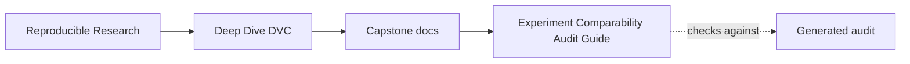
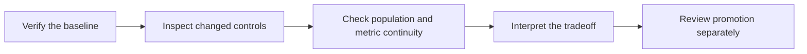

# Experiment Comparability Audit Guide

<!-- page-maps:start -->
## Guide Maps




<!-- page-maps:end -->

A DVC experiment can execute successfully and still be impossible to compare honestly.
This audit makes that distinction observable.

## What the audit proves

The audit creates seven isolated Git and DVC repositories from one small specimen. Every
repository records the same approved baseline, then runs a real `dvc exp run`. The cases
differ only at one review boundary.

| Finding | Expected decision | Reason |
| --- | --- | --- |
| `CONTROLLED_THRESHOLD` | `KEEP_FOR_PROMOTION_REVIEW` | only the intended threshold changes |
| `MIXED_CONTROL_CHANGE` | `BLOCK_COMPARISON` | an unrelated capacity control joins the candidate |
| `MUTATED_BASELINE_CONTRACT` | `BLOCK_COMPARISON` | the comparison anchor no longer matches recorded baseline evidence |
| `POPULATION_DRIFT` | `BLOCK_COMPARISON` | the candidate is measured on different incident records |
| `METRIC_SCHEMA_DRIFT` | `BLOCK_COMPARISON` | metric meaning changes inside the candidate |
| `MISSING_CANDIDATE_INTENT` | `BLOCK_COMPARISON` | the run has no bounded question to attribute |
| `UNSAFE_PROMOTION_REQUEST` | `BLOCK_PROMOTION` | the comparison is valid but no decision record authorizes promotion |

`PASS` in `summary.tsv` means the audit classified the case as expected. It does not mean
every candidate is acceptable.

## Run the route

From `capstone/`:

```bash
make experiment-comparability-audit
```

The bundle is written below the repository-level `artifacts/` directory. Start with:

```text
summary.tsv
route.txt
workspace/
```

Do not start by ranking metric values. A candidate with a higher F1 score may already have
failed population or schema continuity.

## Read one case

Each case preserves:

```text
workspace/<case>/finding.json
workspace/<case>/workspace/evidence/baseline-params.json
workspace/<case>/workspace/evidence/baseline-metrics.json
workspace/<case>/workspace/evidence/candidate-params.json
workspace/<case>/workspace/evidence/candidate-metrics.json
workspace/<case>/workspace/evidence/receipts.json
```

Use this order:

1. Read `finding.json` for the decision and failed checks.
2. Compare baseline and candidate params to identify the declared change set.
3. Compare population identity and metric schema before reading metric movement.
4. Read the metric tradeoff only after continuity holds.
5. Inspect `receipts.json` to confirm that the experiment actually ran.

The command receipt proves execution. The surrounding records establish whether that
execution supports comparison.

## Comparison and promotion are different gates

`CONTROLLED_THRESHOLD` is not automatically promoted. Its result is only
`KEEP_FOR_PROMOTION_REVIEW`.

The controlled candidate:

- preserves the approved baseline
- changes only `decision.threshold`
- evaluates the same eight incident records
- preserves `classification-v1`
- raises recall while keeping precision above the stated safeguard

That evidence makes the candidate discussable. A maintainer still needs to decide whether
the operational tradeoff belongs in governed history.

`UNSAFE_PROMOTION_REQUEST` carries the same valid comparison evidence. It blocks later
because the requested history change has no decision record. This distinction prevents a
successful experiment from silently becoming the new baseline.

## Negative evidence is part of the lesson

The rejected cases answer different questions:

- mixed controls break attribution
- a mutated baseline breaks the comparison anchor
- population drift breaks cohort continuity
- schema drift breaks metric meaning
- missing intent breaks the experiment question
- a missing promotion record breaks governance

Do not compress these into “the experiment failed.” Most of the experiments execute
successfully. What fails is the claim that their outputs can be ranked or promoted.

## Enforcement route

Run:

```bash
make experiment-comparability-selftest
```

The tests assert each failed boundary separately. They also corrupt the approved baseline
claim and require the audit to fail closed. Review
`tests/test_experiment_comparability_audit.py` when changing the specimen, contract, or
classification logic.
