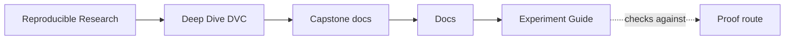
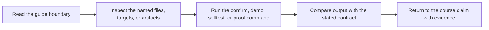

# Experiment Guide

<!-- page-maps:start -->
## Guide Maps

<!-- page-maps:end -->

This guide exists because experiment support is one of the easiest parts of DVC to use sloppily.

## What an experiment is for here

In this capstone, an experiment is a controlled deviation from the baseline parameter
surface. It is not a license to mutate the baseline story until the result looks good.

## Review questions

- Which parameter changed, and why does that change stay comparable to the baseline?
- Which metrics moved, and what do those changes mean operationally?
- Which prediction records changed enough to justify closer review?
- What evidence would be required before promotion to `publish/v1/`?

## Minimum route

1. Run `make experiment-comparability-audit`.
2. Read `summary.tsv` before ranking any candidate metrics.
3. Compare the controlled case with one blocked comparison.
4. Inspect the saved `dvc exp run`, `show`, and `diff` receipts.
5. Return to the publish contract only after comparison and promotion gates are distinct.

Use [Experiment Comparability Audit Guide](experiment-comparability-audit-guide.md) for the
complete evidence order. The older `experiment-review` bundle is useful for inspecting the
current capstone state, but it does not construct negative cases or enforce candidate
comparability.

Read [STAGE_CONTRACT_GUIDE.md](stage-contract-guide.md) first when the real pressure is
not how to run the experiment, but whether the changed params still support honest
comparison and still belong to the stage that owns them.
