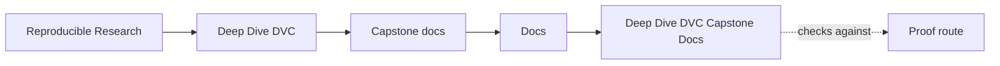
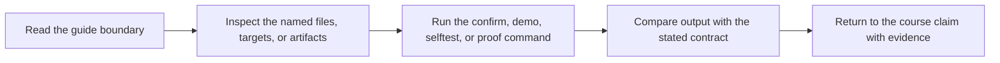

# Deep Dive DVC Capstone Docs

<!-- page-maps:start -->
## Guide Maps

<!-- page-maps:end -->

This shelf is the curated public document surface for the Deep Dive DVC capstone. It is
smaller than the full repository on purpose. The goal is to expose the documents another
reviewer or downstream consumer can use without dragging every internal study route,
source-only guide, or generated review bundle into the exported surface.

## What this shelf is for

- understanding the capstone's domain, architecture, and promoted contract
- reviewing promoted data, model, prediction, recovery, and release surfaces
- navigating the smallest stable set of documents that explains what the repository publishes

## What this shelf does not include

- internal-only reading routes for source placement or bundle packing
- walkthrough aids that are only useful inside the full capstone repository
- generated release artifacts that should stay under the review bundles, not the authored docs surface

## Recommended reading order

1. [Domain Guide](domain-guide.md)
2. [Workflow Evidence Audit Guide](workflow-evidence-audit-guide.md)
3. [Capstone Architecture](architecture.md)
4. [Publish Contract](publish-contract.md)
5. [Stage Contract Guide](stage-contract-guide.md)
6. [Stage Contract Audit Guide](stage-contract-audit-guide.md)
7. [Data Identity Audit Guide](data-identity-audit-guide.md)
8. [Runtime Contract Audit Guide](runtime-contract-audit-guide.md)
9. [Metric Contract Audit Guide](metric-contract-audit-guide.md)
10. [Experiment Comparability Audit Guide](experiment-comparability-audit-guide.md)
11. [Reviewer Handoff Audit Guide](reviewer-handoff-audit-guide.md)
12. [Recovery Guide](recovery-guide.md)
13. [Recovery Readiness Audit Guide](recovery-readiness-audit-guide.md)
14. [Promotion Integrity Audit Guide](promotion-integrity-audit-guide.md)
15. [Boundary Migration Audit Guide](boundary-migration-audit-guide.md)
16. [Experiment Guide](experiment-guide.md)
17. [Review Route Guide](review-route-guide.md)
18. [Release Review Guide](release-review-guide.md)

## Exported docs

- [Capstone Architecture](architecture.md)
- [Boundary Migration Audit Guide](boundary-migration-audit-guide.md)
- [Data Identity Audit Guide](data-identity-audit-guide.md)
- [Domain Guide](domain-guide.md)
- [Experiment Comparability Audit Guide](experiment-comparability-audit-guide.md)
- [Experiment Guide](experiment-guide.md)
- [Metric Contract Audit Guide](metric-contract-audit-guide.md)
- [Publish Contract](publish-contract.md)
- [Promotion Integrity Audit Guide](promotion-integrity-audit-guide.md)
- [Recovery Guide](recovery-guide.md)
- [Recovery Readiness Audit Guide](recovery-readiness-audit-guide.md)
- [Release Review Guide](release-review-guide.md)
- [Reviewer Handoff Audit Guide](reviewer-handoff-audit-guide.md)
- [Review Route Guide](review-route-guide.md)
- [Runtime Contract Audit Guide](runtime-contract-audit-guide.md)
- [Stage Contract Audit Guide](stage-contract-audit-guide.md)
- [Stage Contract Guide](stage-contract-guide.md)
- [Tour](tour.md)
- [Workflow Evidence Audit Guide](workflow-evidence-audit-guide.md)
