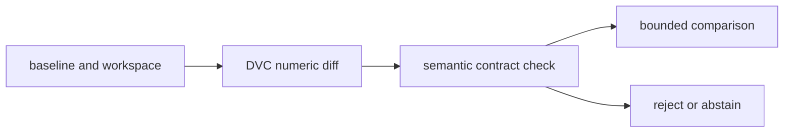

# Metric Contract Audit Guide

This audit asks:

> When two metric values differ, what evidence permits a reviewer to interpret the
> difference as movement in the same measurement?

DVC reports recorded numeric movement. The semantic contract determines whether that
movement supports a comparison.

Run:

```bash
make metric-contract-audit
```

Start with `summary.tsv`, then follow `route.txt`.

## The baseline claim

The specimen’s primary value is positive-class binary F1:

```text
positive_class_f1_at_fixed_threshold = 0.7368
```

That scalar is not the complete claim. The generated metric document also records:

- schema version `1`
- population identity and row count
- decision threshold `0.65`
- metric name and binary-positive-class definition
- fraction unit
- global aggregation
- confusion-matrix counts

The baseline therefore means:

> On the identified 120-row governed population, using a decision threshold of `0.65`,
> global positive-class binary F1 was `0.7368` on a fraction scale.

Removing any bold semantic boundary from that sentence weakens the comparison.

## Read mechanics before meaning

Every case preserves a raw `dvc metrics diff --json` receipt. Read it first.

For the comparable candidate, DVC correctly reports:

```text
0.7368 -> 0.7826
delta = 0.0458
```

The audit then compares the semantic fields DVC does not judge. This order matters:



The numeric diff is evidence. It is not the decision.

## Accepted comparisons

### Comparable candidate

The comparable candidate changes confusion-matrix outcomes while preserving:

- schema version
- population identity and row count
- threshold
- metric definition, name, unit, and aggregation

The `0.0458` increase can support a bounded same-contract improvement claim. It still does
not choose a release policy or prove downstream value.

### Additive metric

The additive case preserves the complete primary contract and adds:

```text
false_positive_rate_at_fixed_threshold
```

Existing primary values remain comparable because their names and meanings do not move.
An additive field is safe only when it does not silently redefine or remove the old
surface.

## Rejected comparisons

Rows marked `PASS / REJECT` are successful reproductions of evidence defects. `PASS` says
the audit observed the intended failure mode. `REJECT` says the metric comparison must
not carry a same-contract claim.

### Population identity drift

The old and new populations both contain `120` rows. Their identities differ.

Equal counts do not prove equal membership, labels, case mix, or selection policy. This
case blocks the common shortcut:

> The evaluation size stayed the same, so the population stayed comparable.

### Unit drift under a familiar key

The metric name stays fixed while the unit changes from fraction to percent. DVC reports
a mechanically correct delta of `77.5241`.

That large positive number is not a dramatic improvement. It is subtraction across
different scales. Stable keys cannot compensate for changed units.

### Control drift

The candidate score is `0.7826`, but the decision threshold changes from `0.65` to `0.50`.
This can support a threshold-policy investigation. It cannot support the claim that the
same fixed-threshold measurement improved.

### Schema-version drift

A changed schema version announces that the comparison contract may be incompatible.
Reviewers must either:

- preserve the prior measurement for continuity
- provide an explicit compatibility mapping
- establish a new baseline under the new contract

They must not treat the version boundary as ordinary score movement.

### Missing population identity

The row count remains available, but the identity needed to establish population
continuity is absent. The correct decision is abstention, represented here as `REJECT`.

Missing evidence is not evidence that nothing changed.

## The compatibility checklist

The audit accepts the primary comparison only when all of these hold:

| Boundary | Required relationship |
| --- | --- |
| schema | same declared version |
| population | identity present and equal |
| population size | row count equal |
| control | decision threshold equal |
| metric | name and definition equal |
| scale | unit equal |
| aggregation | rule equal |
| value | primary metric present in both records |

This is intentionally stricter than “the JSON parsed” and more informative than “the
metric key exists.”

## What the audit proves

The audit proves that:

- DVC can report numeric movement for both valid and invalid comparisons
- equal row counts do not establish population continuity
- stable metric names do not establish unit continuity
- parameter controls alter what fixed-threshold metrics mean
- additive schema evolution can preserve prior claims
- missing semantic evidence requires abstention

## What the audit does not prove

The audit does not decide:

- whether a `0.0458` F1 increase is large enough to release
- whether F1 is the right primary metric for a real project
- whether the governed population represents future production data
- whether fairness, calibration, latency, or cost safeguards pass
- whether schema version numbers alone guarantee compatibility

Those claims need their own evidence and decision policy.

## Review questions

1. Why is the comparable candidate accepted while control drift is rejected?
2. Why does equal population size fail to establish equal population identity?
3. What makes the unit-drift delta mechanically correct but semantically useless?
4. Why can an additive field preserve continuity while a version change blocks it?
5. What should a reviewer write when population identity is missing?
6. Which accepted result still needs a separate release decision?
