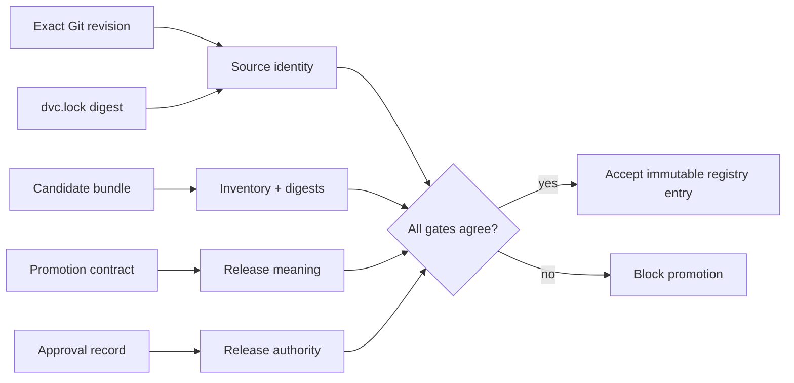
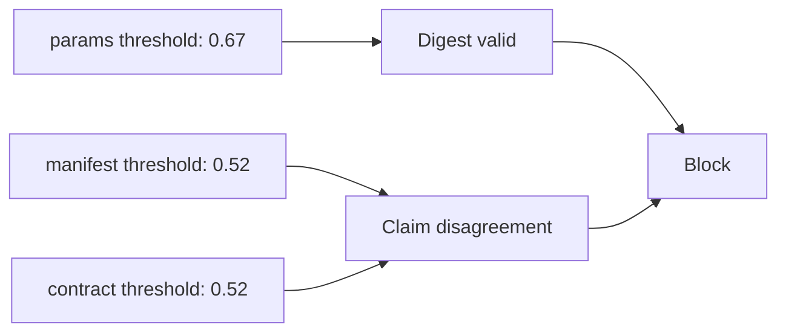
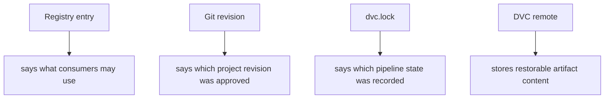

# Promotion Integrity Audit Guide

Use this guide when a candidate bundle already exists and the question is whether it has
earned downstream authority. The audit does not rank experiments. It tests the later
promotion decision.

## The trust boundary



A successful pipeline run can create the candidate. A valid bundle manifest can prove
that its recorded files have not changed. Neither fact proves that the candidate is the
one reviewers approved, that its public claim is coherent, or that consumers received a
stable reference.

## Run the audit

From the DVC capstone:

```bash
make promotion-integrity-audit
```

From the repository root:

```bash
make PROGRAM=reproducible-research/deep-dive-dvc \
  capstone-promotion-integrity-audit
```

The route writes evidence under
`artifacts/audit/reproducible-research/deep-dive-dvc/promotion-integrity/`.
Generated workspaces stay outside the course source tree.

## Read decisions before files

Open `report.json` first. The expected decisions are:

| Finding | Decision | Isolated question |
| --- | --- | --- |
| `COMPLETE_PROMOTION` | `ACCEPT` | do identity, inventory, integrity, claims, provenance, approval, and consumer scope agree? |
| `TAMPERED_ARTIFACT` | `BLOCK` | did an artifact change after its digest was recorded? |
| `UNLISTED_ARTIFACT` | `BLOCK` | does the directory contain a file outside the approved inventory? |
| `THRESHOLD_DRIFT` | `BLOCK` | do rehashed files still contradict the promoted claim? |
| `MUTABLE_REGISTRY_REFERENCE` | `BLOCK` | could the consumer reference silently point at another release later? |
| `STALE_SOURCE_APPROVAL` | `BLOCK` | was approval granted to another Git revision? |
| `MISSING_REQUIRED_REVIEW` | `BLOCK` | did every required review role approve this release? |

Each rejected case isolates one gate. This matters because "verification failed" is too
vague for a release decision. A reviewer should be able to name the broken promise and
the evidence needed to repair it.

## Three records, three jobs

Read these together in `workspace/complete-promotion/`:

| Record | Authority | Question it answers |
| --- | --- | --- |
| `publish/manifest.json` | candidate producer | which artifact bytes were recorded? |
| `promotion-contract.json` | release policy owner | what identity, inventory, claim, reviewers, and consumer surface are required? |
| `promotion-decision.json` | named reviewers | did the required people approve this exact release source? |

Do not collapse them into one file merely to reduce file count. Separation makes
independent review possible:

- the producer cannot create its own approval by regenerating a manifest;
- the approval record cannot redefine the required inventory;
- the contract cannot prove that candidate bytes match their digests.

## Investigation: a changed artifact

Compare:

```text
workspace/complete-promotion/publish/report.md
workspace/tampered-artifact/publish/report.md
```

The tampered report remains readable. Its problem is temporal: its bytes changed after the
manifest recorded the approved candidate. The relevant failed check is
`artifact_integrity_matches_manifest`.

The safe repair is not "update the checksum." Return the changed report to candidate
review, regenerate the manifest, and obtain approval for the new candidate identity.
Updating only the checksum would convert evidence of unauthorized change into apparently
valid evidence.

## Investigation: valid digests, false claim

The `THRESHOLD_DRIFT` case is deliberately harder. Its `params.yaml` changes the decision
threshold from `0.52` to `0.67`, and its manifest receives the new digest and byte size.
Artifact integrity therefore passes.



This case teaches a necessary distinction:

- integrity asks whether recorded bytes changed;
- semantic consistency asks whether the records describe the same release.

A digest cannot prove that a threshold, metric definition, cohort, or approval claim is
correct.

## Investigation: an unstable consumer reference

The mutable-reference case changes both the contract and approval to
`incident-escalation/latest`. Those two records still agree, but the reference cannot
identify the same release after the next promotion.

Use immutable and movable references for different jobs:

| Reference | Appropriate use | Required safeguard |
| --- | --- | --- |
| `incident-escalation/2026-07` | audit, rollback, reproducible consumption | never retarget it |
| `incident-escalation/latest` | convenience discovery | resolve and record the immutable release before use |

The audit blocks a movable alias as the release identity. A production registry may
offer aliases, stages, or channels, but the audit record still needs an immutable target
underneath them.

## Provenance is not storage

The contract records both a Git revision and the digest of `dvc.lock`. These identify the
source declaration and recorded DVC state reviewers considered. The DVC remote has a
different job: it stores content-addressed objects needed to restore that state.



Calling a DVC remote "the registry" hides these different promises. A remote object can be
available without being approved. A registry record can exist while its backing object is
unrecoverable. Review the two boundaries separately.

## Consumer test

The promotion contract explicitly lists supported consumer files. Ask a hypothetical
consumer to perform one action using only those files:

- load `model.json`;
- read the decision threshold from `params.yaml`;
- interpret performance from `metrics.json`;
- read limitations in `report.md`.

If the consumer must inspect a cache path, experiment queue, training intermediate, or
unlisted workspace file, the published interface is incomplete. Either promote the
missing dependency deliberately or narrow the promised consumer action.

## Proof limits

This audit proves that the modeled promotion gates classify seven controlled cases as
intended. It does not prove:

- that the selected candidate is scientifically or ethically suitable;
- that metric thresholds are appropriate for a real operating environment;
- that registry access controls are configured correctly;
- that remote recovery meets its objective;
- that approval identities come from a trusted identity provider.

Use the experiment-comparability audit before this route when candidate selection is in
question. Use the recovery-readiness audit when durable restoration is in question.

## Independent review checklist

- [ ] I can distinguish candidate production from promotion approval.
- [ ] I compared the contract, decision, and candidate manifest.
- [ ] I can explain why the threshold-drift case passes digest checks but blocks.
- [ ] I can name the exact source revision and DVC lock identity that received approval.
- [ ] I can distinguish an immutable release reference from a movable alias.
- [ ] I can state which files consumers may use and which internal surfaces remain unsupported.
- [ ] I can name what this audit deliberately does not prove.
