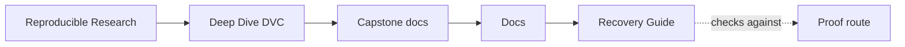
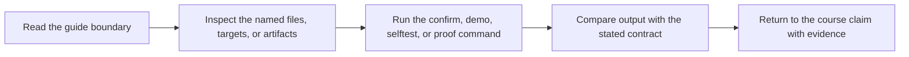
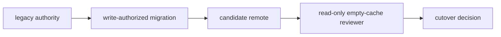

# Recovery Guide

<!-- page-maps:start -->
## Guide Maps




<!-- page-maps:end -->

This capstone has two recovery questions:

- Can the governed current pipeline outputs survive loss of the local DVC cache?
- Can a candidate remote restore every current and historical revision a retention
  contract protects?

They use different proof routes. Choose the route that matches the claim.

## Route chooser

| Question | Command | Primary evidence |
| --- | --- | --- |
| Can current capstone outputs return after local cache loss? | `make recovery-drill` | command result and publish verifier |
| Can I retain a review bundle from that current-state drill? | `make recovery-review` | remote, pull, status, verifier, and manifest evidence |
| Can a candidate remote support protected-history cutover? | `make recovery-readiness-audit` | per-revision empty-cache evidence and cutover decisions |
| Do focused tests enforce cutover boundaries? | `make recovery-readiness-selftest` | rejected partial-copy and contract cases |

A successful current drill does not establish protected history. A protected-history audit
does not establish cloud redundancy or production-scale transfer time.

## Current capstone recovery boundary

The current recovery drill deliberately targets the four governed root pipeline stages:

```text
prepare → fit → evaluate → publish
```

It pushes and pulls those stages explicitly. The capstone also contains nested teaching
specimens with their own deliberately incomplete or dishonest states. A root-level
unscoped pull would sweep those specimens and broaden the drill beyond its contract.

The governed artifact families are:

| Stage | Restored outputs |
| --- | --- |
| `prepare` | train and evaluation splits, data profile |
| `fit` | model |
| `evaluate` | metrics and predictions |
| `publish` | promoted `publish/v1` bundle |

After restore, `incident_escalation_capstone.verify` checks the promoted contract.

## Run the current-state drill

From `capstone/`:

```bash
make recovery-drill
```

The route:

- installs the supported capstone environment
- confirms the pipeline is reproduced
- pushes only the governed root stages to the training remote
- removes governed generated outputs and the local root DVC cache
- pulls only those stages
- verifies `publish/v1`

This route intentionally changes generated capstone state. It does not delete authored
source or initialize a teaching specimen.

Expected conclusion:

> Current governed outputs can be restored from the configured training remote after
> root-cache loss, and the promoted bundle satisfies its verifier.

Unsupported conclusions:

- every historical Git revision is present in the remote
- every DVC experiment remains recoverable
- every nested specimen output was published
- production RTO is known

## Preserve the current-state review

Run:

```bash
make recovery-review
```

Read its bundle in this order:

| Surface | Question |
| --- | --- |
| `remote.txt` | Which remote was configured? |
| `before-status.txt` | What did DVC report before loss? |
| `pull.txt` | What did the restore command report? |
| `verify.json` | Which promoted contract checks passed? |
| `after-status.txt` | What state did DVC report after restore? |
| `manifest-summary.json` | What did the restored release claim to contain? |
| `state-summary.json` | How do declaration, execution, and promotion relate? |
| `manifest.json` | Which evidence files belong to this generated bundle? |

The review and drill routes use the same bounded root-stage selection. The review bundle
adds durable receipts and summaries; it does not broaden the recovery claim.

## Protected-history readiness boundary

The isolated recovery-readiness specimen creates:

- a three-row `release-2025-q1` revision retained for publication audit
- a four-row `main` revision retained for current collaboration
- a legacy remote
- a candidate remote
- separate reviewers with empty artifact caches

Run:

```bash
make recovery-readiness-audit
```

The acceptance rule is:

> Accept cutover only when every protected revision resolves in Git, restores from the
> candidate remote without cache help, matches its content contract, completes within the
> declared objective, and uses a read-only verification route.

## Read the readiness bundle

Start with `summary.tsv`.

| Finding | Expected decision |
| --- | --- |
| `COMPLETE_MIGRATION` | `ACCEPT` |
| `CURRENT_ONLY_COPY` | `BLOCK` |
| `RELEASE_ONLY_COPY` | `BLOCK` |
| `STALE_RELEASE_CLAIM` | `BLOCK` |
| `MUTATING_RECOVERY_ROUTE` | `BLOCK` |
| `MISSING_TIME_OBJECTIVE` | `BLOCK` |

`result: PASS` means the audit reached the expected decision. It does not mean a blocked
migration case was accepted.

Then read:

- `report.json` for failed checks
- `<case>/revision-evidence.json` for resolution, restore, identity, row count, and
  duration
- `<case>/receipts.json` for exact Git and DVC command evidence
- `specimen/recovery-contract.json` for the promise
- `RECOVERY_READINESS_AUDIT_GUIDE.md` for the full decision route

## Diagnose before repair

| Evidence pattern | Boundary |
| --- | --- |
| Git checkout fails | reference availability |
| checkout passes, pull reports missing object | candidate content coverage |
| pull reports permission error | recovery access |
| pull succeeds, digest or row count differs | content contract |
| both revisions pass, route contains `dvc push` | evidence independence |
| identities pass, no positive RTO exists | contract completeness |
| identities pass, duration exceeds objective | recovery performance |

Do not repair a missing object before preserving its failed receipt. A push from a complete
operator cache can erase the evidence that candidate storage was incomplete.

## Keep copy and verification permissions separate

Migration may write candidate storage. Verification should read candidate storage.



When a case blocks:

- preserve the bundle
- keep legacy authority
- authorize a bounded repair separately
- use new reviewers after repair
- rerun the whole protected set

The repair workspace is not closure evidence.

## Separate candidate acceptance from source retirement

Even `COMPLETE_MIGRATION` proves only the specimen contract under the local lab
conditions. Source retirement still needs:

- rollback interval closure
- final protected-set verification
- resolved legal, publication, incident, and archive holds
- named retirement target
- storage-owner approval
- disposition evidence

Do not turn a successful audit into an implicit delete command.

## Choose related guides

Read:

- [Recovery Readiness Audit Guide](recovery-readiness-audit-guide.md) for the case-by-case
  cutover investigation
- [Publish Contract](publish-contract.md) when the question is which restored promoted
  files deserve downstream trust
- [Release Review Guide](release-review-guide.md) when restored identity passes but
  release meaning still needs review
- [Stage Contract Audit Guide](stage-contract-audit-guide.md) when recovery reveals a
  stage dependency or output boundary problem
- [Reviewer Handoff Audit Guide](reviewer-handoff-audit-guide.md) when the issue is
  independent collaborator access rather than long-term retention

## Recovery review checklist

Before claiming success:

- [ ] the protected artifact family is named
- [ ] current and historical scope are not conflated
- [ ] authoritative remote is named
- [ ] reviewer cache condition is stated
- [ ] Git revision resolution is separate from DVC object retrieval
- [ ] restored content identity is checked
- [ ] duration is compared with a prior objective
- [ ] verification does not repair remote state
- [ ] proof limits are written
- [ ] source retirement remains a separate decision
