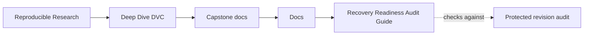
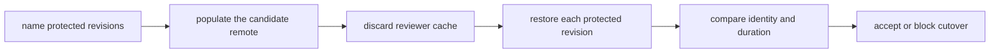

# Recovery Readiness Audit Guide

<!-- page-maps:start -->
## Guide Maps




<!-- page-maps:end -->

A remote is not ready for cutover because `dvc push` completed or because the current
workspace can pull. Cutover is supportable only when every state the project promises to
retain can be restored and identified from the candidate remote without help from an
author's cache.

This audit turns that claim into a small experiment. It builds two distinct revisions of
one DVC-tracked dataset:

- `release-2025-q1` is a published three-row state retained for later audit
- `main` is a current four-row state retained for collaboration and automation

Each revision has its own expected SHA-256 identity and row count. A reviewer receives a
fresh Git clone, discards local DVC cache state, restores from the candidate remote, and
compares the result with the contract.

## The decision boundary

The audit accepts remote cutover only when all of these claims hold:

| Claim | Evidence |
| --- | --- |
| retention scope is explicit | at least two protected revisions are named in `recovery-contract.json` |
| Git history resolves | each protected revision can be checked out in a clean clone |
| candidate storage is complete | each revision can be pulled after its reviewer cache is removed |
| restored meaning is unchanged | SHA-256 and row-count claims match the restored artifact |
| verification does not repair storage | the recovery route contains no push, garbage collection, or remote reconfiguration |
| recovery speed is testable | a positive recovery-time objective is declared and each observed pull stays within it |

The time measurement in this local specimen is not a production service-level result.
Its teaching purpose is to make the contract shape visible: objective first, observed
duration second, decision last.

## Why the audit creates separate reviewers

Testing both revisions in one workspace can leak evidence:

- the first restore can populate cache for the second
- the author's cache can hide an incomplete remote
- a changed pointer can be mistaken for changed content
- a successful current-state pull can be generalized to all history

The audit therefore gives every protected revision a separate clone and an empty cache.
The candidate remote is the only permitted content source. This arrangement makes a
missing historical object fail where it should fail.

## The six cases

Start with `summary.tsv`. It places the intended decision beside the observed decision:

| Case | What is true | Correct decision |
| --- | --- | --- |
| complete migration | candidate remote contains both protected DVC objects | `ACCEPT` |
| current-only copy | current state restores but the published release does not | `BLOCK` |
| release-only copy | the published release restores but current state does not | `BLOCK` |
| stale release claim | both objects restore, but the published identity claim is wrong | `BLOCK` |
| mutating recovery route | objects restore, but the proposed check includes `dvc push` | `BLOCK` |
| missing time objective | objects restore, but recovery duration has no declared limit | `BLOCK` |

These cases separate mechanisms that are often collapsed into one vague statement:
"the backup works." A remote can be reachable but incomplete. A pull can succeed while a
claim is stale. A route can finish only because it repairs the storage it was supposed to
evaluate.

## Run the audit

From the course directory:

```bash
make capstone-recovery-readiness-audit
```

Or from `capstone/`:

```bash
make recovery-readiness-audit
```

Generated evidence is written under the repository's `artifacts/audit/` tree. The source
specimen is never initialized or changed in place.

## Read evidence from decision to mechanism

Use this order:

- `summary.tsv` shows whether each case reached the expected cutover decision.
- `report.json` shows the checks that supported or blocked each decision.
- `<case>/revision-evidence.json` shows revision resolution, restore result, expected and
  actual identity, row count, and measured duration.
- `<case>/receipts.json` shows the exact Git and DVC commands, return codes, standard
  output, and standard error.
- `specimen/recovery-contract.json` shows what the repository promised before the drill.
- `scripts/audit_recovery_readiness.py` and the focused test show how the promise is
  enforced.

Read receipts after the decision surfaces. Raw command output can explain a failure, but
it should not force every reviewer to reconstruct the decision rule from scratch.

## Investigate current-only migration

In `CURRENT_ONLY_COPY`, open the two revision records side by side.

Expected pattern:

| Revision | Restored? | Identity matches? | Meaning |
| --- | --- | --- | --- |
| `release-2025-q1` | no | no | candidate remote omitted protected history |
| `main` | yes | yes | current workspace coverage is real but insufficient |

The mainline success is not a partial excuse. It is the reason this failure is easy to
miss in an ordinary smoke test.

Then open that case's `receipts.json` and compare:

- the author command that copied current state
- the release reviewer's failed cache-empty pull
- the main reviewer's successful cache-empty pull

The contrast is direct evidence that remote reachability and historical coverage are
different properties.

## Investigate a stale content claim

`STALE_RELEASE_CLAIM` restores both artifacts. If review ended at the pull return code,
cutover would appear safe.

The release evidence instead shows:

- `restored: true`
- an actual SHA-256 derived from the recovered bytes
- an expected SHA-256 taken from the contract
- `content_claim_matches: false`

Recovery has two layers:


Both layers must pass. Restoring unverified bytes is availability evidence, not release
identity evidence.

## Investigate a mutating route

The `MUTATING_RECOVERY_ROUTE` case restores both revisions and matches both content
claims. It still blocks.

A route containing `dvc push` can fill the candidate remote from whatever cache is
available to the operator. That may be useful during migration, but it is not an
independent cutover check. The audit separates:

| Activity | Storage permission | Purpose |
| --- | --- | --- |
| migration | write | populate candidate storage |
| verification | read | test candidate storage as it stands |
| repair | write | correct a rejected candidate |
| re-verification | read | test again after the repair is complete |

Combining these activities produces evidence that cannot say whether the candidate was
complete before the check began.

## Use the result in a cutover review

An acceptable review note should name:

- the protected revision set
- the candidate remote under test
- the fact that reviewers started without artifact cache
- content-identity results for every protected revision
- observed durations and the declared objective
- the audit bundle location
- the explicit decision about retiring the legacy remote

A blocked note should name the failed check rather than saying only "migration failed."
For example:

> Candidate storage restores `main` but not `release-2025-q1`. The published revision
> remains protected by retention policy, so the legacy remote cannot be retired. Copy the
> missing release object, preserve the failed receipts, and rerun the read-only audit.

That note preserves the failure and gives repair a bounded target.

## What this audit does not prove

This local specimen does not prove:

- cloud-provider durability or regional redundancy
- credential rotation under a real identity system
- production-scale transfer performance
- recovery of every artifact family in another repository
- organizational approval for deleting or decommissioning storage

It teaches the evidence structure those broader checks need: explicit scope, empty-cache
restore, content identity, measured duration, read-only verification, and a gated
cutover decision.
