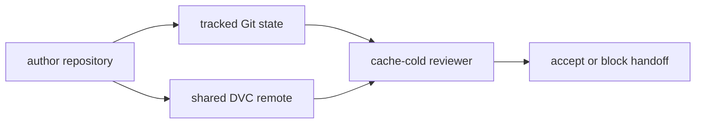

# Reviewer Handoff Audit Guide

This audit asks:

> Can a reviewer recover the recorded state, inspect its claim, and reproduce it using
> only tracked repository state and read access to the shared DVC remote?

Run:

```bash
make reviewer-handoff-audit
```

Start with `summary.tsv`, then follow `route.txt`. The generated author repositories and
reviewer clones are isolated under the repository-level `artifacts/` directory.

## The handoff contract

The specimen records a small incident summary:

```text
record_count = 4
severity_total = 11
weekend_handoffs = 2
```

That result is not a complete handoff by itself. The reviewer also needs:

- a tracked pointer that identifies the input data
- remote objects for both the input and recorded result
- tracked remote configuration that names where authorized readers should pull
- every declared stage dependency in Git or DVC
- a clean recorded execution before any repair-oriented reproduction
- a review route that does not require writes to shared storage
- a result contract that explains what the generated numbers claim

The accepted case supplies all seven boundaries.

## Why the audit uses separate author and reviewer workspaces

The author's workspace contains a warm DVC cache and the history of how the state was
created. Those conveniences can hide handoff defects.

Each audit case therefore creates:

1. an author Git repository
2. an isolated shared DVC remote
3. a cache-cold reviewer clone
4. saved receipts from the reviewer route



The reviewer never receives the author's cache or untracked files.

## Read the receipts in claim order

For each case, read:

1. `evidence/finding.json`
2. the `remote_list` receipt
3. the `pull` receipt
4. the `status_before_repro` receipt
5. the `repro` receipt
6. `reviewer/handoff-contract.json`
7. `reviewer/reports/summary.json` when present

This order prevents a successful final reproduction from erasing evidence that the
submitted handoff was stale or incomplete.

## Accepted handoff

`COMPLETE_HANDOFF` passes every check:

- the reviewer discovers the shared remote from tracked configuration
- `dvc pull` restores the exact recorded input and result
- `dvc status --json` reports clean state before reproduction
- `dvc repro` succeeds without private files
- the review route avoids remote mutation
- the expected claim is present
- the restored result matches that claim

`ACCEPT` does not mean the incident analysis is scientifically sufficient. It means the
repository carries the evidence needed for another maintainer to recover and explain this
bounded result.

## Blocked handoffs

Rows marked `PASS / BLOCK` are successful demonstrations of handoff defects. `PASS`
describes the audit result. `BLOCK` describes the merge or handoff decision.

### Missing remote object

The remote is configured, but the author never pushes the DVC objects.

The reviewer knows where to pull and still cannot recover the bytes. A pointer plus a
plausible author result is not shared evidence.

### Undiscoverable remote

The author configures the remote only in `.dvc/config.local`.

The objects exist, but the clean clone does not know which remote belongs to the
repository. Private configuration is useful for credentials and machine-specific
overrides; it cannot be the only record of the shared storage route.

### Untracked stage dependency

The author has `policy/severity-policy.json`, but Git does not.

Remote recovery succeeds because the DVC objects exist. The pipeline still cannot be
inspected or reproduced from the clone. Remote completeness does not compensate for an
incomplete Git repository.

### Stale execution record

The author changes and pushes the tracked data pointer without reproducing the dependent
stage.

The reviewer can pull every object, and `dvc repro` can eventually succeed. The handoff
still blocks because:

- pre-reproduction status reports a stale stage
- the submitted result reflects the prior data
- reproduction is a local repair, not proof that the submitted state was coherent

This case is why the audit saves status before reproduction.

### Mutating review route

The handoff commands include `dvc push`.

Every file may be complete, but ordinary review should not require write credentials.
Verification and publication are different authorities. A read-only reviewer route is
safer for CI, forks, and human reviewers.

### Missing result contract

Pull and reproduction both succeed, but the expected claim is absent.

Execution without interpretation leaves the reviewer unable to tell whether the output is
correct, surprising, or irrelevant. A runnable repository is not yet a reviewable
handoff.

## Handoff decision table

| Boundary | Accepted evidence | Blocking evidence |
| --- | --- | --- |
| remote route | tracked configuration names the remote | only local configuration knows it |
| remote objects | clean pull restores required bytes | pointer names absent objects |
| Git completeness | all stage dependencies are tracked | author-only dependency |
| recorded execution | status is clean before reproduction | submitted lock or output is stale |
| reviewer authority | pull, inspect, and local reproduce | shared remote mutation required |
| result meaning | explicit expected claim matches result | result contract missing or mismatched |

## What this audit proves

The audit proves that, for this specimen:

- a warm author cache can hide missing shared objects
- object availability and remote discoverability are separate contracts
- Git completeness and DVC remote completeness are both required
- successful reproduction can repair a stale workspace without validating the submitted
  handoff
- read-only review can be separated from publication authority
- executable output still needs an interpretation contract

## What this audit does not prove

The audit does not prove:

- that a real production remote has sufficient durability or retention
- that repository credentials are distributed safely
- that every CI provider handles forked contributions correctly
- that the incident sample is representative
- that branch protection requires this audit
- that the result should be promoted

Those are separate storage, security, governance, scientific, and release claims.

## Review questions

1. Why does missing-object evidence differ from an undiscoverable remote?
2. Why does the untracked dependency fail after a successful pull?
3. Why does successful reproduction not make the stale submitted state acceptable?
4. Which operations require remote write authority, and why are they absent from review?
5. What can a reviewer conclude from the result contract?
6. Which blocked case would ordinary unit tests be least likely to expose?
