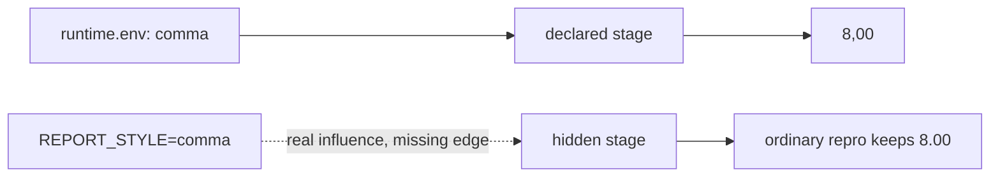

# Runtime Contract Audit Guide

This audit asks:

> If runtime state changes while code, data, command text, and parameters stay fixed, can
> DVC know that a result should be rebuilt?

The answer depends on whether the runtime influence reaches the declared graph.

Run:

```bash
make runtime-contract-audit
```

Start with `summary.tsv`, then follow `route.txt`.

## The paired stages

Both stages total the numbers `3` and `5` and render the result as either `8.00` or
`8,00`.

| Stage | Runtime source | DVC visibility |
| --- | --- | --- |
| `declared_runtime` | `environment/runtime.env` | file is a dependency |
| `hidden_runtime` | process variable `REPORT_STYLE` | variable is absent from declaration |

The rendering logic and input data are shared. Only the route by which runtime policy
enters the command differs.



## Read four evidence layers

| Layer | Surface | Question answered |
| --- | --- | --- |
| runtime | fingerprint JSON | which governed runtime facts differ? |
| declaration | `dvc.yaml` | which influences can DVC inspect? |
| planner | status and repro receipts | why did DVC run or skip? |
| semantics | result files | does output reflect current runtime meaning? |

`dvc.lock` is execution evidence after a run. It does not make an undeclared process
variable visible before the run.

## Declared runtime change

The audit changes:

```text
REPORT_STYLE=dot
```

to:

```text
REPORT_STYLE=comma
```

inside the declared contract file.

Expected evidence:

- status names `declared_runtime`
- the pre-rebuild result still says `style=dot`
- repro runs the stage
- the rebuilt result says `style=comma` and `rendered=8,00`

This is the complete declared-input cycle: detect stale state, rebuild, then verify current
meaning.

## Hidden runtime change

In the paired case, the audit changes the process environment from `dot` to `comma` while
leaving `dvc.yaml` unchanged.

Expected evidence:

- fingerprints differ on `report_style`
- Python and platform fingerprints remain equal
- `dvc status --json` is empty
- ordinary repro skips `hidden_runtime`
- the result remains `8.00`

An empty status object is not proof that the result is semantically current. It is proof
that no **declared** change is visible.

## Why force is not a repair

The audit then runs:

```bash
dvc repro --force hidden_runtime
```

The output changes to `8,00`, and `dvc.lock` changes because DVC records the newly produced
output identity. `dvc.yaml` remains byte-for-byte identical.

This demonstrates two facts:

1. the environment variable genuinely influences the result
2. forcing one run does not add the missing influence to future stale decisions

The next process-environment change can again be invisible.

## Result and decision

Rows use two judgments:

- `PASS / ACCEPT`: observed behavior a truthful runtime contract should preserve
- `PASS / REJECT`: the audit successfully reproduced behavior a production contract
  should reject

The hidden-status, ordinary-repro, and forced-run rows are expected `PASS / REJECT`
findings. Changing them to `ACCEPT` would normalize an undeclared runtime dependency.

## What a fingerprint can and cannot do

The audit fingerprint records:

- Python version and implementation
- platform and machine
- governed `REPORT_STYLE`

It narrows the changed runtime fact in this specimen. A fingerprint does not automatically
make DVC stale. It must either:

- be materialized as a declared dependency
- be represented by a governed parameter
- be enforced by an external execution policy whose evidence is reviewed with the run

Inventory without connection to a decision is observability, not control.

## What this audit does not claim

The deterministic formatting policy is a teaching substitute for broader runtime effects.
The audit does not claim that:

- all environment drift produces visible output differences
- containers eliminate host or service variation
- a lockfile captures every runtime fact
- DVC should manage operating systems or package installation

It proves the graph boundary: DVC reacts to declared state, not arbitrary process context.

## Review questions

1. Why does the declared case become stale?
2. Why is empty hidden-case status compatible with stale semantic output?
3. What evidence proves the process variable caused the difference?
4. Why does the lock change after force without repairing `dvc.yaml`?
5. Which fingerprint fields are controls, and which are only context?
6. How would you make a real runtime influence reviewable in your repository?
